<p align="center">
  
</p>

<h1 align="center">Visual Anything</h1>

<p align="center">
  Make any concept or system visual, and explore it interactively.<br>
  <em>A model first, views after: local-first, in plain files you keep in git, with Claude working beside you through MCP.</em>
</p>

<p align="center">
  <a href="LICENSE"></a>
  
  
  
  
</p>

<p align="center">
  <a href="#download">Download</a> ·
  <a href="#features">Features</a> ·
  <a href="#worlds">Worlds</a> ·
  <a href="#get-started">Get started</a> ·
  <a href="#claude-through-mcp">Claude through MCP</a> ·
  <a href="docs/guide.md">Guide</a> ·
  <a href="CHANGELOG.md">Changelog</a> ·
  <a href="#license">License</a>
</p>

## Download

### For everyone

You need no programming and nothing else installed.

1. **Download the file for your system** from the [Releases page](../../releases/latest):

   | Your computer | The file to download |
   | --- | --- |
   | Windows | `visual-anything-windows-x64.exe` |
   | Mac with Apple silicon (M1 or later) | `visual-anything-macos-arm64` |
   | Mac with Intel | `visual-anything-macos-x64` |
   | Linux | `visual-anything-linux-x64` |
   | Linux on ARM (64-bit) | `visual-anything-linux-arm64` |

2. **Open it** with a double-click. It opens your browser at the Projects screen. Nothing leaves your computer.
3. **Pick a sample from your world**, such as healthcare, finance or systems architecture, and start exploring. Or start an empty project.

### The first time you open it

The file is not signed yet, so your system warns you once:

- **Windows** says "Windows protected your PC". Choose **More info**, then **Run anyway**.
- **macOS** says it "could not verify" the file. Open **System Settings**, then **Privacy & Security**, choose **Open Anyway**, and open the file again.
- **Linux** does not warn, but the file must be made executable first: `chmod +x visual-anything-linux-x64`.

The [guide](docs/guide.md#running-the-executable) has the details, and what to do if your system still refuses.

### Connect Claude Desktop

To have Claude work on your project with you, use **Connect Claude…** in the app's menu (the icon at the top right), or run `visual-anything setup-claude` in a terminal. Then restart Claude Desktop.

<p align="center">
  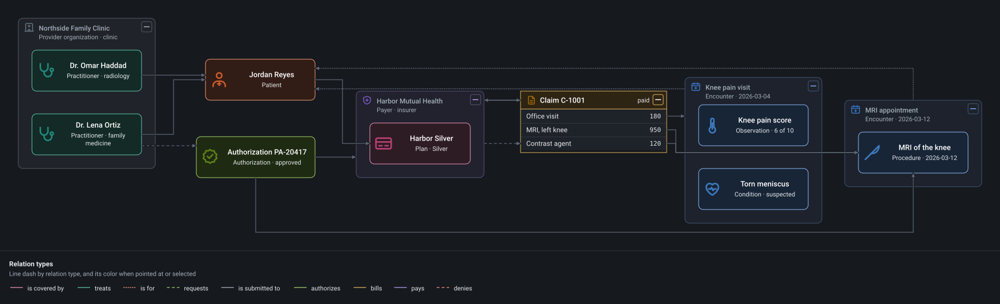
</p>

## Features

- **A model first, views after.** Elements come from components and relations from relation types, in packages. Each view shows part of the model and lays it out automatically; a shape you move by hand stays where you put it.
- **A canvas for large models.** 10,000 elements in a view pan, zoom and select at 60 fps. Containers collapse and expand, detail fades as you zoom out, and lines go around shapes or follow the route you give them.
- **Every world in one tool.** Systems architecture and C4, data science and machine learning, data modeling with SQL export, processes and state machines, physical AI with solids and joints, healthcare and finance.
- **Scenarios, tours and simulation.** Play a sequence of steps over a view, choose between alternatives, guide someone through your views, or let a programmable component simulate tick by tick in a sandbox.
- **Physical space.** A component draws its 3D solid inside its shape, and a panel shows elements where they really are; turning a joint moves everything it carries. [See it.](#physical-ai)
- **Yours, on your computer.** It runs on 127.0.0.1, keeps your project as JSON files a git merge driver understands, compares versions between commits, and exports SVG, PDF, Mermaid, Structurizr and a read-only page that connects nowhere.
- **Extensible and safe.** Packages add components, actions, importers, exporters and panels; their code runs sandboxed, only after you approve it.
- **Claude as a collaborator.** Claude reads and edits the same model through MCP; every change it makes is one action in your undo history, and you can review its proposals before they apply.
- **English and Spanish**, light and dark themes, and full keyboard use.

## Worlds

Each world has a sample project. `pnpm exec tsx packages/server/src/cli.ts new <folder> --from <sample>` copies one, and these pictures are its views exported as SVG in the Clean look.

### Systems architecture

`my-systems`: services, stores and queues, nested in their systems.

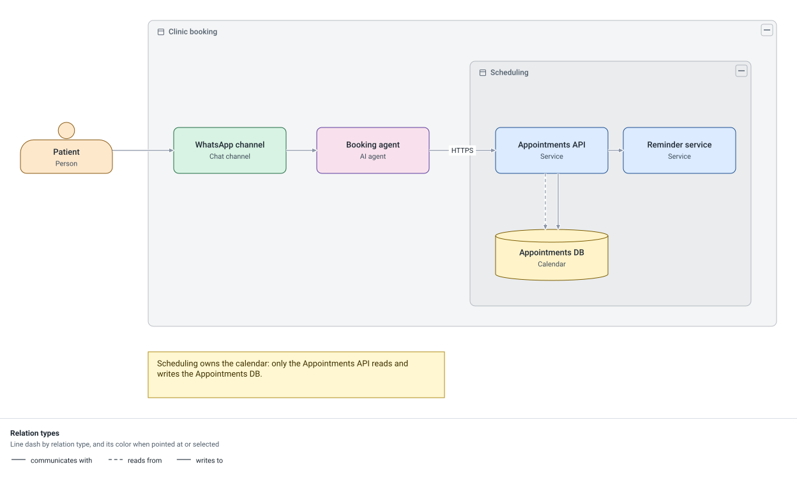

### C4

`c4-architecture`: the containers of a system, C4-style.

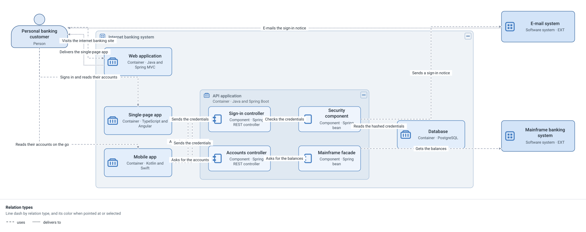

### Data science

`data-science-pipeline`: data from its sources to a trained model.

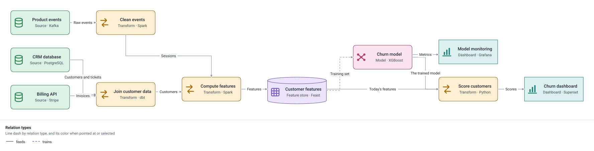

### Machine learning

`churn-classifier`: how a churn classifier is trained.

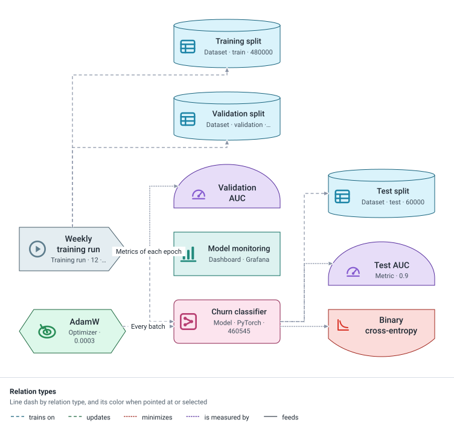

### Data modeling

`bookshop-database`: a bookshop's tables, columns and foreign keys, which export as SQL.

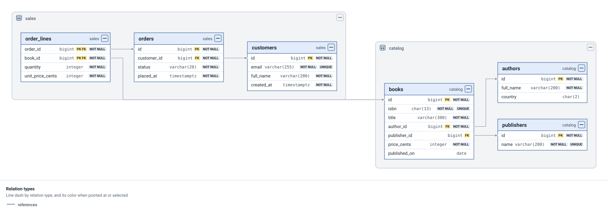

### Processes

`order-process`: an order from placing it to delivery.

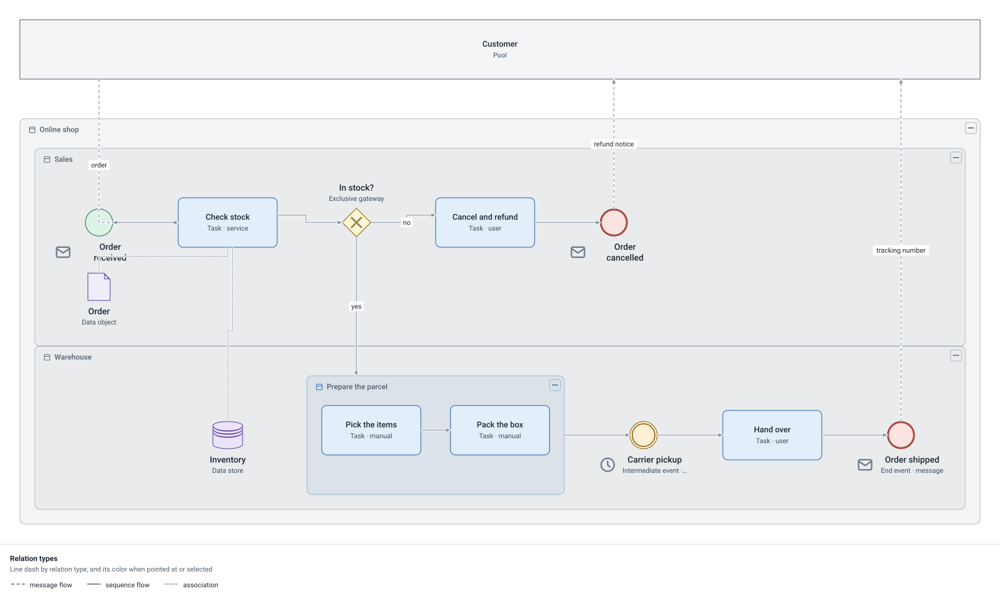

### Physical AI

`robot-arm`: a six-axis arm drawn as its 3D solid, with the motors and encoders that drive and sense each joint placed around it. The physical-space panel beside the canvas shows where everything really is, and its sliders turn each joint, moving everything the joint carries.

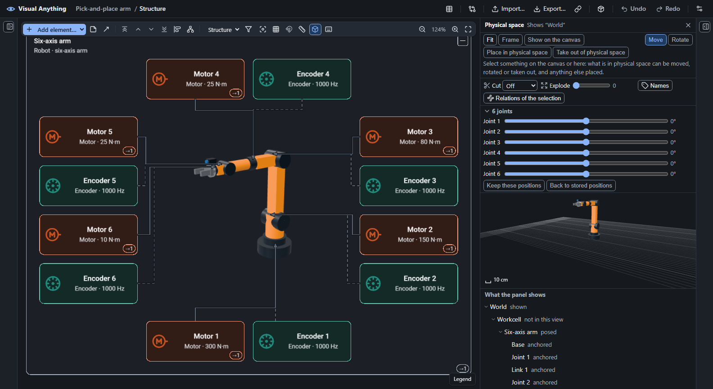

Its control loop, from the grasp policy through the joint controller to each motor:

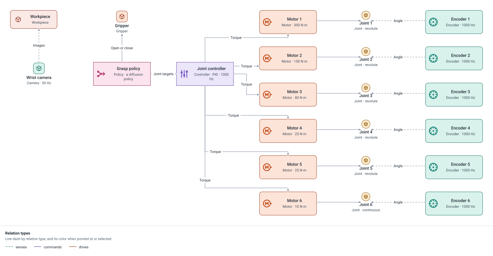

### Healthcare

`clinic-claim`: a claim's journey from a visit to its payment.

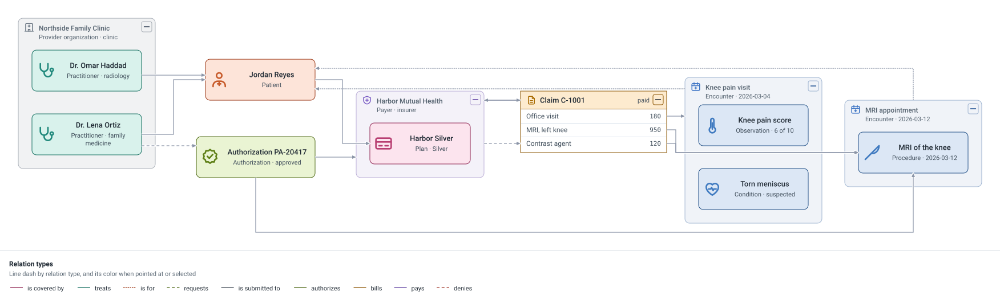

### Finance

`workshop-books`: from an invoice to the ledger.

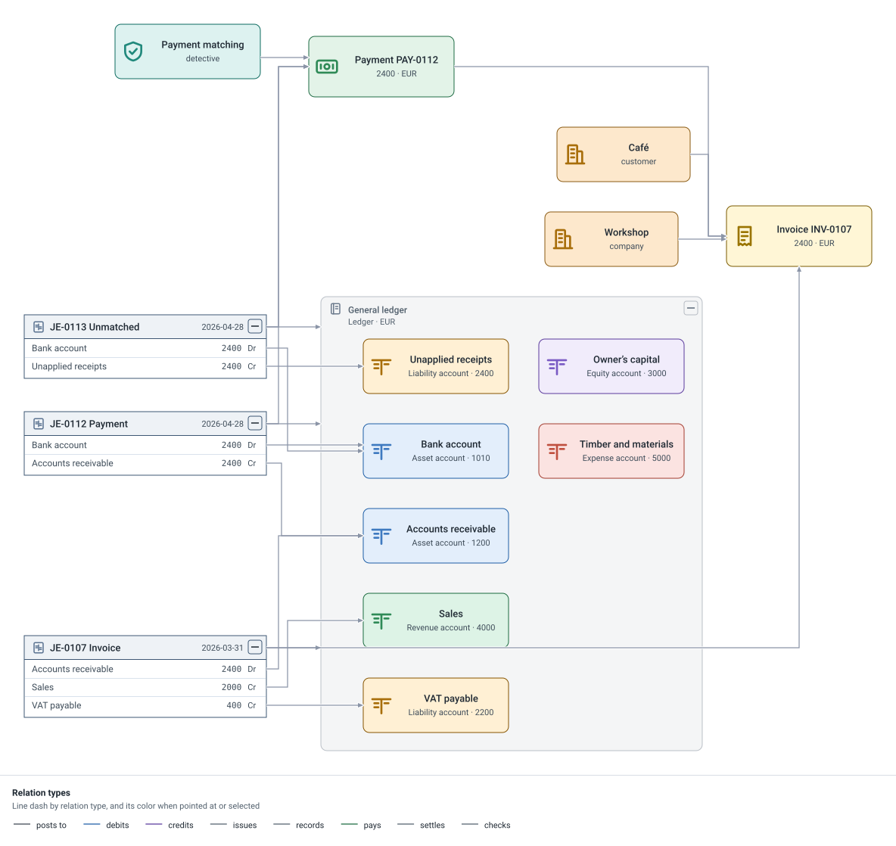

## Get started

From the repository, with Node.js 22.13 or later and pnpm:

```sh
pnpm install
pnpm dev        # serves examples/my-systems and opens your browser
```

Start a project of your own, empty or from a sample:

```sh
pnpm exec tsx packages/server/src/cli.ts new ~/my-project --from bookshop-database
```

Or take the single executable for your system, which needs nothing else installed, and run `visual-anything <folder>`. The [guide](docs/guide.md#running-the-executable) has the details.

## Run it in Docker

The repository holds the image's recipe. With Docker installed, from the repository:

```sh
docker compose up
```

That builds the image, starts the program at home and prints an address that opens the app once, within two minutes. It serves only this computer, on `127.0.0.1:47700`. Your projects and preferences live in `./data` (`data/projects` and `data/preferences`); set `VISUAL_ANYTHING_DATA` to keep them elsewhere, and on Linux run it as `UID=$(id -u) GID=$(id -g) docker compose up` so that the files stay yours.

- **Another address**, for a new tab: `docker attach visual-anything`, press `a`, then Ctrl+P Ctrl+Q to leave it running. Ctrl+C stops it.
- **Claude**: the MCP server's command is `docker exec -i visual-anything visual-anything mcp`, as in `claude mcp add visual-anything -- docker exec -i visual-anything visual-anything mcp`.
- **Another port**: set `VISUAL_ANYTHING_PORT`, which changes the port inside and outside alike.

Why it listens on the container's every interface, and what still keeps it local, is in [ADR 0094](docs/adr/0094-a-container-runs-the-program-with-its-port-on-the-hosts-loopback.md).

## Claude through MCP

Claude Code or Claude Desktop starts Visual Anything's MCP server and works on the project you have open. `visual-anything setup-claude`, or **Connect Claude…** in the app, adds it to Claude Desktop and prints the command for Claude Code; or add it yourself:

```sh
claude mcp add visual-anything -- <executable> mcp <project>
```

Setting it up from the repository, with Claude Desktop, and what Claude can do are in the [guide](docs/guide.md#claude-through-mcp).

## Documentation

- [Guide](docs/guide.md): projects, addresses, exports, versions, packages, git and Claude in detail.
- [CONTEXT.md](CONTEXT.md): the domain's words.
- [Decisions](docs/adr/): every architecture decision record.
- [Spec](docs/spec-v0.1.md): v0.1's scope and milestones.
- [Changelog](CHANGELOG.md): what changed in each version.

## License

Visual Anything is open source under the [MIT license](LICENSE). What it ships from others, and their licenses, is listed in [THIRD-PARTY-NOTICES.md](THIRD-PARTY-NOTICES.md).
