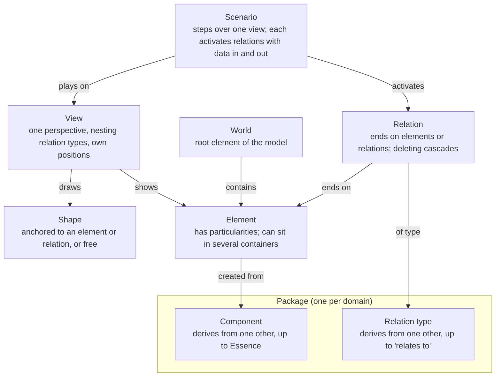
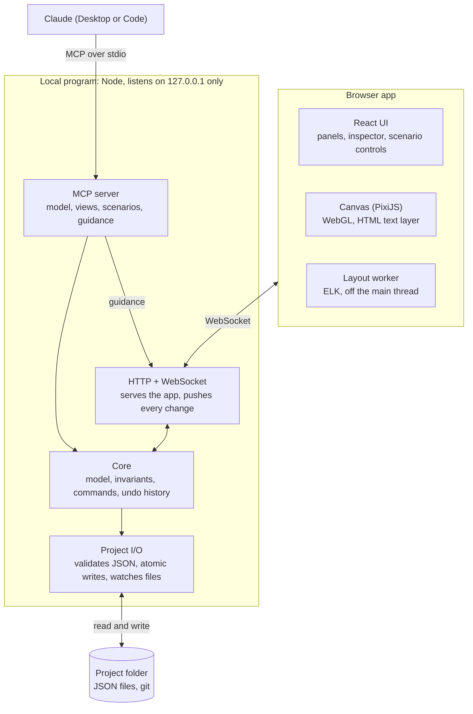

# Visual Anything v0.1 — Specification

Last updated 2026-10-24 · Ivan

> Exported from the Claude doc "Visual Anything v0.1 — Specification". Once this repository exists, this file is the source of truth: change it here, through pull requests.

v0.1 is a local-first tool where you model one of your own systems, explore it across abstraction levels and perspectives, play real scenarios over it step by step, and let Claude build and explain it through MCP. It validates case 1 (the architecture of a system you run), is built solo in TypeScript, and uses the terms in `CONTEXT.md` and the decisions in `docs/adr/`.

## Goals and success criteria

v0.1 is done when you can model one of your own systems end to end, read it at two abstraction levels, and play a real request through it with Claude's help.

- [x] One system you run is modeled with containers nested at least two levels deep, in two views with different perspectives.
- [x] Collapsing a container shows aggregated relations, and focus mode isolates the relations of the selected element.
- [ ] A view with 10,000 elements pans, zooms and selects smoothly (target: 60 frames per second) on your laptop.
- [x] Claude, through MCP, builds and edits the model and its views, turns a pasted log into a scenario, and guides you live.
- [x] Every edit, yours or Claude's, undoes one action at a time, with Claude's actions labelled as such.
- [x] Project files are plain JSON that diff cleanly in git and are validated when opened.

## Scope

v0.1 covers the model, views, layout, tables, the component editor, images, themes, scenarios and Claude through MCP; anything that needs code from packages, the remaining dimensions (3D included) or sharing waits, in the order of "After v0.1" below.

| Capability | In v0.1 | Later |
| --- | --- | --- |
| Model | Elements, relations, attributes, particularities, World | — |
| Components and relation types | Built-in "Systems" and "Data modeling" packages; your own, derived and changed in the component editor or written in JSON, by hand or by Claude | Programmable ones (case 4) |
| Tables | A component that draws what its elements hold as rows, as a table draws its columns; columns added on the canvas, typed or pasted | Importing many tables at once |
| Images | SVG pictures and small PNG, JPEG or WebP bitmaps kept in packages, shown on components and single elements as an icon or as the whole shape | Large photos kept as files; images as free shapes; SVG with named parts as shapes (M8b) |
| Languages | English and Spanish for everything the app shows, following the browser unless you choose (ADR 0038) | More languages |
| Themes | Light and dark for the app and the canvas, following the system unless you choose; kept by the local program for each person | More themes, such as high contrast |
| Appearance editing | Any #RRGGBB fill and stroke for elements, components and relation types (built-in ones through project appearances), one relation, notes and free arrows; from the inspector or by Claude | Transparency, gradients; colors that depend on an attribute's value |
| Grid and rulers | A grid that follows the zoom, rulers in canvas units, and snapping of hand moves to 8 canvas units | Custom spacing, guides dragged from rulers, alignment guides |
| Views | One perspective each, nesting chosen per view, stacking order, collapse and expand, filters, focus mode | Semantic zoom declared as data (after v0.1) |
| Layout | ELK automatic layout, pinned shapes, orthogonal routing; routes chosen by hand, straight, orthogonal or curved | Curved routes drawn by layout (M8b) |
| Free shapes | Note and arrow | Free 2D geometry for shapes (M8b), and more free shapes |
| Scenarios | Record, play, data per step, simultaneous relations, aggregated steps | Import real traces through a package |
| Tours | — | Recorded guidance played full screen, with comments (M11, after v0.1) |
| Claude through MCP | Model, views, declarative components with their images, rows and connection points, appearances, scenarios, live guidance | Writing programmable code, with approval |
| Time (model versions) | — | Comparing versions between git commits, in the app and for pull requests (M11b) |
| Attribute space | — | Case 3 (transformer) |
| Physical space (3D) | — | Case 5 (robotic arm, human body): 3D models inside components first, then a 3D panel linked to the 2D views (after v0.1) |
| Live data from your systems | Claude refreshes the model through its other MCPs | Packages that request network permission |
| Export (image, PDF, shareable page) | PNG of the open view | SVG, PDF, text, and a read-only page to share, embed and read on a phone (M6b) |
| HTML | — | Static HTML imported as a cleaned drawing (M8b, ADR 0068); HTML that runs only with a new ADR |
| Collaboration | Git on the project files | A merge driver that merges project files by id, and proposals to review Claude's changes (M11b); no real-time editing |
| Platforms | Windows, macOS and Linux: the local program as one executable for each (ADR 0037), or from npm, with the app in any desktop browser | Mobile reading through the read-only page (M6b); installers and updates (Track D) |
| Embedded chat | — | Optional package |
| Import | Claude builds models from Mermaid, draw.io, SQL, OpenAPI, Terraform, logs and more with its tools | Importers in the app for Mermaid, spreadsheets and JSON, Structurizr and LikeC4, and draw.io; starter packages per domain (M6c) |

## Domain model

Everything in the model is typed: elements come from components and relations from relation types, both shared in packages; views and scenarios show and play the model without changing it.



Rules the core enforces:

- Every element is created from exactly one component; every component derives from exactly one other, up to Essence.
- Every relation has a relation type; relation types derive up to "relates to". A relation's ends are elements or other relations.
- Deleting a relation also deletes the relations that end on it, after showing them.
- An element can have several containers, and containment can never form a cycle.
- Limits on what a relation type may connect only produce warnings.
- A view has exactly one perspective, chooses which nesting relation types arrange it and keeps its own positions; pinned shapes keep theirs through layout.
- A scenario plays over one view; each step activates one or more relations, and there are no branches.

## Architecture

v0.1 is one local Node program and a browser app. Every edit, from you or from Claude, becomes a command applied by a single core, so the rules are checked in one place and both kinds of edit share one undo history.



The browser and Claude never write files: both send commands to the core, which checks the rules, records each change in one undo history and saves it. Claude's live guidance goes straight to the open view without touching the model.

- **Local program** (Node, listening only on 127.0.0.1): serves the app, owns the model and its history, reads and writes the project folder, keeps each person's preferences outside every project (ADR 0032), and exposes the MCP server.
- **Browser app** (React, PixiJS, ELK in a worker): renders the open view, turns your gestures into commands and shows Claude's live guidance. Drags and other continuous gestures update the canvas locally and send a single command when they end.
- **Claude** (Desktop or Code): connects through an MCP stdio entry point that attaches to the running local program, starting it if needed.
- **Core**: the same TypeScript package runs in both places, so a read-only demo can run in the browser alone.

This ownership is recorded in ADR 0016.

## Project files

A project is a folder of JSON files with Visual Anything's own extensions, validated against a published schema when opened and written with a stable key order so git diffs stay small.

```text
my-systems/
  project.vaproject          name, schema version, packages in use, project appearances
  model.vamodel              World, elements, relations, attributes, particularities
  packages/
    systems.vapackage        components and relation types
  views/
    system-overview.vaview   perspective, nesting relation types, positions, pinned and free shapes
  scenarios/
    patient-books-appointment.vascenario   view, steps, relations per step, data in and out
  tours/
    how-booking-works.vatour     steps, each a view state with a caption, marks and speaker notes
  comments/
    reminder-timing.vacomment    one thread: its anchor, whether resolved, and its comments
```

- Ids are generated once and never reused; files refer to each other only by id.
- Positions and stacking orders live only in view files, so moving shapes or changing which is drawn in front never touches the model; dropping a shape into or out of a container changes its containment, which is part of the model.
- No file contains code that runs. Programmable code, after v0.1, lives in packages and runs sandboxed.
- Writes are atomic (a temporary file, then a rename), so a crash never leaves a half-written file. Changes made outside the app, such as a git pull, are reloaded with a notice.
- Each kind of file is read within a size cap, such as 1 MiB for a thread of comments, and a change that would write a file past its cap is refused before anything is written, so that whatever is written opens again.
- A file that the merge driver merged may hold what clashed as conflicts, kept as data, and it still validates (M11b, ADR 0072).

## Canvas, views and layout

The canvas draws one view at a time with WebGL, and every layout decision is kept per view.

- **Shapes**: an anchored shape takes its look from its component (shape, icon, label, connection points), and particularities can change it for one element. Free shapes in v0.1: note and arrow.
- **Relations**: drawn with their relation type's style, orthogonal by default. They attach to connection points when the component defines them, otherwise to the border. A relation that ends on another relation attaches to the middle of that relation's line.
- **Abstraction**: containers expand and collapse; a collapsed container shows aggregated relations with a count and a thicker line. An element with several containers appears inside each one, and selecting one copy selects all of them.
- **Perspective**: fixed per view; the toolbar switches between views over the same part of the model.
- **Explore**: filters by component, relation type or attribute hide shapes without moving any; focus mode dims everything not connected to the selection; any relation can be followed to its other end.
- **Layout**: ELK runs in a worker for shapes without a position and on demand; pinned shapes are fixed inputs, and results animate in when ready.
- **Edit**: create from the component palette, directly in World, inside the selected container or next to the selected element, or inside any element from its menu; connect; move, putting shapes inside a container by dropping them on it and taking them out by dragging them clear of it (hold Alt to move only), or from the shape menu and the inspector; bring to front, bring forward, send backward and send to back; rename inline; edit attributes and particularities in the inspector; and delete with a preview of what cascades; undo and redo.
- **Text**: edited in an HTML layer placed over the shape, then drawn back on the canvas.
- **Themes**: the app and the canvas are drawn light or dark, following the system unless you choose, and change together; built-in colors have a shade for each theme, and every color you set is drawn as set in both (ADR 0033).

## Scenarios

A scenario plays a concrete example over one view, step by step, showing what moves where and what each step takes in and produces.

1. **Record**: start recording and click relations in order; shift-click adds another relation to the same step. Each step gets a short description and its data in and out (JSON) in the side panel.
2. **Or ask Claude**: describe the example or paste a real log. Claude maps it to elements and relations through MCP, builds the steps and asks when a line matches nothing in the model.
3. **Play**: play and pause, previous and next, speed. The active relations and their ends are highlighted, a marker travels along each relation, and the side panel shows the step.
4. **Read it at any level**: consecutive steps that happen entirely inside a collapsed container play as one aggregated step with a count; expanding the container mid-playback reveals them.

Playing never changes the model or the view's positions. Branches are left out by design: an alternative path is another scenario. If a relation that a step uses is deleted, the step is kept and marked broken so you can fix it.

## Claude through MCP

Through MCP, Claude can do everything you can do in v0.1, and each of its write calls is one undoable action labelled Claude in the history.

| Group | What Claude can do |
| --- | --- |
| Read | Summarize the project; query elements and relations by component, attribute or container; read a view, with its positions and the order it draws the shapes in each container, or a scenario |
| Model | Create, update and delete elements, relations, attributes and particularities; define components and relation types in JSON; put elements inside containers and take them out |
| Views | Create views; set the perspective, nesting relation types and stacking order; collapse, expand and filter; run layout |
| Guide (live) | Highlight, focus, pan to a shape, show a short caption and step through a scenario, while the app is open |
| Scenarios | Create a scenario from steps, from a description or from a log; play it |

- Claude's changes appear live in the open view.
- Guidance never changes the model; it only moves and marks the open view. Run layout is asked of the open app, which lays the view out in its worker and records the layout as it records any layout (ADR 0029).
- Writing programmable code waits until after v0.1, and will need your approval before it runs.
- Tool descriptions include examples, because they are how Claude learns to use the tools well.
- Preferences, such as the theme, are each person's own: Claude's tools neither read nor change them, except that `read_package_code` says whether the person approved a package's code and which capabilities they granted it (ADR 0060); "everything you can do" means everything you can do to the project.

## Quality bar

These hold at every milestone, not only at the end.

- **Performance**: 10,000 elements in one view pan, zoom and select smoothly, with a 60 frames per second target; a theme switch never stalls a frame; layout never blocks interaction.
- **Security**: project files never run code and are validated when opened. The local program listens only on 127.0.0.1, checks the origin of every request and requires a per-session token for the live connection, so other websites cannot drive it. The core has no network access.
- **Accessibility**: keyboard navigation between shapes and along relations, an outline panel that mirrors the view, contrast in both themes of 4.5:1 for text and 3:1 for lines, marks, control boundaries and focus rings, and reduced motion for every animation when the system asks for it.
- **Reliability**: atomic writes, reload on outside changes, and property tests for the core rules: undo exactly reverses every command, containment never forms a cycle, and deletes cascade as specified.

## Decisions settled while writing

Three choices came up while writing this spec, and three more when its scope grew on 2026-10-23; all six follow the recommendation below.

| Decision | Settled | Rejected alternative |
| --- | --- | --- |
| What v0.1 takes of the scope added on 2026-10-23 | Stacking order, putting shapes inside containers and the shape menu in M2; tables and appearance traits in M3; the component editor and images in a new M3b; themes, colors and the grid in Track A beside the milestones | v0.1 as planned plus tables, with the editor and images moved to v0.2 |
| How 3D comes in | After v0.1, once shapes can have free 2D geometry: first 3D models drawn inside components, then a 3D panel linked to the 2D views, under a new ADR that supersedes ADR 0003 | A switch between 2D and 3D for each view, which ADR 0003 rejected: text and relations read worse in 3D |
| HTML | Static HTML enters as a drawing, cleaned and turned into SVG, after v0.1 | Storing HTML with scripts, which is code that runs |
| Who owns the model while editing | The local program owns the model and its history; the browser sends commands and renders what comes back (ADR 0016) | The browser owns it and the local program relays Claude's calls, so Claude can only edit while the app is open |
| File extensions | .vaproject, .vamodel, .vapackage, .vaview, .vascenario | Plain .json with a type field inside |
| Deleting a relation that a scenario uses | The delete preview lists the affected scenarios; their steps are marked broken, not deleted, so you can fix them | Delete those steps too |

## Milestones and tasks

Eight milestones in build order, each ending in something you can use, and Track A beside them; tasks are in order within each one.

**M0 · Skeleton.** Done when one command opens the browser on a sample project showing a static view.

- [x] Create the monorepo with pnpm workspaces: core, server, app, schema
- [x] Define the project file types and generate the JSON Schema from them
- [x] Local program: serve the app on 127.0.0.1, open the browser, load a project folder
- [x] App shell in React: header, model panel, canvas area, inspector
- [x] Continuous integration: type checks, lint, tests

**M1 · Model core.** Done when the core passes property tests for undo, cascades and containment cycles, and a project folder round-trips without changes.

- [x] Elements, components derived up to Essence, relations ending on elements or relations, relation types derived up to "relates to", particularities
- [x] Commands and history: every change is a command; undo and redo; each action labelled by author (you or Claude)
- [x] Rules: block containment cycles, warn on relation type limits, cascade deletes with a preview
- [x] Project I/O: validate on open, stable formatting, atomic writes, reload on outside changes
- [x] Built-in "Systems" package: Box, System, Service (Chat channel, AI agent, MCP server, Semantic layer), Database, Object storage, Person; relation types communicates with, writes to, reads from, queries, loads into, is part of

**M2 · Canvas.** Done when a synthetic view with 10,000 elements pans, zooms and selects at the 60 frames per second target.

- [x] PixiJS renderer: anchored shapes from their component's look, relations with orthogonal routes and arrowheads
- [x] Pan, zoom, select (click and box), move, connect, delete
- [x] Inline text editing in an HTML layer; inspector for attributes and particularities
- [x] Free shapes: note and arrow
- [x] Keyboard navigation and outline panel
- [x] Benchmark with a synthetic 10,000-element view
- [x] Stacking order per view, drawn and pointed at in the same order; put shapes inside containers and take them out from the canvas, the shape menu and the inspector; create inside the selected container, next to the selected element, or inside any element

**M3 · Views, layout and tables.** Done when you can collapse a container and read its aggregated relations; you can switch between two perspectives of the same system; you can model the sample's appointments and patients as tables inside the Appointments DB, one by adding its columns on the canvas and one by pasting its `CREATE TABLE`, with the reference between them attached at the rows it joins, before and after layout and after collapsing a table; and the tables benchmark meets the 60 frames per second target, while applying one edit at 10,000 elements takes at most 50 ms and a layout at most 150 ms.

- [x] Project files read only as regular files within size caps; a launch address that works once
- [ ] Scene and renderer within budget: a per-element cache and incremental scenes for position-only and same-size actions, checked against a full build by a property test; rows in bands; benchmark phases for one column and one layout
- [x] Appearance traits in the schema and core: detail and badges, connection points, contents drawn as rows, attribute choices and units, limits that lift with "any"; the core checks every value a command sets; newer formats refused with a clear message
- [x] Commands: components, relation types and packages changed trait by trait; elements reordered; definitions created only once, with ids the program makes
- [x] Built-in "Data modeling" package: Table, Column, is column of, references; reserved package ids; the nesting relation type chosen by its limits
- [x] Views: perspective, nesting relation types, positions; view list and perspective switcher
- [x] Nesting with several containers: one copy per container, selected together
- [x] Collapse and expand with aggregated relations (count and line weight), also for what a row holds
- [x] Filters and focus mode, by degrees and by direction, with isolating the selection
- [x] ELK layout in a worker, pinned shapes as fixed inputs, re-layout on demand; each table as one block with a connection point for each related row
- [x] Connection points from components, in a format that leaves room for free geometry: relations attach to them, and ELK takes them as ports
- [ ] Relations routed by hand, per view, as in draw.io: each end attached to a connection point or to any point of a shape's border, chosen by dragging it; bend points added, moved and removed; orthogonal segments dragged; straight, orthogonal or curved; Reset route goes back to the automatic route
- [ ] Tables on the canvas: rows, relations to rows, drawing within the budget; columns added on the canvas, typed or pasted; the tables benchmark

**M3b · Component editor and images.** Done when you derive a component from a built-in one in the component editor, change its shape, colors, detail and attributes, give it an SVG icon from a file, give one element a PNG of its own and another element a picture already in the project, and undo each step one at a time; an SVG holding a script or an outside reference is cleaned before it is saved and never runs; the built app shows no content security policy violation; and a view of 10,000 elements with tables and images still pans, zooms and selects at the 60 frames per second target. It runs after M3, and can run beside M4 in a second session.

- [x] Images in the schema and core: package images, the SVG and bitmap cleaner and its cleaned view, checks on open, the history's size budget
- [x] The page's content security policy with Trusted Types, worker policies, a payload limit on the live connection, and dev mode's guard on project files
- [x] The component editor in the inspector and the Components tab: derive, define, change and remove your own components, relation types and packages, showing what each one inherits
- [ ] Images on the canvas within the frame budget, and in the inspector and the component editor
- [ ] Benchmark with images
- [x] MCP tools for images, once M4's entry point exists

**M4 · Claude through MCP.** Done when Claude builds a view of a system from a description, walks you through it live, and you can undo each of its actions.

- [x] MCP stdio entry point that attaches to the running local program through an endpoint and a credential of its own, which accept only the messages Claude may send
- [x] Read and query tools
- [x] Write tools for the model, components and views (components, relation types and packages trait by trait, rows, tables and appearances included): one undoable action per call, labelled Claude
- [x] Live guidance over the WebSocket: highlight, focus, pan to, caption
- [x] Tool descriptions written for Claude, with examples

**M5 · Scenarios.** Done when you paste a real log, Claude turns it into a scenario, and you play it at two abstraction levels.

- [x] Scenario files: steps with one or more relations, description, data in and out
- [x] Recording on the canvas: click in order, shift-click for simultaneous relations
- [x] Playback: play and pause, step, speed, travelling marker, step panel
- [x] Aggregated steps inside collapsed containers
- [x] MCP tools: create from steps, a description or a log; play and step
- [x] Broken steps when a relation they use is deleted

**M6 · Dogfooding and v0.1.** Done when your own system is modeled end to end, with two views and one real scenario, and every success criterion above holds.

- [x] Model your system (case 1) together with Claude: `examples/visual-anything` models Visual Anything itself, built only through Claude's MCP tools and the app, with two views, Structure and A command's path, the scenario "A shape moves" from `logs/a-shape-moves.log`, and a tour
- [x] Search and jump: a find field (Ctrl+F) over names, ids, components and attribute values, results grouped by view, Enter selects and shows
- [x] View addresses built on one view state (view, camera, selection, filters, focus, scenario step), kept in the address's fragment, with Copy address
- [x] A view address opens in a new tab of the browser that has the project open, which joins its session (ADR 0043); `visual-anything open --view` and Claude's `open_app` open a tab at a view state in the program that runs, and `get_view_address` answers the full address (ADR 0044); the canvas toolbar keeps one row, with what does not fit under More
- [x] PNG export of the open view or the whole view, at 1× or 2×, in the current theme
- [x] A history panel: each action's label, author (you or Claude) and time, and Undo to here
- [x] Recipes for Claude to build models, views and scenarios from what exists (Mermaid, PlantUML, draw.io, Structurizr, SQL, OpenAPI, Terraform, Kubernetes, docker-compose, a repository, logs and traces) with its tools, as MCP prompts (`build_from_…`)
- [x] Fix what dogfooding surfaces. Modeling Visual Anything with itself (W46) found:
  - [x] Ids made from names split a word at an apostrophe (`claude-s-messages`, `a-command-s-path.vaview`); they keep it whole now (ADR 0019)
  - [x] `set_scope` did not say how to show only elements picked by hand: `added` alone shows the whole model; it now says to exclude Essence and add them (ADR 0040)
  - [x] The log a sample's scenario comes from is kept beside it in `logs/`, which `.gitignore`'s `*.log` left out (ADR 0019)
  - [x] Placing new shapes inside a container never moves the shapes beside it, so a container that grows with what Claude adds covers its neighbours until the whole view is laid out (ADR 0015 moves only new shapes); the placement moves the unpinned ones aside now, right or down, past the pinned ones (ADR 0015's clarification of W48)
  - [x] Placing what Claude adds is recorded as the person's action (`Lay out 22 new shapes`, by you), also after `change_container` without places: one change of Claude's takes two undos, and the history shows layouts nobody asked for; the placement joins the action that added the shapes now (ADR 0065)
  - [x] The canvas's routes do not go around the shapes between their ends, so in nested views lines cross other shapes and their names; an automatic orthogonal route now goes around the shapes and name plates in its way inside the container that holds both its ends, routed in a worker and again only where a change touches it, and the SVG and PDF route at once (ADR 0039)
  - [x] A view cannot leave out relation types: a Structure view of a code base draws every call and connection between its parts, which only filters, never kept with the view, hide; a view's `relationTypesLeftOut` leaves them out now, set beside the scope and by Claude's `leave_out_relation_types` (ADR 0064)
  - [x] Below about 60%, straight edges thinner than a pixel vanish and only rounded corners draw, so a shape inside a container of the same fill disappears; every outline is now at least a device pixel wide at any zoom, and a shape in a container is outlined in a color that reads on its fill when its stroke does not (ADR 0014, ADR 0033)
  - [x] Fit can choose a zoom at which no names draw (17% for 84 shapes), and `lay_out_view` leaves the camera where it was, so the person may see blank boxes or empty canvas; Fit keeps to the zoom names draw from and shows the view from its top left when the whole would draw none (ADR 0055), and the app fits what `lay_out_view` laid out (ADR 0029)
  - [x] Playback and `go_to_step` never bring the step played into view, so a step off screen plays unseen; a step's relations now come into view with a tour's capped, eased move, unless the person moved the camera during playback (ADR 0031)
  - [x] Guidance that names a view switches every open tab to it, and a tab switched so keeps the camera of the view it showed; it shows another view only in the tab the person used last, or the tab Claude opened, and a tab switched to a view takes the camera it last showed it at, or fits it (ADR 0029)
  - [x] The canvas's keys, such as Alt+− to collapse, do nothing while focus is in the outline, and the outline offers no collapse; Alt+− and Alt++ on a row, and the row's menu, collapse and expand its container or the selection's (ADR 0024)
  - [x] The program writes nothing per action, so the log of a command's path had to come from the browser's WebSocket frames; a `--log` option writing one line per action would make one to paste; `--log <file>` does now (ADR 0016's clarification)
  - [x] `define_component` and `update_component` warn about no color, as `set_appearance` does about a fill that fades into the light canvas; they give its warnings now, and so do `define_relation_type` and `update_relation_type` (ADR 0029's clarification of W48)
  - [x] A collapsed container's count is cut off at its component's size (`Code package…`); it has a line of its own under the detail when the header has room, and comes first on the detail's line when not, on the canvas and in the SVG
  - [x] The header wraps to two rows when the view's name and the Undo label are long, which moves the canvas down while you work (A4); it keeps one row now, the view's and the project's names and the action Undo and Redo name cut with "…", whole in their tooltips and to screen readers
- [x] README with setup for Claude Desktop and Claude Code
- [ ] Tag v0.1 in the private repository

**M6b · Out.** It is planned here so that it can run beside M6c, in the first wave after v0.1. Done when:

- the open view exports as SVG and as PDF from the app and from the command line, and each matches the canvas: the scene's bounds, its ids as `data-` attributes, and the view's name and description as title and description;
- the outline exports as Markdown, the view as Mermaid, and a view of Systems components as Structurizr DSL, each saying what it lost;
- Export → Read-only page writes one file that opens offline in a desktop browser and on a phone, shows every view, plays every scenario and follows view addresses;
- the page holds no token and connects nowhere, which a test checks against its policy (ADR 0041);
- the page opens the 10,000-element benchmark view within the frame budget on the reference laptop.

- [x] An SVG writer from the scene, in pure TypeScript without the DOM: shapes, rows, routes and curves, labels, cleaned images, title, description and `data-` ids; a test compares its bounds with the scene's (a dated clarification of ADR 0014: an output, not a second renderer)
- [x] PDF made from that SVG, with its fonts embedded; the library is chosen and recorded in the same clarification
- [x] `visual-anything export <folder> --view <id> --format svg|pdf|md|mermaid|structurizr|page [--out <file>]` (with `--theme light|dark`; for `page`, `--view` is the view the page opens at, the first by default)
- [x] Text exports: the outline in Markdown, which also serves as the view's long description; Mermaid, through each element's first container; Structurizr DSL for views of Systems components
- [x] The read-only page (ADR 0041): a viewer build without the live connection, the commands or the editors; the project as data; its policy; touch; view addresses; the About panel with the packages' attribution
- [x] The Export dialog: PNG, SVG, PDF, text and the page, each with its size and what it leaves out
- [x] Claude's `export_view`, which answers SVG, Markdown, Mermaid or Structurizr text and writes no file
- [ ] Benchmark: the page's size and how long it takes to open at 10,000 elements; how long the SVG takes to write (the exports' phase, `exports-bench.html`, is in, not yet run)

**M6c · In.** Planned beside M6b; scopes go first, since every importer and every starter package needs them. Done when:

- a view can show part of the model through its scope (ADR 0040), set from the app and by Claude, with the core's property tests for it;
- each of these imports through the mapping dialog as one undoable action that reports what matched nothing (ADR 0042):
  - a Mermaid flowchart;
  - a CSV of elements and relations;
  - a Structurizr workspace in JSON;
  - a draw.io file;
- the hostile-input tests pass;
- the C4 and data-science starter packages ship with icons whose licenses pass the license test (ADR 0047), each with a sample project and a scenario, and New project from a sample starts from them;
- a package can be added from another project.

- [x] Scopes in the schema and the core, test-first with property tests (ADR 0040): the rules, `added` and `leftOut`, the commands `set-scope`, `add-to-view` and `leave-out-of-view`, and new elements added to the scope of the view they were made in
- [x] Scopes on the canvas:
  - the scene, layout, aggregation, search and the perspective switcher follow the scope;
  - playback marks steps outside the view;
  - the inspector edits the scope;
  - the canvas and the outline offer Add to this view and Leave out of this view;
  - shapes count the relations that leave the view
- [x] Claude's tools to read and set a scope, and to add to a view or leave out of it
- [x] The import pipeline (ADR 0042): the plan, the mapping dialog, one batch, the report; Import… in the header, `visual-anything import <folder> <file>`, and Claude's `import_file`
- [x] The Mermaid reader: flowcharts, C4, ER and class diagrams
- [x] The spreadsheet (CSV and TSV) and JSON readers, importing again by a key
- [x] The Structurizr workspace JSON and LikeC4 model readers, with their views as scopes
- [x] The draw.io reader: compressed and plain files, `.drawio.svg` and `.drawio.png`, shapes, containers, edges with their waypoints, and pages as views
- [x] License fields in the schema, and the license test (ADR 0047)
- [x] Starter packages for C4 architecture and data-science pipelines, each with icons, a sample project and a scenario, in English and Spanish; New project from a sample
- [x] A package added from another project, with its version and attribution, and updated from it after a preview
- [x] A command's draft keeps the model's index up to date, so that a batch of N creates is no longer quadratic: 10,000 elements with their shapes and relations land in about 1 s (ADR 0042)
- [x] Planned relations carry their description, and importing again updates the values of a relation the project already has
- [ ] An import at the limits lands in fewer operations, as commands do past `BULK` changes to one list (about 26 s on a loaded machine now)

**M7 · Package code.** It is planned here so that it can run in the second wave after v0.1. Done when:

- a package's code computes attributes, checks elements and draws inside shapes through its three hooks, in QuickJS inside WebAssembly in a worker (ADR 0054);
- it runs only after you approve it by its hash, and any change to it asks again;
- a call past 50 ms or 32 MiB stops without stalling a frame;
- the hostile-code tests pass: loops, allocation bombs, reaching for `globalThis`, `fetch`, the page or another package;
- Claude can read, write and run a package's code after your approval.

- [x] `PackageFile.code` and `capabilities` in the schema, and the hooks' types and the checks of their answers in the core, test-first
- [x] The worker: one QuickJS runtime per package, the limits, the messages, turning a failing package off
- [x] Approval by hash and by capability, kept in your preferences; the approval dialog; computed values marked as computed
- [ ] `draw` answers drawn inside shapes through the declarative drawing format, within the frame budget
- [x] Claude's tools for package code, approved in the app
- [x] A sample package with code (a unit converter that computes an attribute, a check, and a gauge drawn inside its shape)

**M8 · Detail and data.** Planned beside M7 and M11. Done when:

- a view colors, sizes, marks and fades shapes by an attribute through its overlays, with a legend, also in every export (ADR 0055);
- appearances declare levels of detail by scale, without flicker, and zooming far into a collapsed container can expand it;
- elements carry external identifiers that search and importers use, and destination attributes open a view, another project or a web address after a confirmation (ADR 0056);
- live values from Claude, the command line and approved package code show with their mark and age, and are never saved (ADR 0057);
- an element list edits a component's or a scope's elements in bulk, and a pasted block of cells is one action;
- a time range on an attribute filters and plays;
- the reading benchmark of 100,000 elements and 200,000 relations meets its marks.

- [x] Overlays in the schema and the core (discrete, continuous and passthrough mappings to fill, stroke, size, badge and opacity), with their commands; the scene applies them; the legend on the canvas and in exports; Claude's tools
- [x] Levels of detail in appearances, with their inheritance and hysteresis; the renderer switches levels by tile; expanding and collapsing by zoom
- [x] External identifiers in the schema; search by identifier; crosswalk tables for importers
- [x] The destination attribute type: the mark, following it, the confirmation, opening another project at a view state through its own program, and the checks on opening
- [x] Live values: protocol version 6, the program's store and limits, the app's lookup with marks and age, Keep as attribute, `set_live_values` and `visual-anything live`; package code granted an origin fetches through the program (ADR 0063)
- [x] The element list: a panel of elements by component or by scope, with attributes as columns, sorting, filters, editing in place, a pasted block of cells as one action, and selection in step with the canvas
- [x] Time ranges: a range filter on a date, time or number attribute, with a slider and playback, kept by the app as filters are (ADR 0025)
- [x] Overlays and the element list read through the attribute lookup, live and computed values over stored ones; the view state carries the time range, in view addresses, `open_app` and tour steps; a live update keeps a running layout animation (ADR 0057, ADR 0044, ADR 0058)
- [ ] A live update of 1,000 values on a 10,000-element view within a frame, judged by the benchmark's `?live` phase in the browser (ADR 0057)
- [x] Claude reads live values with their sender and age (W45), and `filter_view` sets a time range (W48) (ADR 0057)
- [ ] The reading benchmark: 100,000 elements and 200,000 relations opened with containers collapsed; 60 fps while fewer than 10,000 shapes show; expanding a container of 1,000 under 100 ms; a search under 50 ms; drawing many instances at once when zoomed out, and layout only for what is open

**M11 · Tours and comments.** Planned beside M7 and M8, moved ahead of M9. Done when:

- a tour is made in the app or by Claude, one step at a time from view states, saved as a `.vatour` file, and played full screen with captions, marks, scenarios and speaker notes, by keys, with short eased moves and cuts under reduced motion (ADR 0058);
- it plays in the read-only page too;
- comment threads anchored to elements, relations, views or points are kept as `.vacomment` files, one thread per file, shown as pins and in a panel, answered by Claude, and resolved (ADR 0059).

- [x] Tour files in the schema and the loader; tour commands in the core, test-first, steps naming deleted things kept and flagged
- [x] The tours panel: Add step from the view state, captions and marks edited in place, steps reordered
- [x] Full-screen playback: the caption card, the progress line, keys, the camera's capped and eased moves, speaker notes in a second window, and tours in the read-only page
- [x] Claude's tools for tours, and `play_tour`, which plays one full screen in the open app (W45)
- [x] Comment files in the schema and the loader; comment commands in the core, test-first, threads whose anchor is deleted kept as detached (the file kind, the loader, the watcher and the writer are in)
- [x] Pins on the canvas and the comments panel, with filters; authors from your preferences
- [x] Claude's tools for comments, and working through the open ones

**M8b · Beyond boxes.** Planned in the third wave, beside M11b. Its three seams, in the schema, the core and the scene, go first and in order, since every other task draws, points at, routes, lays out or exports what they define; the next eight tasks then run in parallel, and the benchmark is measured once they are merged. Done when:

- a component's appearance, or one element's own, gives its shapes free geometry (ADR 0066):
  - SVG path data with lines, Bézier curves and arcs, polygons and ellipses, holes included;
  - set from the component editor, from path data, an SVG file or a named part, and by Claude, each change one undoable action;
  - drawn by the canvas at every zoom, far out as its simplified outline and never as its box;
- pointing, hovering, selecting and dropping go by the outline: a point in a hole, or beside the outline inside its box, finds what lies behind, which the hit tests check against the outline to within a quarter of a canvas unit;
- relations attach on the outline, at a connection point carried in from its side or where the line toward the other end last leaves the outline; orthogonal routes stay orthogonal as they meet it, and ELK lays such shapes out by their boxes and ports;
- an SVG image's named parts are listed with previews, and Anchor parts… anchors the contents of a drawing with parts to them, in one action, from the app and by Claude (ADR 0067):
  - by name, by id, or by an external identifier through a crosswalk;
  - creating an element for each part that matches nothing, when asked;
- each anchored part is drawn in its place over its picture, and is selected, hovered, focused, filtered, colored by overlays, related, played through and listed in the outline as its element's shape; drawn outside a drawing with parts, it keeps its part's outline and picture;
- replacing the picture keeps the anchors of the parts it still has; before it applies, it says which anchored parts it loses, which then warn `unknown-part`, and an undo brings them back;
- a static HTML file becomes an imported drawing shown by an element, in one undoable action with a report of what it dropped (ADR 0068):
  - from Import…, from `visual-anything import` and from Claude's `import_drawing`;
  - the hostile-input tests show that scripts, handlers, frames, forms, styles that load and addresses are dropped, that nothing runs and that nothing is fetched;
  - the bundle tests show that neither the app's page nor the read-only page holds the converter;
- a relation type, a relation and a view can draw their automatic routes straight or curved, as every layout and every later move then draw them, while routes chosen by hand keep their ends, bend points and style (ADR 0069);
- the SVG and PDF exports and the read-only page draw free geometry, drawings with parts and automatic curves as the canvas does, and the SVG test compares their bounds with the scene's;
- the performance budget holds: the beyond-boxes benchmark (`?geometry`, alone and with `?curves`) meets these marks on the reference laptop:
  - pan, zoom and select at the 60 frames per second target, on 10,000 elements of which:
    - 2,000 have free geometry, in 20 distinct geometries, 4 of them at the caps;
    - 1,000 are anchored parts in 20 drawings with parts, 2 of whose pictures are at the cap on parts;
    - 2,000 relations attach on outlines, 1,000 of them curved automatically;
  - a pointer moving over outlines finds what is under it within 1 ms at the 95th percentile;
  - moving a shape with free geometry and 50 relations is applied within the 50 ms an edit may take;
  - its theme switch keeps A1's rule (every frame within 33 ms and 95% within 16.7 ms), and its runs with the image store cleared hold the 60 frames per second target, as M3b's images benchmark does.

- [x] **Seam 1, in the main session: free geometry and route styles in the schema and the core**, test-first with property tests (ADR 0066, ADR 0069).
  - **Schema:**
    - `Appearance.geometry` (`FreeGeometry`: `width`, `height`, `outline` of `path`, `polygon` and `ellipse` contours, `keepProportions` and `label`) and `Appearance.part` (`PartReference`: `part` and an optional `image`), each also `none`;
    - `AppearanceImage.placement` gains `parts`, `RelationAppearance` gains `route`, `ViewFile` gains `routeStyle`, and `RelationRoute.style` gains `orthogonal`;
    - the schemas regenerated, and `PROTOCOL_VERSION` 7.
  - **Resolution and commands:**
    - resolution and inheritance, project appearances included;
    - `automaticRouteStyleOf(project, view, relation)`, which `set-route` compares with to keep only what differs;
    - `update-view` and the appearance commands carry the new keys.
  - **The outline maths,** `core/src/geometry/`:
    - the strict path reader, `GEOMETRY_CAPS`, and `readGeometry` into the normalized `Outline`: fills, holes and stroked lines, made of moves, lines and cubics;
    - `fitOutline` to a rectangle, and on a fitted outline `outlineHolds`, `outlineExit`, `outlinePlace` (a side and a place carried in), `outlineInnerPoint`, `outlineLabelArea`, `flattenOutline`, `simplifyOutline` and `outlinePathData`, cached by outline and size.
  - **Checks:** the codes `invalid-geometry`, `geometry-too-large` and `large-geometry`, refused by commands and warned on open.
  - **Property tests:**
    - a point is held exactly when a much finer reference flattening holds it, to within 0.25 units;
    - a last exit lies on the outline, and no later point of its ray is inside;
    - reading normalized path data again gives the same outline.
- [x] **Seam 2, in the main session: named parts in the core** (ADR 0067).
  - `core/src/images/parts.ts`, with `partsOf`, `partPicture`, `geometryOf` and `PART_CAPS`, read from the cleaned view and cached by it.
  - `unknown-part` and `too-many-parts` after every action and on open, and `in-use` for an image that a `part` names.
  - The anchored parts a replacement would lose, in its preview: `partsLostByReplacing`, which the replace dialog and `replace_image` call.
  - Property tests:
    - every part's picture is exactly what `cleanSvg` gives for it;
    - parts come in document order, with their transforms applied;
    - ADR 0027's attack corpus goes through parts too.
- [x] **Seam 3, in the main session: the scene's seam**, which the parallel tasks use as it is.
  - `ElementShape.outline`: the fitted outline of its free geometry or of its part.
  - `ElementShape.part`: `{ image, part, color, inDrawing }`.
  - `ElementShape.picture`: where a drawing with parts draws its picture.
  - Anchored parts placed in their drawings, without positions of their own, and a drawing's other contents below its picture.
  - `RelationLine.style` on every line, automatic ones included.
  - `outlines.ts`'s `shapeHolds(shape, point)` and `shapeBorderPoint(shape, inside, toward)`, and `draw.ts`'s `drawOutline(graphics, outline, colors)`, over the core's outline maths. They sit beside the outlines rather than in `geometry.ts`, which the layout worker loads, so that the worker never loads the core.
  - Automatic straight and curved lines, routed as routes chosen by hand without bend points are, and side by side as automatic lines are; the routing task carries their ends onto outlines.
  - The incremental scene keeps outlines and parts across moves and recolors, which its property test checks against a full build.
- [ ] **Free geometry on the canvas** (ADR 0066):
  - tiles' plain and full drawings of outlines, holes cut;
  - silhouettes and plain blocks drawn as simplified outlines, and collapsed containers' sheets;
  - names in the label area, or beside the shape in the hover and selection marks, and icons;
  - hit testing, box selection and drop targets by the outline, and hover and selection marks along it.
- [ ] **Routes on outlines, and automatic curves** (ADR 0066, ADR 0069):
  - automatic ends at the last exit, orthogonal ends carried on to the outline, and connection points and border attachments carried in;
  - automatic straight and curved routes, fanned apart as parallel lines are;
  - route handles and dragged ends on outlines (ADR 0039's clarification);
  - layout's ports for free geometry, and each drawing with parts as one block with a port for each related part (ADR 0015's clarification).
- [ ] **Anchored parts on the canvas** (ADR 0067):
  - drawings with parts drawn as their picture under their header;
  - what is drawn over parts: veils, and overlays' fills, strokes and badges;
  - parts' own pictures, through the image store, for parts drawn at full strength in a faint drawing; parts far out;
  - pressing and dragging; keyboard navigation and the outline in the picture's order;
  - the inspector's parts of a drawing, and Anchor parts…, matching by name, id or an external identifier through a crosswalk, and creating what matches nothing.
- [ ] **The editors:**
  - the component editor's Shape section: free geometry from path data, an SVG file or a named part, with Keep proportions and the label area, and a preview;
  - the part a component or an element is drawn as, and the placement With its parts;
  - a relation type's and a relation's Route, a view's Lines, and the Style control's Automatic (ADR 0039's clarification);
  - every text in English and Spanish, and the catalog test's avoided words extended with the new terms' avoid lists.
- [ ] **HTML as a drawing** (ADR 0068):
  - `server/src/drawings/`: parse5, the allow-list and its caps, the conversion into satori's input, satori in a worker thread limited to 256 MiB and 10 s, Roboto, `cleanSvg`, and the report;
  - the live request and its answer, and Import…'s preview, report and single action;
  - `visual-anything import` with `.html`;
  - the hostile-input tests, and the bundle tests for both pages;
  - the single executables with satori's WebAssembly, a notice of the code they bundle, and a smoke test that makes a drawing.
- [ ] **Claude's tools:**
  - `set_appearance` with `geometry`, `part` and `route`; `update_view` with `routeStyle`; `set_route` with `orthogonal` and the automatic style;
  - `list_image_parts`, `anchor_parts` and `import_drawing`, and the lost parts in `replace_image`'s answer;
  - descriptions with examples of path data and of anchoring an atlas's parts.
- [ ] **Exports:**
  - the SVG writer draws outlines as `path`s with `fill-rule="evenodd"`, drawings with parts as their picture with what changes their parts drawn over it, and automatic curves;
  - the PDF from it, and the read-only page as the canvas draws;
  - the SVG test's bounds for free geometry, a drawing with parts and automatic curves;
  - Mermaid and Structurizr say that they lost the outlines.
- [ ] **A sample,** `examples/beyond-boxes`: a heart drawn for Visual Anything (CC0-1.0), whose chambers and vessels are anchored to its named parts; a component with free geometry; one view drawn curved; a card imported from HTML; and a scenario of blood flowing through the heart.
- [x] **The benchmark:** `?geometry` and `?curves`, in work and frames modes, with the phases of the "Done when" above (W60, the harness; the measurements wait for the other tasks to be merged and for a quiet machine):
  - pan, zoom and select, at the whole view and with names shown;
  - pointing along outlines;
  - dragging a shape with free geometry and 50 relations;
  - a run with the image store cleared;
  - a theme switch.

**M11b · Versions.** Planned for the third wave, beside M8b. The core's comparison, merge and proposals go first, in the main session, since everything else builds on them. Then two rounds of tasks run in parallel. Done when:

- two versions of a project compare in the core by id, element by element and view by view, into what was added, removed, changed and moved, each with what differs; and the property tests pass (ADR 0070):
  - a version compared with itself shows no change;
  - compared the other way round, added and removed swap;
  - a comparison followed through any action equals comparing afresh;
- the local program reads the project as a commit of its repository holds it, through git's plumbing, and writes nothing to the repository (ADR 0071):
  - git runs by its absolute path, with arguments and never a shell;
  - the hostile-repository tests pass: configuration that starts programs, names that look like options, links, submodules, files past their caps and objects that a partial clone lacks start no program, reach no network and read nothing outside the repository;
- Compare with… in the app takes the project as opened, the last commit, a branch, a tag or a recent commit. It draws the open view before, after and as a comparison, with a legend that does not rest on color alone, the Changes list, and `]` and `[` to step through the changes. At 10,000 elements:
  - comparing takes at most 100 ms;
  - following an action takes at most 5 ms;
  - the drawing stays within the frame budget;
- the comparison leaves the app and goes to pull requests:
  - the Export dialog writes a comparison's drawings as SVG and PDF, and its summary in Markdown;
  - `visual-anything compare <folder> --base <ref> --out <folder>`, with no program running, writes the summary and, for each view that changed, SVGs before, after and of the comparison;
  - a CI job keeps them for each pull request that changes `examples/`;
- with Review Claude's changes on, Claude's changes gather into one proposal (ADR 0073):
  - every open app shows it as a comparison, and the person accepts it change by change, or refuses it;
  - what is accepted is one undoable action of Claude's, which keeps what the person did meanwhile;
  - nothing of a proposal reaches a file, the history or git before it is accepted;
- `visual-anything merge-driver` merges two edits of each of the seven kinds of project file by id (ADR 0072):
  - it is named in `.gitattributes`, and defined in the person's git configuration only by `visual-anything merge-driver --install`;
  - independent changes join, and conflicts stay as data in a file that still validates;
  - the app lists the conflicts and resolves them one by one, as undoable actions;
  - a real `git merge` of two branches of a sample joins their independent changes, and keeps what clashes as conflicts;
  - a 10,000-element model file merges in at most 500 ms;
- the merge driver's hostile-input tests pass: it runs no program, loads nothing from the repository, and writes nothing but the file git gives it.

The first three tasks are the seams, built in the main session in this order. The next four run in parallel once they are merged, and the last six once those are.

- [ ] **The comparison in the core** (main session, test-first; `core/src/versions/`: `items.ts`, `compare.ts`, `operations-between.ts`; ADR 0070):
  - `ItemRef`, the items of ADR 0070, with `itemKey(ref)`, such as `element:<id>` or `position:<view>:<element> in <container>`, and `fileItemKey(ref)`, the key a conflict keeps in its file (ADR 0072);
  - `compareProjects(older, newer): Comparison`:
    - `changes`, grouped as ADR 0070 groups them, each with its `status`, its main `ref`, the `items` it covers and its `differences`;
    - `counts`;
    - `names`: every id it mentions, with its name in either version;
  - `compareView(comparison, older, newer, view): ViewComparison`: the state in that view of each element, relation and free shape it draws in either version, and the view's own changes;
  - `recompare(comparison, older, newer, operations)`;
  - `operationsBetween(from, to)`: the operations that turn one project into the other;
  - property tests:
    - a version compared with itself has no changes;
    - the other way round, added and removed swap, and the rest stays;
    - after random commands, `recompare` equals `compareProjects`;
    - `applyOperations(a, operationsBetween(a, b))` gives `b`, and its inverse gives `a` back.
- [ ] **The merge and conflicts in the core** (main session, test-first; `schema/src/files.ts`, `core/src/versions/merge.ts`, `core/src/commands/conflicts.ts`; ADR 0072):
  - `conflicts` (`FileConflict`) in the seven file kinds, and the JSON Schema regenerated;
  - `mergeItem`, the three-way merge of one item, with a policy for whose value stays in place, which proposals share;
  - `mergeFile(kind, base, ours, theirs, { sides })`, which returns `{ file, conflicts }` and is built on `mergeItem`;
  - the operation `set-conflicts`, the command `resolve-conflicts` (`{ file, resolutions: { conflict, take: 'kept' | 'other' }[] }`), and the warning `merge-conflict`;
  - property tests:
    - a file merged with an unchanged side gives the other side;
    - changes to different items, or to different keys of one item, always join, whichever side each is on;
    - every merged file validates against its schema and keeps the rules one file can tell;
    - resolving every conflict leaves a file without `conflicts`.
- [ ] **Proposals in the core, and protocol 7** (main session, test-first; `core/src/versions/proposals.ts`, `core/src/protocol.ts`, `core/src/preferences.ts`, `server/src/claude/messages.ts`; ADR 0073):
  - `propose(proposal | undefined, project, command, context)`;
  - `rebaseProposal(proposal, project, operations?)`;
  - `proposalChanges(proposal)`, with what each change needs, and whether the person changed it too;
  - `acceptProposal(proposal, project, changes, context)`, which returns what `executeCommand` returns;
  - the preference `reviewClaude`;
  - protocol 7's messages, with their decoders: `versions/list`, `versions/listed`, `version/compare`, `version/compared`, `version/refused`, `proposal/shown`, `proposal/accept`, `proposal/refuse` and `proposal/closed`, and the guidance `comparison`. It is 7, or the next free version if another milestone takes 7 first;
  - the Claude endpoint's messages: `command`'s `propose`, `proposal/made`, `proposal/withdraw`, `versions/list` and `version/compare`;
  - property tests:
    - accepting every change gives the proposed project, and accepting none changes nothing;
    - any choice closed under what its changes need keeps every rule;
    - undoing the accepted action gives back the project before it;
    - a rebase after any action of the person's keeps every change of Claude's that the action does not touch.
- [ ] **Versions in the program** (`server/src/versions/`, `server/src/project.ts`, hooks in `session.ts` and `server/src/claude/endpoint.ts`; ADR 0071):
  - the git runner:
    - git found once, by its absolute path;
    - `spawn` with arguments, the allowed subcommands, the options and the cleaned environment;
    - the limits and timeouts;
  - the listing, and reading a commit's project files by tree and blob ids within the caps;
  - `loadProjectFrom(files)`: the loader's checks from bytes, which `loadProject` now reads through;
  - the session keeps the version as opened, and answers `versions/list` and `version/compare` from the app and from Claude's endpoint, with the comparison worked out;
  - the hostile-repository tests.
- [ ] **The comparison on the canvas and in exports** (`app/src/canvas/comparison/`, `app/src/versions/changes/`, the renderer, `app/src/export/`, the theme tokens; ADR 0070). Compare with…, proposals and conflicts all open what it builds.
  - `comparisonScene(older, newer, view, viewComparison, drawing)` for `before`, `after` and `comparison`:
    - the scene, with each shape's state;
    - removed shapes at their older places, and moved shapes' older places;
    - the count on a collapsed container that hides changes;
  - the renderer draws the marks, glyphs and patterns, and the legend, within the frame budget;
  - the four tokens of each theme, with their contrast tests;
  - the canvas's comparison mode, `showComparison({ older, newer, comparison, title, onEnd })`:
    - before, after and comparison, read-only, and Escape to end it;
    - `]` and `[`, with the camera and announcements;
    - the comparison followed through every action with `recompare`;
  - `ChangesList`, given a comparison:
    - counts, and the changes by kind with what differs;
    - filters, and the open view only;
    - choosing a change shows it;
    - ticks, where a proposal asks for them;
  - the model panel's Changes tab, which holds the `ChangesList` of what is open, whether a comparison, a proposal or the project's conflicts;
  - `svgOfComparison(…)`: the SVG writer draws the same scene and legend, and PDF takes it as it is;
  - `writeComparisonSummary(older, newer, comparison, options)`: the Markdown summary, with every text of the project escaped;
  - its text in English and Spanish.
- [ ] **The merge driver** (`server/src/merge-driver.ts`, `main.ts`, `.gitattributes`, the README; ADR 0072):
  - `visual-anything merge-driver <ancestor> <ours> <theirs> <path> [<ours' name> <theirs' name>]`:
    - its inputs are read as regular files within their cap;
    - `%A` is written atomically;
    - it exits 0 or 1, and keeps ours when an input does not read;
  - `--install [--global] [--no-attributes]` and `--uninstall`, through `git config` with arguments, the command naming this program by its absolute path, quoted for git's shell;
  - the seven lines in this repository's `.gitattributes`, and the README's section on installing it;
  - the hostile-input tests;
  - a test that runs a real `git merge` in a temporary repository, with the driver given through `-c`, never through the person's configuration.
- [ ] **Proposals in the program** (`server/src/proposals.ts`, hooks in `session.ts` and `server/src/claude/endpoint.ts`, `server/src/claude/bridge.ts`, `server/src/claude/tools.ts`; ADR 0073):
  - the session's one proposal, kept on top of the project;
  - Claude's commands proposed while `reviewClaude` is on, or with `propose`;
  - `proposal/shown` to every app and to Claude after each change;
  - Accept and Refuse from an app, an accepted proposal made into one action of Claude's;
  - `--stop-when-idle` waiting for a proposal, for at most an hour;
  - the bridge's proposed copy for Claude's reads;
  - every write tool's answer saying when it was proposed, `run_commands`' `propose`, `read_proposal` and `withdraw_proposal`.
- [ ] **Compare with… in the app** (`app/src/versions/`, the header, the Export dialog):
  - the dialog: the version as opened, `HEAD`, branches, tags and recent commits, as the program lists them, with why when git cannot list any;
  - asking the program for the version chosen, then opening the comparison mode and the Changes tab on it;
  - the Export dialog's comparison: SVG and PDF of each drawing, and the summary;
  - the guidance `comparison`, applied as if the person had chosen it;
  - English and Spanish.
- [ ] **`visual-anything compare`** (`server/src/compare-command.ts`, `main.ts`, CI):
  - `<folder> --base <ref> [--head <ref>] [--view <id>]… --out <folder> [--theme light|dark] [--image-url <prefix>]`, the head being the files on disk unless given;
  - it writes `summary.md` and, for each view that changed, `<view>.before.svg`, `<view>.after.svg` and `<view>.comparison.svg`:
    - atomically, and never over a project file;
    - with no program running, and nothing written to the repository;
  - a test on a temporary repository with two commits of a sample;
  - a CI job that compares a pull request's `examples/` with its base branch, and keeps the folder as an artifact.
- [ ] **Reviewing proposals in the app** (`app/src/proposals/`, the history panel):
  - the toggle of Review Claude's changes;
  - the notice that Claude proposes changes, and the review drawn as a comparison;
  - the changes with their ticks, what each needs, and those the person changed too;
  - Accept, Accept the ticked changes and Refuse, and what the other tabs see;
  - English and Spanish.
- [ ] **Conflicts in the app, and for Claude** (`app/src/versions/conflicts/`, `server/src/claude/conflict-tools.ts`):
  - the conflicts of every file in the Changes tab whenever the project holds any, each drawn as a comparison between what is kept and the other choice;
  - Keep and Take the other, one at a time or for a whole file;
  - the note that the file can now be added with git;
  - Claude's `list_conflicts` and `resolve_conflicts`.
- [ ] **Claude and versions** (`server/src/claude/version-tools.ts`):
  - `list_versions`;
  - `compare_versions`, with counts and changes, at most 200 per call with an offset, for one view if asked;
  - `show_comparison`, which sends the guidance;
  - tool descriptions with examples.
- [ ] **Benchmarks** (the core's benchmarks, `app/src/bench`):
  - comparing, and following a comparison, at 10,000 elements and at the reading benchmark's size;
  - the comparison drawn at 10,000 elements;
  - an action while a proposal is open at 10,000 elements, which its rebase slows by at most 20 ms;
  - merging a 10,000-element model file;
  - reading the benchmark project's version from git.

**Track A · Look and feel**, beside the milestones: A1 right after M2 and before M3's app tasks; A2's core before M3's commands for collapse, expand and filters, and A2 tagged before M4's write tools are fixed; A3 after M3's canvas tasks; A4 before M4's UI tasks. Its commits start with `A<n>:`, and each stage is tagged `a<n>` when its Done when holds.

**A1 · Themes.** Done when the app and the canvas follow the system's light or dark setting, and the Theme control in the header (also shown while connecting and on failure screens) switches between Match the system, Light and Dark; an explicit choice survives restarting Visual Anything and is in place on the first frame; the contrast tests pass for every pair in both themes; and on the benchmark a theme switch keeps every frame within 33 ms and 95% within 16.7 ms, shows on the canvas and the panels together in one frame, never shows a tile drawn in the other theme, and every M2 phase meets the 60 frames per second target in both themes.

- [x] Preferences: core types and rules, the next protocol version, the preferences file kept by the local program outside every project
- [x] Theme tokens generated from one TypeScript source, light and dark, with contrast tests
- [x] The header's Theme control and the first paint in the chosen theme
- [x] Control states, focus rings, icons, the canvas message and the menus in place
- [x] The canvas follows the theme: background, marks, labels, casings and notes, built-in colors in their dark shades, tiles restyled within the frame budget and shown with the panels in one frame
- [x] Benchmark phases for theme switches, for panning and zooming after them, and for selecting everything

**A2 · Colors.** Done when, from the inspector, any #RRGGBB can be given to an element's fill and stroke, to every element of a built-in component and of one of the project's own, to a built-in relation type, to one relation, to a note, to a free arrow and to several selected shapes at once; each change is one undoable action whose git diff shows only the keys it changed; picking the color already shown records nothing; each has a command for Claude; and on the benchmark, recoloring every Service shows on screen in one frame and keeps every later frame within 33 ms.

- [x] Project appearances, a relation's own appearance and free-shape colors in the file format and the core, with their commands
- [x] Colors checked and normalized by every command that stores one
- [x] Recolors restyle tiles in place; the scene keeps what did not change
- [x] The inspector edits colors for one shape, every shape of a definition and a selection, from a picker or a color code

**A3 · Grid, rulers and snapping.** Done when the grid and rulers can be shown from the canvas toolbar and with Shift+G and Shift+R; with both shown, every benchmark phase meets the 60 frames per second target and the grid adds at most 0.5 ms per frame at the median; while the grid shows and snapping is on, a hand move stores the moving shape that carries the pressed one at a multiple of 8 canvas units inside its container, pins it, keeps the rest of the selection's arrangement and lands where its preview showed, a shape created by hand is stored at a multiple of 8 and stays unpinned, and Alt places freely; and Shift with an arrow key moves the selection by 8.

- [x] One step of 8: built-in sizes, nudges and the sample
- [x] The grid, following the zoom, also on the container under the pointer
- [x] Snapping of drags, nudges and new shapes, with the container's grid and position while dragging
- [x] Rulers with the selection's extent

**A4 · Polish.** Done when no color, size, spacing, radius, shadow or z-index is written out in any stylesheet outside the generated tokens, every control has hover, pressed, disabled and focus-visible states, every icon comes from one icon set kept in the app, and every empty state says what to do next.

**Track L · Languages**, beside the milestones, starting now (ADR 0038). Its commits start with `L<n>:`.

**L1 · The app in English and Spanish.** Done when every text the app shows (panels, menus, dialogs, captions, announcements, keyboard help, built-in components and relation types, the history's labels and the local program's and the core's messages) reads in Spanish when Spanish is chosen or the browser asks for it, and in English otherwise; the choice is a preference kept by the local program; and the tests of the catalog and of the core's templates pass.

- [x] The catalog, `t()` and `useT()`, plurals, the language preference and the header's control
- [x] The app's own text, file by file, as each task that owns a file finishes
- [x] The core's and the local program's messages, through templates, and the built-in packages' names

**Track D · Distribution**, beside the milestones, starting now (ADR 0037). Its commits start with `D<n>:`, and each stage is tagged `d<n>` when its Done when holds.

**D1 · Every system.** Done when the test suite, typecheck, lint and build run in CI on Linux for every push, and on Windows, macOS and Linux for every pull request to `master` (ADR 0037 says why), and pass.

- [x] CI on Windows, macOS and Linux, with Node 22 and 24 on Linux
- [x] Whatever differs between the three systems fixed where the suite finds it: paths, file locks, line endings, opening the browser

**D2 · One executable per system.** Done when CI builds, for every tag `v*` and on demand, single executables for Windows x64, macOS arm64 and x64, and Linux x64 and arm64; each one, started on its own system with no Node installed, opens a sample project, serves it on 127.0.0.1 and opens the browser; `visual-anything mcp` lists the MCP tools; and the README says how to set up Claude Desktop and Claude Code with the executable.

- [x] The server bundled into one script, and the built app read from embedded assets
- [x] Node single executable applications built and smoke-tested in CI on each system, macOS ones signed ad hoc
- [ ] Release artifacts attached to a tag, with checksums

**D3 · Installers and signing** (when Visual Anything is published). An MSI for Windows, a signed and notarized macOS app, a Linux AppImage or package, and updates.

## After v0.1

The order below follows the two benchmarks of what Visual Anything needs to represent anything complex (`docs/designs/benchmark.md` and `docs/designs/benchmark-2.md`): the model already holds what is hardest to add later, so what comes next is getting content out and in, control of detail and data, explanation, appearance beyond boxes, versions, and physical space. Milestones run in parallel waves; each gets its tasks, and the ADRs it needs, when it is planned.

| Wave | Milestone |
| --- | --- |
| 1 | **M6b · Out**, planned above. SVG and PDF export, from the app and the command line; a read-only page in one file, to share, embed and read on a phone; text exports: the outline in Markdown, Mermaid and Structurizr DSL. |
| 1 | **M6c · In**, planned above. Views that show part of the model, a scope of rules and hand-picked elements (a new ADR superseding part of ADR 0025), first; then Mermaid, spreadsheet and JSON, Structurizr and LikeC4, and draw.io imports; starter packages and sample projects per domain; packages shared between projects. |
| 2 | **M7 · Package code**, planned above. Code kept in packages computes attributes, checks elements and draws shapes; it runs sandboxed (ADR 0012), only after you approve it, and changing it asks again; Claude can read, write and check it. |
| 2 | **M8 · Detail and data**, planned above. Semantic zoom declared as data; overlays that color shapes by an attribute, with a legend; external identifiers and crosswalks; destinations, attributes that open a view, a project or a web address; live values from running systems; an element list edited in bulk; time ranges with playback; a reading benchmark at 100,000 elements. |
| 2 | **M11 · Tours and comments**, planned above. Tours made from recorded guidance and played full screen, built on view states; comments kept in the project. |
| 3 | **M8b · Beyond boxes**, planned above. Free 2D geometry for a component's shape, with exact hit testing and connection points; SVG with named parts, each part an anchored shape of its element; static HTML imported as a cleaned drawing; curved routes drawn by layout. |
| 3 | **M11b · Versions**, planned above. Comparing versions between git commits, in the app and for pull requests; proposals to review Claude's changes before they apply; a git merge driver for project files. |
| 4 | **M9 · Physical space inside components.** A component can draw its element's 3D model (glTF, cleaned by the local program and never carrying behavior) inside its shape: a cached picture while you pan, live when you focus it, with three.js loaded only when a view needs it. |
| 4 | **M10 · A linked physical-space panel.** A 3D panel beside the canvas, showing the same elements where they really are, with selection, focus and scenarios linked to the 2D views. A new ADR that supersedes ADR 0003 comes first. |
| 4 | **M12 · Simulate (case 4).** A programmable component simulates a behavior from parameters you change, within its limits, and stops cleanly when it exceeds them. |
| 4 | **M13 · Anatomy.** A built-in anatomy package and import from open anatomical ontologies, with their licenses respected, built on M8 to M10. |
| beside | **Track L, stage L2.** More languages, Portuguese first; the core's messages and history labels name built-in definitions by id, so that their names read in the language chosen too. |

Not planned: a switch between 2D and 3D for each view, an iframe for each element, storing HTML with scripts or 3D models with behavior in a project, editing together in real time, accounts or a hosted server, a package marketplace before M7, Claude regenerating whole views, and long Prezi-style zoom flights.
