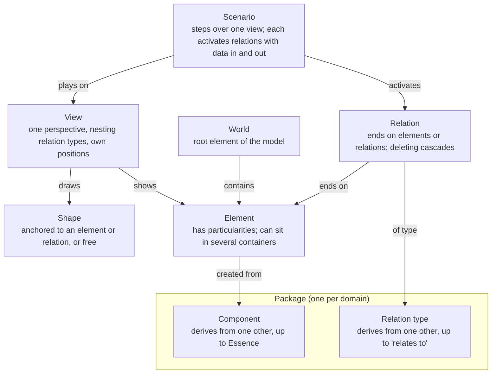
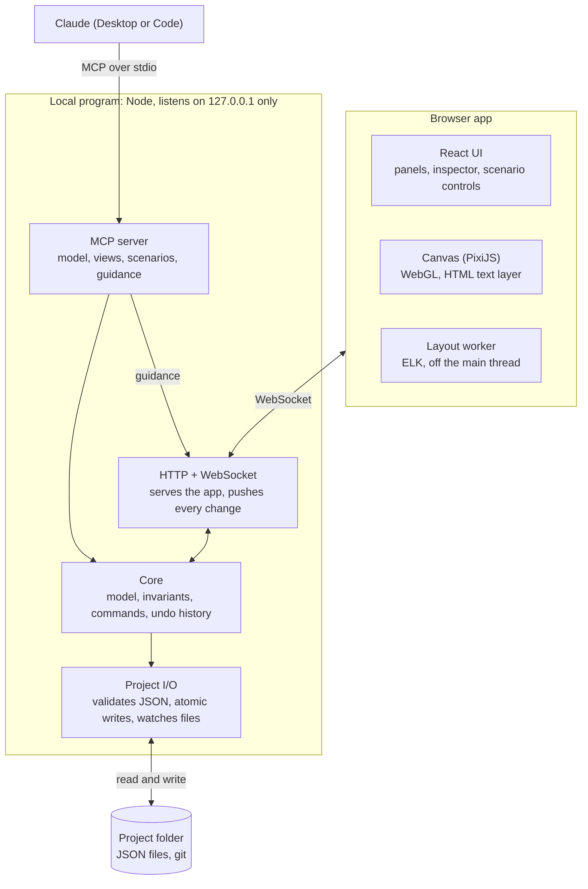

# Visual Anything v0.1 — Specification

Last updated 2026-10-23 · Ivan

> Exported from the Claude doc "Visual Anything v0.1 — Specification". Once this repository exists, this file is the source of truth: change it here, through pull requests.

v0.1 is a local-first workspace where you model one of your own systems, explore it across abstraction levels and perspectives, replay real scenarios over it step by step, and let Claude build and explain it through MCP. It validates case 1 (the architecture of a system you run), is built solo in TypeScript, and uses the terms in `CONTEXT.md` and the decisions in `docs/adr/`.

## Goals and success criteria

v0.1 is done when you can model one of your own systems end to end, read it at two abstraction levels, and replay a real request through it with Claude's help.

- [ ] One system you run is modeled with containers nested at least two levels deep, in two views with different perspectives.
- [ ] Collapsing a container shows aggregated relations, and focus mode isolates the relations of the selected element.
- [ ] A view with 10,000 elements pans, zooms and selects smoothly (target: 60 frames per second) on your laptop.
- [ ] Claude, through MCP, builds and edits the model and its views, turns a pasted log into a scenario, and guides you live.
- [ ] Every edit, yours or Claude's, undoes one action at a time, with Claude's actions labelled as such.
- [ ] Project files are plain JSON that diff cleanly in git and are validated when opened.

## Scope

v0.1 covers the model, views, layout, scenarios and Claude through MCP; anything that needs code from packages, the remaining dimensions or sharing waits.

| Capability | In v0.1 | Later |
| --- | --- | --- |
| Model | Elements, relations, attributes, particularities, World | — |
| Components and relation types | Built-in "Systems" package; new ones written in JSON, by hand or by Claude | Created from the canvas; programmable ones (case 4) |
| Views | One perspective each, nesting chosen per view, stacking order, collapse and expand, filters, focus mode | — |
| Layout | ELK automatic layout, pinned shapes, orthogonal routing | — |
| Free shapes | Note and arrow | More shapes |
| Scenarios | Record, play, data per step, simultaneous relations, aggregated steps | Import real traces through a package |
| Tours | — | v0.2, able to play scenarios |
| Claude through MCP | Model, views, declarative components, scenarios, live guidance | Writing programmable code, with approval |
| Time (model versions) | — | After v0.1 |
| Attribute space | — | Case 3 (transformer) |
| Physical space | — | Case 5 (robotic arm) |
| Live data from your systems | Claude refreshes the model through its other MCPs | Packages that request network permission |
| Export (image, PDF, shareable page) | — | After v0.1 |
| Collaboration | Git on the project files | No real-time editing |
| Platforms | Desktop browsers | Mobile out of scope |
| Embedded chat | — | Optional package |
| draw.io import | — | Not planned |

## Domain model

Everything in the model is typed: elements come from components and relations from relation types, both shared in packages; views and scenarios show and replay the model without changing it.



Rules the core enforces:

- Every element is created from exactly one component; every component derives from exactly one other, up to Essence.
- Every relation has a relation type; relation types derive up to "relates to". A relation's ends are elements or other relations.
- Deleting a relation also deletes the relations that end on it, after showing them.
- An element can have several containers, and containment can never form a cycle.
- Limits on what a relation type may connect only produce warnings.
- A view has exactly one perspective, chooses which nesting relation types arrange it and keeps its own positions; pinned shapes keep theirs through layout.
- A scenario plays over one view; each step activates one or more relations, and there are no branches.

## Architecture

v0.1 is one local Node program and a browser app. Every edit, from you or from Claude, becomes a command applied by a single core, so the rules are checked in one place and both kinds of edit share one undo history.



The browser and Claude never write files: both send commands to the core, which checks the rules, records each change in one undo history and saves it. Claude's live guidance goes straight to the open view without touching the model.

- **Local program** (Node, listening only on 127.0.0.1): serves the app, owns the model and its history, reads and writes the project folder, and exposes the MCP server.
- **Browser app** (React, PixiJS, ELK in a worker): renders the open view, turns your gestures into commands and shows Claude's live guidance. Drags and other continuous gestures update the canvas locally and send a single command when they end.
- **Claude** (Desktop or Code): connects through an MCP stdio entry point that attaches to the running local program, starting it if needed.
- **Core**: the same TypeScript package runs in both places, so a read-only demo can run in the browser alone.

This ownership is recorded in ADR 0016.

## Project files

A project is a folder of JSON files with Visual Anything's own extensions, validated against a published schema when opened and written with a stable key order so git diffs stay small.

```text
my-systems/
  project.vaproject          name, schema version, packages in use
  model.vamodel              World, elements, relations, attributes, particularities
  packages/
    systems.vapackage        components and relation types
  views/
    system-overview.vaview   perspective, nesting relation types, positions, pinned and free shapes
  scenarios/
    patient-books-appointment.vascenario   view, steps, relations per step, data in and out
```

- Ids are generated once and never reused; files refer to each other only by id.
- Positions and stacking orders live only in view files, so moving shapes or changing which is drawn in front never touches the model; dropping a shape into or out of a container changes its containment, which is part of the model.
- No file contains code that runs. Programmable code, after v0.1, lives in packages and runs sandboxed.
- Writes are atomic (a temporary file, then a rename), so a crash never leaves a half-written file. Changes made outside the app, such as a git pull, are reloaded with a notice.

## Canvas, views and layout

The canvas draws one view at a time with WebGL, and every layout decision is kept per view.

- **Shapes**: an anchored shape takes its look from its component (shape, icon, label, connection points), and particularities can change it for one element. Free shapes in v0.1: note and arrow.
- **Relations**: drawn with their relation type's style, orthogonal by default. They attach to connection points when the component defines them, otherwise to the border. A relation that ends on another relation attaches to the middle of that relation's line.
- **Abstraction**: containers expand and collapse; a collapsed container shows aggregated relations with a count and a thicker line. An element with several containers appears inside each one, and selecting one copy selects all of them.
- **Perspective**: fixed per view; the toolbar switches between views over the same part of the model.
- **Explore**: filters by component, relation type or attribute hide shapes without moving any; focus mode dims everything not connected to the selection; any relation can be followed to its other end.
- **Layout**: ELK runs in a worker for shapes without a position and on demand; pinned shapes are fixed inputs, and results animate in when ready.
- **Edit**: create from the component palette, directly in World, inside the selected container or next to the selected element, or inside any element from its menu; connect; move, putting shapes inside a container by dropping them on it and taking them out by dragging them clear of it (hold Alt to move only), or from the shape menu and the inspector; bring to front, bring forward, send backward and send to back; rename inline; edit attributes and particularities in the inspector; and delete with a preview of what cascades; undo and redo.
- **Text**: edited in an HTML layer placed over the shape, then drawn back on the canvas.

## Scenarios

A scenario replays a concrete example over one view, step by step, showing what moves where and what each step takes in and produces.

1. **Record**: start recording and click relations in order; shift-click adds another relation to the same step. Each step gets a short description and its data in and out (JSON) in the side panel.
2. **Or ask Claude**: describe the example or paste a real log. Claude maps it to elements and relations through MCP, builds the steps and asks when a line matches nothing in the model.
3. **Play**: play and pause, previous and next, speed. The active relations and their ends are highlighted, a marker travels along each relation, and the side panel shows the step.
4. **Read it at any level**: consecutive steps that happen entirely inside a collapsed container play as one aggregated step with a count; expanding the container mid-playback reveals them.

Playing never changes the model or the view's positions. Branches are left out by design: an alternative path is another scenario. If a relation that a step uses is deleted, the step is kept and marked broken so you can fix it.

## Claude through MCP

Through MCP, Claude can do everything you can do in v0.1, and each of its write calls is one undoable action labelled Claude in the history.

| Group | What Claude can do |
| --- | --- |
| Read | Summarize the project; query elements and relations by component, attribute or container; read a view, with its positions and the order it draws the shapes in each container, or a scenario |
| Model | Create, update and delete elements, relations, attributes and particularities; define components and relation types in JSON; put elements inside containers and take them out |
| Views | Create views; set the perspective, nesting relation types and stacking order; collapse, expand and filter; run layout |
| Guide (live) | Highlight, focus, pan to a shape, show a short caption and step through a scenario, while the app is open |
| Scenarios | Create a scenario from steps, from a description or from a log; play it |

- Claude's changes appear live in the open view.
- Guidance never changes the model; it only moves and marks the open view.
- Writing programmable code waits until after v0.1, and will need your approval before it runs.
- Tool descriptions include examples, because they are how Claude learns to use the tools well.

## Quality bar

These hold at every milestone, not only at the end.

- **Performance**: 10,000 elements in one view pan, zoom and select smoothly, with a 60 frames per second target; layout never blocks interaction.
- **Security**: project files never run code and are validated when opened. The local program listens only on 127.0.0.1, checks the origin of every request and requires a per-session token for the live connection, so other websites cannot drive it. The core has no network access.
- **Accessibility**: keyboard navigation between shapes and along relations, an outline panel that mirrors the view, sufficient contrast, and reduced motion during playback when the system asks for it.
- **Reliability**: atomic writes, reload on outside changes, and property tests for the core rules: undo exactly reverses every command, containment never forms a cycle, and deletes cascade as specified.

## Decisions settled while writing

Three choices came up while writing this spec; all three follow the recommendation below.

| Decision | Settled | Rejected alternative |
| --- | --- | --- |
| Who owns the model while editing | The local program owns the model and its history; the browser sends commands and renders what comes back (ADR 0016) | The browser owns it and the local program relays Claude's calls, so Claude can only edit while the app is open |
| File extensions | .vaproject, .vamodel, .vapackage, .vaview, .vascenario | Plain .json with a type field inside |
| Deleting a relation that a scenario uses | The delete preview lists the affected scenarios; their steps are marked broken, not deleted, so you can fix them | Delete those steps too |

## Milestones and tasks

Seven milestones in build order, each ending in something you can use; tasks are in order within each one.

**M0 · Skeleton.** Done when one command opens the browser on a sample project showing a static view.

- [x] Create the monorepo with pnpm workspaces: core, server, app, schema
- [x] Define the project file types and generate the JSON Schema from them
- [x] Local program: serve the app on 127.0.0.1, open the browser, load a project folder
- [x] App shell in React: header, model panel, canvas area, inspector
- [x] Continuous integration: type checks, lint, tests

**M1 · Model core.** Done when the core passes property tests for undo, cascades and containment cycles, and a project folder round-trips without changes.

- [x] Elements, components derived up to Essence, relations ending on elements or relations, relation types derived up to "relates to", particularities
- [x] Commands and history: every change is a command; undo and redo; each action labelled by author (you or Claude)
- [x] Rules: block containment cycles, warn on relation type limits, cascade deletes with a preview
- [x] Project I/O: validate on open, stable formatting, atomic writes, reload on outside changes
- [x] Built-in "Systems" package: Box, System, Service (Chat channel, AI agent, MCP server, Semantic layer), Database, Object storage, Person; relation types communicates with, writes to, reads from, queries, loads into, is part of

**M2 · Canvas.** Done when a synthetic view with 10,000 elements pans, zooms and selects at the 60 frames per second target.

- [x] PixiJS renderer: anchored shapes from their component's look, relations with orthogonal routes and arrowheads
- [x] Pan, zoom, select (click and box), move, connect, delete
- [x] Inline text editing in an HTML layer; inspector for attributes and particularities
- [x] Free shapes: note and arrow
- [x] Keyboard navigation and outline panel
- [x] Benchmark with a synthetic 10,000-element view
- [ ] Stacking order per view, drawn and pointed at in the same order; put shapes inside containers and take them out from the canvas, the shape menu and the inspector; create inside the selected container, next to the selected element, or inside any element

**M3 · Views and layout.** Done when you can collapse a container and read its aggregated relations, and switch between two perspectives of the same system.

- [ ] Views: perspective, nesting relation types, positions; view list and perspective switcher
- [ ] Nesting with several containers: one copy per container, selected together
- [ ] Collapse and expand with aggregated relations (count and line weight)
- [ ] Filters and focus mode
- [ ] ELK layout in a worker, pinned shapes as fixed inputs, re-layout on demand
- [ ] Connection points from components: relations attach to them, and ELK takes them as ports

**M4 · Claude through MCP.** Done when Claude builds a view of a system from a description, walks you through it live, and you can undo each of its actions.

- [ ] MCP stdio entry point that attaches to the running local program
- [ ] Read and query tools
- [ ] Write tools for the model, components and views: one undoable action per call, labelled Claude
- [ ] Live guidance over the WebSocket: highlight, focus, pan to, caption
- [ ] Tool descriptions written for Claude, with examples

**M5 · Scenarios.** Done when you paste a real log, Claude turns it into a scenario, and you play it at two abstraction levels.

- [ ] Scenario files: steps with one or more relations, description, data in and out
- [ ] Recording on the canvas: click in order, shift-click for simultaneous relations
- [ ] Playback: play and pause, step, speed, travelling marker, step panel
- [ ] Aggregated steps inside collapsed containers
- [ ] MCP tools: create from steps, a description or a log; play and step
- [ ] Broken steps when a relation they use is deleted

**M6 · Dogfooding and v0.1.** Done when your own system is modeled end to end, with two views and one real scenario, and every success criterion above holds.

- [ ] Model your system (case 1) together with Claude
- [ ] Fix what dogfooding surfaces
- [ ] README with setup for Claude Desktop and Claude Code
- [ ] Tag v0.1 in the private repository
