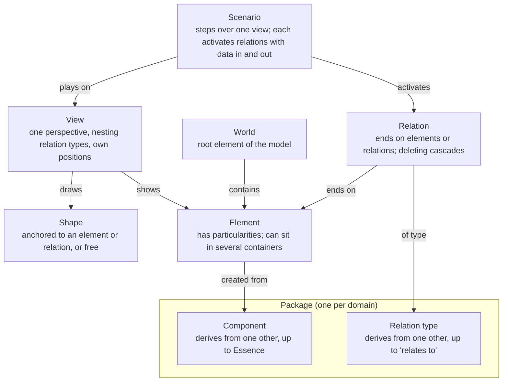
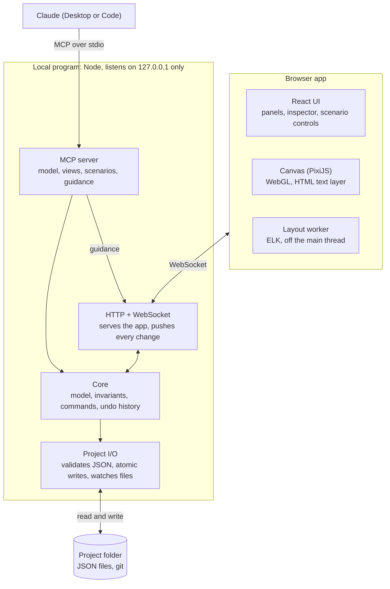

# Visual Anything v0.1 — Specification

Last updated 2026-10-24 · Ivan

> Exported from the Claude doc "Visual Anything v0.1 — Specification". Once this repository exists, this file is the source of truth: change it here, through pull requests.

v0.1 is a local-first tool where you model one of your own systems, explore it across abstraction levels and perspectives, play real scenarios over it step by step, and let Claude build and explain it through MCP. It validates case 1 (the architecture of a system you run), is built solo in TypeScript, and uses the terms in `CONTEXT.md` and the decisions in `docs/adr/`.

## Goals and success criteria

v0.1 is done when you can model one of your own systems end to end, read it at two abstraction levels, and play a real request through it with Claude's help.

- [x] One system you run is modeled with containers nested at least two levels deep, in two views with different perspectives.
- [x] Collapsing a container shows aggregated relations, and focus mode isolates the relations of the selected element.
- [x] A view with 10,000 elements pans, zooms and selects smoothly (target: 60 frames per second) on your laptop (done; the marks this laptop misses are recorded in `docs/designs/benchmark-3.md` and `benchmark-4.md` and, by the user's decision of 2026-10-27, do not hold it back).
- [x] Claude, through MCP, builds and edits the model and its views, turns a pasted log into a scenario, and guides you live.
- [x] Every edit, yours or Claude's, undoes one action at a time, with Claude's actions labelled as such.
- [x] Project files are plain JSON that diff cleanly in git and are validated when opened.

## Scope

v0.1 covers the model, views, layout, tables, the component editor, images, themes, scenarios and Claude through MCP; anything that needs code from packages, the remaining dimensions (3D included) or sharing waits, in the order of "After v0.1" below.

| Capability | In v0.1 | Later |
| --- | --- | --- |
| Model | Elements, relations, attributes, particularities, World | — |
| Components and relation types | Built-in "Systems" and "Data modeling" packages; your own, derived and changed in the component editor or written in JSON, by hand or by Claude | Programmable ones (case 4) |
| Tables | A component that draws what its elements hold as rows, as a table draws its columns; columns added on the canvas, typed or pasted | Importing many tables at once |
| Images | SVG pictures and small PNG, JPEG or WebP bitmaps kept in packages, shown on components and single elements as an icon or as the whole shape | Large photos kept as files; images as free shapes; SVG with named parts as shapes (M8b) |
| Languages | English and Spanish for everything the app shows, following the browser unless you choose (ADR 0038) | More languages |
| Themes | Light and dark for the app and the canvas, following the system unless you choose; kept by the local program for each person | More themes, such as high contrast |
| Appearance editing | Any #RRGGBB fill and stroke for elements, components and relation types (built-in ones through project appearances), one relation, notes and free arrows; from the inspector or by Claude | Transparency, gradients; colors that depend on an attribute's value |
| Grid and rulers | A grid that follows the zoom, rulers in canvas units, and snapping of hand moves to 8 canvas units; alignment guides, resize handles, and aligning, distributing and sizing alike the selection (ADR 0074) | Custom spacing, guides dragged from rulers |
| Views | One perspective each, nesting chosen per view, stacking order, collapse and expand, filters, focus mode | Semantic zoom declared as data (after v0.1) |
| Layout | ELK automatic layout, pinned shapes, orthogonal routing; routes chosen by hand, straight, orthogonal or curved | Curved routes drawn by layout (M8b) |
| Free shapes | Note and arrow | Free 2D geometry for shapes (M8b), and more free shapes |
| Scenarios | Record, play, data per step, simultaneous relations, aggregated steps | Import real traces through a package |
| Tours | — | Recorded guidance played full screen, with comments (M11, after v0.1) |
| Claude through MCP | Model, views, declarative components with their images, rows and connection points, appearances, scenarios, live guidance | Writing programmable code, with approval |
| Time (model versions) | — | Comparing versions between git commits, in the app and for pull requests (M11b) |
| Attribute space | — | Case 3 (transformer) |
| Physical space (3D) | — | Case 5 (robotic arm, human body): solids inside components first (M9, ADR 0075), then a physical-space panel linked to the 2D views (M10, ADR 0076) |
| Live data from your systems | Claude refreshes the model through its other MCPs | Packages that request network permission |
| Export (image, PDF, shareable page) | PNG of the open view | SVG, PDF, text, and a read-only page to share, embed and read on a phone (M6b) |
| HTML | — | Static HTML imported as a cleaned drawing (M8b, ADR 0068); HTML that runs only with a new ADR |
| Collaboration | Git on the project files | A merge driver that merges project files by id, and proposals to review Claude's changes (M11b); no real-time editing |
| Platforms | Windows, macOS and Linux: the local program as one executable for each (ADR 0037), or from npm, with the app in any desktop browser | Mobile reading through the read-only page (M6b); installers and updates (Track D) |
| Embedded chat | — | Optional package |
| Import | Claude builds models from Mermaid, draw.io, SQL, OpenAPI, Terraform, logs and more with its tools | Importers in the app for Mermaid, spreadsheets and JSON, Structurizr and LikeC4, and draw.io; starter packages per domain (M6c) |

## Domain model

Everything in the model is typed: elements come from components and relations from relation types, both shared in packages; views and scenarios show and play the model without changing it.



Rules the core enforces:

- Every element is created from exactly one component; every component derives from exactly one other, up to Essence.
- Every relation has a relation type; relation types derive up to "relates to". A relation's ends are elements or other relations.
- Deleting a relation also deletes the relations that end on it, after showing them.
- An element can have several containers, and containment can never form a cycle.
- Limits on what a relation type may connect only produce warnings.
- A view has exactly one perspective, chooses which nesting relation types arrange it and keeps its own positions; pinned shapes keep theirs through layout.
- A scenario plays over one view; each step activates one or more relations. In v0.1 there are no branches; decisions between labelled alternatives come with M11c (ADR 0078).

## Architecture

v0.1 is one local Node program and a browser app. Every edit, from you or from Claude, becomes a command applied by a single core, so the rules are checked in one place and both kinds of edit share one undo history.



The browser and Claude never write files: both send commands to the core, which checks the rules, records each change in one undo history and saves it. Claude's live guidance goes straight to the open view without touching the model.

- **Local program** (Node, listening only on 127.0.0.1): serves the app, owns the model and its history, reads and writes the project folder, keeps each person's preferences outside every project (ADR 0032), and exposes the MCP server.
- **Browser app** (React, PixiJS, ELK in a worker): renders the open view, turns your gestures into commands and shows Claude's live guidance. Drags and other continuous gestures update the canvas locally and send a single command when they end.
- **Claude** (Desktop or Code): connects through an MCP stdio entry point that attaches to the running local program, starting it if needed.
- **Core**: the same TypeScript package runs in both places, so a read-only demo can run in the browser alone.

This ownership is recorded in ADR 0016.

## Project files

A project is a folder of JSON files with Visual Anything's own extensions, validated against a published schema when opened and written with a stable key order so git diffs stay small.

```text
my-systems/
  project.vaproject          name, schema version, packages in use, project appearances
  model.vamodel              World, elements, relations, attributes, particularities
  packages/
    systems.vapackage        components and relation types
  views/
    system-overview.vaview   perspective, nesting relation types, positions, pinned and free shapes
  scenarios/
    patient-books-appointment.vascenario   view, steps, relations per step, data in and out
  tours/
    how-booking-works.vatour     steps, each a view state with a caption, marks and speaker notes
  comments/
    reminder-timing.vacomment    one thread: its anchor, whether resolved, and its comments
```

- Ids are generated once and never reused; files refer to each other only by id.
- Positions and stacking orders live only in view files, so moving shapes or changing which is drawn in front never touches the model; dropping a shape into or out of a container changes its containment, which is part of the model.
- No file contains code that runs. Programmable code, after v0.1, lives in packages and runs sandboxed.
- Writes are atomic (a temporary file, then a rename), so a crash never leaves a half-written file. Changes made outside the app, such as a git pull, are reloaded with a notice.
- Each kind of file is read within a size cap, such as 1 MiB for a thread of comments, and a change that would write a file past its cap is refused before anything is written, so that whatever is written opens again.
- A file that the merge driver merged may hold what clashed as conflicts, kept as data, and it still validates (M11b, ADR 0072).

## Canvas, views and layout

The canvas draws one view at a time with WebGL, and every layout decision is kept per view.

- **Shapes**: an anchored shape takes its look from its component (shape, icon, label, connection points), and particularities can change it for one element. Free shapes in v0.1: note and arrow.
- **Relations**: drawn with their relation type's style, orthogonal by default. They attach to connection points when the component defines them, otherwise to the border. A relation that ends on another relation attaches to the middle of that relation's line.
- **Abstraction**: containers expand and collapse; a collapsed container shows aggregated relations with a count and a thicker line. An element with several containers appears inside each one, and selecting one copy selects all of them.
- **Perspective**: fixed per view; the toolbar switches between views over the same part of the model.
- **Explore**: filters by component, relation type or attribute hide shapes without moving any; focus mode dims everything not connected to the selection; any relation can be followed to its other end.
- **Layout**: ELK runs in a worker for shapes without a position and on demand; pinned shapes are fixed inputs, and results animate in when ready.
- **Edit**: create from the component palette, directly in World, inside the selected container or next to the selected element, or inside any element from its menu; connect; move, putting shapes inside a container by dropping them on it and taking them out by dragging them clear of it (hold Alt to move only), or from the shape menu and the inspector; bring to front, bring forward, send backward and send to back; rename inline; edit attributes and particularities in the inspector; and delete with a preview of what cascades; undo and redo.
- **Text**: edited in an HTML layer placed over the shape, then drawn back on the canvas.
- **Themes**: the app and the canvas are drawn light or dark, following the system unless you choose, and change together; built-in colors have a shade for each theme, and every color you set is drawn as set in both (ADR 0033).

## Scenarios

A scenario plays a concrete example over one view, step by step, showing what moves where and what each step takes in and produces.

1. **Record**: start recording and click relations in order; shift-click adds another relation to the same step. Each step gets a short description and its data in and out (JSON) in the side panel.
2. **Or ask Claude**: describe the example or paste a real log. Claude maps it to elements and relations through MCP, builds the steps and asks when a line matches nothing in the model.
3. **Play**: play and pause, previous and next, speed. The active relations and their ends are highlighted, a marker travels along each relation, and the side panel shows the step.
4. **Read it at any level**: consecutive steps that happen entirely inside a collapsed container play as one aggregated step with a count; expanding the container mid-playback reveals them.

Playing never changes the model or the view's positions. Branches are left out by design: an alternative path is another scenario. If a relation that a step uses is deleted, the step is kept and marked broken so you can fix it.

## Claude through MCP

Through MCP, Claude can do everything you can do in v0.1, and each of its write calls is one undoable action labelled Claude in the history.

| Group | What Claude can do |
| --- | --- |
| Read | Summarize the project; query elements and relations by component, attribute or container; read a view, with its positions and the order it draws the shapes in each container, or a scenario |
| Model | Create, update and delete elements, relations, attributes and particularities; define components and relation types in JSON; put elements inside containers and take them out |
| Views | Create views; set the perspective, nesting relation types and stacking order; collapse, expand and filter; run layout |
| Guide (live) | Highlight, focus, pan to a shape, show a short caption and step through a scenario, while the app is open |
| Scenarios | Create a scenario from steps, from a description or from a log; play it |

- Claude's changes appear live in the open view.
- Guidance never changes the model; it only moves and marks the open view. Run layout is asked of the open app, which lays the view out in its worker and records the layout as it records any layout (ADR 0029).
- Writing programmable code waits until after v0.1, and will need your approval before it runs.
- Tool descriptions include examples, because they are how Claude learns to use the tools well.
- Preferences, such as the theme, are each person's own: Claude's tools neither read nor change them, except that `read_package_code` says whether the person approved a package's code and which capabilities they granted it (ADR 0060); "everything you can do" means everything you can do to the project.

## Quality bar

These hold at every milestone, not only at the end.

- **Performance**: 10,000 elements in one view pan, zoom and select smoothly, with a 60 frames per second target; a theme switch never stalls a frame; layout never blocks interaction.
- **Security**: project files never run code and are validated when opened. The local program listens only on 127.0.0.1, checks the origin of every request and requires a per-session token for the live connection, so other websites cannot drive it. The core has no network access.
- **Accessibility**: keyboard navigation between shapes and along relations, an outline panel that mirrors the view, contrast in both themes of 4.5:1 for text and 3:1 for lines, marks, control boundaries and focus rings, and reduced motion for every animation when the system asks for it.
- **Reliability**: atomic writes, reload on outside changes, and property tests for the core rules: undo exactly reverses every command, containment never forms a cycle, and deletes cascade as specified.

## Decisions settled while writing

Three choices came up while writing this spec, and three more when its scope grew on 2026-10-23; all six follow the recommendation below.

| Decision | Settled | Rejected alternative |
| --- | --- | --- |
| What v0.1 takes of the scope added on 2026-10-23 | Stacking order, putting shapes inside containers and the shape menu in M2; tables and appearance traits in M3; the component editor and images in a new M3b; themes, colors and the grid in Track A beside the milestones | v0.1 as planned plus tables, with the editor and images moved to v0.2 |
| How 3D comes in | After v0.1, once shapes can have free 2D geometry: first solids drawn inside components (M9, ADR 0075), then a physical-space panel linked to the 2D views (M10), under ADR 0076, which supersedes ADR 0003 | A switch between 2D and 3D for each view, which ADR 0003 rejected: text and relations read worse in 3D |
| HTML | Static HTML enters as a drawing, cleaned and turned into SVG, after v0.1 | Storing HTML with scripts, which is code that runs |
| Who owns the model while editing | The local program owns the model and its history; the browser sends commands and renders what comes back (ADR 0016) | The browser owns it and the local program relays Claude's calls, so Claude can only edit while the app is open |
| File extensions | .vaproject, .vamodel, .vapackage, .vaview, .vascenario | Plain .json with a type field inside |
| Deleting a relation that a scenario uses | The delete preview lists the affected scenarios; their steps are marked broken, not deleted, so you can fix them | Delete those steps too |

## Milestones and tasks

Eight milestones in build order, each ending in something you can use, and Track A beside them; tasks are in order within each one.

**M0 · Skeleton.** Done when one command opens the browser on a sample project showing a static view.

- [x] Create the monorepo with pnpm workspaces: core, server, app, schema
- [x] Define the project file types and generate the JSON Schema from them
- [x] Local program: serve the app on 127.0.0.1, open the browser, load a project folder
- [x] App shell in React: header, model panel, canvas area, inspector
- [x] Continuous integration: type checks, lint, tests

**M1 · Model core.** Done when the core passes property tests for undo, cascades and containment cycles, and a project folder round-trips without changes.

- [x] Elements, components derived up to Essence, relations ending on elements or relations, relation types derived up to "relates to", particularities
- [x] Commands and history: every change is a command; undo and redo; each action labelled by author (you or Claude)
- [x] Rules: block containment cycles, warn on relation type limits, cascade deletes with a preview
- [x] Project I/O: validate on open, stable formatting, atomic writes, reload on outside changes
- [x] Built-in "Systems" package: Box, System, Service (Chat channel, AI agent, MCP server, Semantic layer), Database, Object storage, Person; relation types communicates with, writes to, reads from, queries, loads into, is part of

**M2 · Canvas.** Done when a synthetic view with 10,000 elements pans, zooms and selects at the 60 frames per second target.

- [x] PixiJS renderer: anchored shapes from their component's look, relations with orthogonal routes and arrowheads
- [x] Pan, zoom, select (click and box), move, connect, delete
- [x] Inline text editing in an HTML layer; inspector for attributes and particularities
- [x] Free shapes: note and arrow
- [x] Keyboard navigation and outline panel
- [x] Benchmark with a synthetic 10,000-element view
- [x] Stacking order per view, drawn and pointed at in the same order; put shapes inside containers and take them out from the canvas, the shape menu and the inspector; create inside the selected container, next to the selected element, or inside any element

**M3 · Views, layout and tables.** Done when you can collapse a container and read its aggregated relations; you can switch between two perspectives of the same system; you can model the sample's appointments and patients as tables inside the Appointments DB, one by adding its columns on the canvas and one by pasting its `CREATE TABLE`, with the reference between them attached at the rows it joins, before and after layout and after collapsing a table; and the tables benchmark meets the 60 frames per second target, while applying one edit at 10,000 elements takes at most 50 ms and a layout at most 150 ms.

- [x] Project files read only as regular files within size caps; a launch address that works once
- [x] Scene and renderer within budget: a per-element cache and incremental scenes for position-only and same-size actions, checked against a full build by a property test; rows in bands; benchmark phases for one column and one layout (done; the marks this laptop misses are recorded in `docs/designs/benchmark-3.md` and, by the user's decision of 2026-10-27, do not hold it back)
- [x] Appearance traits in the schema and core: detail and badges, connection points, contents drawn as rows, attribute choices and units, limits that lift with "any"; the core checks every value a command sets; newer formats refused with a clear message
- [x] Commands: components, relation types and packages changed trait by trait; elements reordered; definitions created only once, with ids the program makes
- [x] Built-in "Data modeling" package: Table, Column, is column of, references; reserved package ids; the nesting relation type chosen by its limits
- [x] Views: perspective, nesting relation types, positions; view list and perspective switcher
- [x] Nesting with several containers: one copy per container, selected together
- [x] Collapse and expand with aggregated relations (count and line weight), also for what a row holds
- [x] Filters and focus mode, by degrees and by direction, with isolating the selection
- [x] ELK layout in a worker, pinned shapes as fixed inputs, re-layout on demand; each table as one block with a connection point for each related row
- [x] Connection points from components, in a format that leaves room for free geometry: relations attach to them, and ELK takes them as ports
- [x] Relations routed by hand, per view, as in draw.io: each end attached to a connection point or to any point of a shape's border, chosen by dragging it; bend points added, moved and removed; orthogonal segments dragged; straight, orthogonal or curved; Reset route goes back to the automatic route (done; the marks this laptop misses are recorded in `docs/designs/benchmark-3.md` and, by the user's decision of 2026-10-27, do not hold it back)
- [x] Tables on the canvas: rows, relations to rows, drawing within the budget; columns added on the canvas, typed or pasted; the tables benchmark (done; the marks this laptop misses are recorded in `docs/designs/benchmark-3.md` and, by the user's decision of 2026-10-27, do not hold it back)

**M3b · Component editor and images.** Done when you derive a component from a built-in one in the component editor, change its shape, colors, detail and attributes, give it an SVG icon from a file, give one element a PNG of its own and another element a picture already in the project, and undo each step one at a time; an SVG holding a script or an outside reference is cleaned before it is saved and never runs; the built app shows no content security policy violation; and a view of 10,000 elements with tables and images still pans, zooms and selects at the 60 frames per second target. It runs after M3, and can run beside M4 in a second session.

- [x] Images in the schema and core: package images, the SVG and bitmap cleaner and its cleaned view, checks on open, the history's size budget
- [x] The page's content security policy with Trusted Types, worker policies, a payload limit on the live connection, and dev mode's guard on project files
- [x] The component editor in the inspector and the Components tab: derive, define, change and remove your own components, relation types and packages, showing what each one inherits
- [x] Images on the canvas within the frame budget, and in the inspector and the component editor (done; the marks this laptop misses are recorded in `docs/designs/benchmark-3.md` and, by the user's decision of 2026-10-27, do not hold it back)
- [x] Benchmark with images (done; the marks this laptop misses are recorded in `docs/designs/benchmark-3.md` and, by the user's decision of 2026-10-27, do not hold it back)
- [x] MCP tools for images, once M4's entry point exists

**M4 · Claude through MCP.** Done when Claude builds a view of a system from a description, walks you through it live, and you can undo each of its actions.

- [x] MCP stdio entry point that attaches to the running local program through an endpoint and a credential of its own, which accept only the messages Claude may send
- [x] Read and query tools
- [x] Write tools for the model, components and views (components, relation types and packages trait by trait, rows, tables and appearances included): one undoable action per call, labelled Claude
- [x] Live guidance over the WebSocket: highlight, focus, pan to, caption
- [x] Tool descriptions written for Claude, with examples

**M5 · Scenarios.** Done when you paste a real log, Claude turns it into a scenario, and you play it at two abstraction levels.

- [x] Scenario files: steps with one or more relations, description, data in and out
- [x] Recording on the canvas: click in order, shift-click for simultaneous relations
- [x] Playback: play and pause, step, speed, travelling marker, step panel
- [x] Aggregated steps inside collapsed containers
- [x] MCP tools: create from steps, a description or a log; play and step
- [x] Broken steps when a relation they use is deleted

**M6 · Dogfooding and v0.1.** Done when your own system is modeled end to end, with two views and one real scenario, and every success criterion above holds.

- [x] Model your system (case 1) together with Claude: `examples/visual-anything` models Visual Anything itself, built only through Claude's MCP tools and the app, with two views, Structure and A command's path, the scenario "A shape moves" from `logs/a-shape-moves.log`, and a tour
- [x] Search and jump: a find field (Ctrl+F) over names, ids, components and attribute values, results grouped by view, Enter selects and shows
- [x] View addresses built on one view state (view, camera, selection, filters, focus, scenario step), kept in the address's fragment, with Copy address
- [x] A view address opens in a new tab of the browser that has the project open, which joins its session (ADR 0043); `visual-anything open --view` and Claude's `open_app` open a tab at a view state in the program that runs, and `get_view_address` answers the full address (ADR 0044); the canvas toolbar keeps one row, with what does not fit under More
- [x] PNG export of the open view or the whole view, at 1× or 2×, in the current theme
- [x] A history panel: each action's label, author (you or Claude) and time, and Undo to here
- [x] Recipes for Claude to build models, views and scenarios from what exists (Mermaid, PlantUML, draw.io, Structurizr, SQL, OpenAPI, Terraform, Kubernetes, docker-compose, a repository, logs and traces) with its tools, as MCP prompts (`build_from_…`)
- [x] Fix what dogfooding surfaces. Modeling Visual Anything with itself (W46) found:
  - [x] Ids made from names split a word at an apostrophe (`claude-s-messages`, `a-command-s-path.vaview`); they keep it whole now (ADR 0019)
  - [x] `set_scope` did not say how to show only elements picked by hand: `added` alone shows the whole model; it now says to exclude Essence and add them (ADR 0040)
  - [x] The log a sample's scenario comes from is kept beside it in `logs/`, which `.gitignore`'s `*.log` left out (ADR 0019)
  - [x] Placing new shapes inside a container never moves the shapes beside it, so a container that grows with what Claude adds covers its neighbours until the whole view is laid out (ADR 0015 moves only new shapes); the placement moves the unpinned ones aside now, right or down, past the pinned ones (ADR 0015's clarification of W48)
  - [x] Placing what Claude adds is recorded as the person's action (`Lay out 22 new shapes`, by you), also after `change_container` without places: one change of Claude's takes two undos, and the history shows layouts nobody asked for; the placement joins the action that added the shapes now (ADR 0065)
  - [x] The canvas's routes do not go around the shapes between their ends, so in nested views lines cross other shapes and their names; an automatic orthogonal route now goes around the shapes and name plates in its way inside the container that holds both its ends, routed in a worker and again only where a change touches it, and the SVG and PDF route at once (ADR 0039)
  - [x] A view cannot leave out relation types: a Structure view of a code base draws every call and connection between its parts, which only filters, never kept with the view, hide; a view's `relationTypesLeftOut` leaves them out now, set beside the scope and by Claude's `leave_out_relation_types` (ADR 0064)
  - [x] Below about 60%, straight edges thinner than a pixel vanish and only rounded corners draw, so a shape inside a container of the same fill disappears; every outline is now at least a device pixel wide at any zoom, and a shape in a container is outlined in a color that reads on its fill when its stroke does not (ADR 0014, ADR 0033)
  - [x] Fit can choose a zoom at which no names draw (17% for 84 shapes), and `lay_out_view` leaves the camera where it was, so the person may see blank boxes or empty canvas; Fit keeps to the zoom names draw from and shows the view from its top left when the whole would draw none (ADR 0055), and the app fits what `lay_out_view` laid out (ADR 0029)
  - [x] Playback and `go_to_step` never bring the step played into view, so a step off screen plays unseen; a step's relations now come into view with a tour's capped, eased move, unless the person moved the camera during playback (ADR 0031)
  - [x] Guidance that names a view switches every open tab to it, and a tab switched so keeps the camera of the view it showed; it shows another view only in the tab the person used last, or the tab Claude opened, and a tab switched to a view takes the camera it last showed it at, or fits it (ADR 0029)
  - [x] The canvas's keys, such as Alt+− to collapse, do nothing while focus is in the outline, and the outline offers no collapse; Alt+− and Alt++ on a row, and the row's menu, collapse and expand its container or the selection's (ADR 0024)
  - [x] The program writes nothing per action, so the log of a command's path had to come from the browser's WebSocket frames; a `--log` option writing one line per action would make one to paste; `--log <file>` does now (ADR 0016's clarification)
  - [x] `define_component` and `update_component` warn about no color, as `set_appearance` does about a fill that fades into the light canvas; they give its warnings now, and so do `define_relation_type` and `update_relation_type` (ADR 0029's clarification of W48)
  - [x] A collapsed container's count is cut off at its component's size (`Code package…`); it has a line of its own under the detail when the header has room, and comes first on the detail's line when not, on the canvas and in the SVG
  - [x] The header wraps to two rows when the view's name and the Undo label are long, which moves the canvas down while you work (A4); it keeps one row now, the view's and the project's names and the action Undo and Redo name cut with "…", whole in their tooltips and to screen readers
- [x] README with setup for Claude Desktop and Claude Code
- [ ] Tag v0.1 in the private repository

**M6b · Out.** It is planned here so that it can run beside M6c, in the first wave after v0.1. Done when:

- the open view exports as SVG and as PDF from the app and from the command line, and each matches the canvas: the scene's bounds, its ids as `data-` attributes, and the view's name and description as title and description;
- the outline exports as Markdown, the view as Mermaid, and a view of Systems components as Structurizr DSL, each saying what it lost;
- Export → Read-only page writes one file that opens offline in a desktop browser and on a phone, shows every view, plays every scenario and follows view addresses;
- the page holds no token and connects nowhere, which a test checks against its policy (ADR 0041);
- the page opens the 10,000-element benchmark view within the frame budget on the reference laptop.

- [x] An SVG writer from the scene, in pure TypeScript without the DOM: shapes, rows, routes and curves, labels, cleaned images, title, description and `data-` ids; a test compares its bounds with the scene's (a dated clarification of ADR 0014: an output, not a second renderer)
- [x] PDF made from that SVG, with its fonts embedded; the library is chosen and recorded in the same clarification
- [x] `visual-anything export <folder> --view <id> --format svg|pdf|md|mermaid|structurizr|page [--out <file>]` (with `--theme light|dark`; for `page`, `--view` is the view the page opens at, the first by default)
- [x] Text exports: the outline in Markdown, which also serves as the view's long description; Mermaid, through each element's first container; Structurizr DSL for views of Systems components
- [x] The read-only page (ADR 0041): a viewer build without the live connection, the commands or the editors; the project as data; its policy; touch; view addresses; the About panel with the packages' attribution
- [x] The Export dialog: PNG, SVG, PDF, text and the page, each with its size and what it leaves out
- [x] Claude's `export_view`, which answers SVG, Markdown, Mermaid or Structurizr text and writes no file
- [ ] Benchmark: the page's size and how long it takes to open at 10,000 elements; how long the SVG takes to write (the exports' phase, `exports-bench.html`, is in, not yet run)

**M6c · In.** Planned beside M6b; scopes go first, since every importer and every starter package needs them. Done when:

- a view can show part of the model through its scope (ADR 0040), set from the app and by Claude, with the core's property tests for it;
- each of these imports through the mapping dialog as one undoable action that reports what matched nothing (ADR 0042):
  - a Mermaid flowchart;
  - a CSV of elements and relations;
  - a Structurizr workspace in JSON;
  - a draw.io file;
- the hostile-input tests pass;
- the C4 and data-science starter packages ship with icons whose licenses pass the license test (ADR 0047), each with a sample project and a scenario, and New project from a sample starts from them;
- a package can be added from another project.

- [x] Scopes in the schema and the core, test-first with property tests (ADR 0040): the rules, `added` and `leftOut`, the commands `set-scope`, `add-to-view` and `leave-out-of-view`, and new elements added to the scope of the view they were made in
- [x] Scopes on the canvas:
  - the scene, layout, aggregation, search and the perspective switcher follow the scope;
  - playback marks steps outside the view;
  - the inspector edits the scope;
  - the canvas and the outline offer Add to this view and Leave out of this view;
  - shapes count the relations that leave the view
- [x] Claude's tools to read and set a scope, and to add to a view or leave out of it
- [x] The import pipeline (ADR 0042): the plan, the mapping dialog, one batch, the report; Import… in the header, `visual-anything import <folder> <file>`, and Claude's `import_file`
- [x] The Mermaid reader: flowcharts, C4, ER and class diagrams
- [x] The spreadsheet (CSV and TSV) and JSON readers, importing again by a key
- [x] The Structurizr workspace JSON and LikeC4 model readers, with their views as scopes
- [x] The draw.io reader: compressed and plain files, `.drawio.svg` and `.drawio.png`, shapes, containers, edges with their waypoints, and pages as views
- [x] License fields in the schema, and the license test (ADR 0047)
- [x] Starter packages for C4 architecture and data-science pipelines, each with icons, a sample project and a scenario, in English and Spanish; New project from a sample
- [x] A package added from another project, with its version and attribution, and updated from it after a preview
- [x] A command's draft keeps the model's index up to date, so that a batch of N creates is no longer quadratic: 10,000 elements with their shapes and relations land in about 1 s (ADR 0042)
- [x] Planned relations carry their description, and importing again updates the values of a relation the project already has
- [ ] An import at the limits lands in fewer operations, as commands do past `BULK` changes to one list (about 26 s on a loaded machine now)

**M7 · Package code.** It is planned here so that it can run in the second wave after v0.1. Done when:

- a package's code computes attributes, checks elements and draws inside shapes through its three hooks, in QuickJS inside WebAssembly in a worker (ADR 0054);
- it runs only after you approve it by its hash, and any change to it asks again;
- a call past 50 ms or 32 MiB stops without stalling a frame;
- the hostile-code tests pass: loops, allocation bombs, reaching for `globalThis`, `fetch`, the page or another package;
- Claude can read, write and run a package's code after your approval.

- [x] `PackageFile.code` and `capabilities` in the schema, and the hooks' types and the checks of their answers in the core, test-first
- [x] The worker: one QuickJS runtime per package, the limits, the messages, turning a failing package off
- [x] Approval by hash and by capability, kept in your preferences; the approval dialog; computed values marked as computed
- [ ] `draw` answers drawn inside shapes through the declarative drawing format, within the frame budget
- [x] Claude's tools for package code, approved in the app
- [x] A sample package with code (a unit converter that computes an attribute, a check, and a gauge drawn inside its shape)

**M8 · Detail and data.** Planned beside M7 and M11. Done when:

- a view colors, sizes, marks and fades shapes by an attribute through its overlays, with a legend, also in every export (ADR 0055);
- appearances declare levels of detail by scale, without flicker, and zooming far into a collapsed container can expand it;
- elements carry external identifiers that search and importers use, and destination attributes open a view, another project or a web address after a confirmation (ADR 0056);
- live values from Claude, the command line and approved package code show with their mark and age, and are never saved (ADR 0057);
- an element list edits a component's or a scope's elements in bulk, and a pasted block of cells is one action;
- a time range on an attribute filters and plays;
- the reading benchmark of 100,000 elements and 200,000 relations meets its marks.

- [x] Overlays in the schema and the core (discrete, continuous and passthrough mappings to fill, stroke, size, badge and opacity), with their commands; the scene applies them; the legend on the canvas and in exports; Claude's tools
- [x] Levels of detail in appearances, with their inheritance and hysteresis; the renderer switches levels by tile; expanding and collapsing by zoom
- [x] External identifiers in the schema; search by identifier; crosswalk tables for importers
- [x] The destination attribute type: the mark, following it, the confirmation, opening another project at a view state through its own program, and the checks on opening
- [x] Live values: protocol version 6, the program's store and limits, the app's lookup with marks and age, Keep as attribute, `set_live_values` and `visual-anything live`; package code granted an origin fetches through the program (ADR 0063)
- [x] The element list: a panel of elements by component or by scope, with attributes as columns, sorting, filters, editing in place, a pasted block of cells as one action, and selection in step with the canvas
- [x] Time ranges: a range filter on a date, time or number attribute, with a slider and playback, kept by the app as filters are (ADR 0025)
- [x] Overlays and the element list read through the attribute lookup, live and computed values over stored ones; the view state carries the time range, in view addresses, `open_app` and tour steps; a live update keeps a running layout animation (ADR 0057, ADR 0044, ADR 0058)
- [ ] A live update of 1,000 values on a 10,000-element view within a frame, judged by the benchmark's `?live` phase in the browser (ADR 0057)
- [x] Claude reads live values with their sender and age (W45), and `filter_view` sets a time range (W48) (ADR 0057)
- [ ] The reading benchmark: 100,000 elements and 200,000 relations opened with containers collapsed; 60 fps while fewer than 10,000 shapes show; expanding a container of 1,000 under 100 ms; a search under 50 ms; drawing many instances at once when zoomed out, and layout only for what is open

**M11 · Tours and comments.** Planned beside M7 and M8, moved ahead of M9. Done when:

- a tour is made in the app or by Claude, one step at a time from view states, saved as a `.vatour` file, and played full screen with captions, marks, scenarios and speaker notes, by keys, with short eased moves and cuts under reduced motion (ADR 0058);
- it plays in the read-only page too;
- comment threads anchored to elements, relations, views or points are kept as `.vacomment` files, one thread per file, shown as pins and in a panel, answered by Claude, and resolved (ADR 0059).

- [x] Tour files in the schema and the loader; tour commands in the core, test-first, steps naming deleted things kept and flagged
- [x] The tours panel: Add step from the view state, captions and marks edited in place, steps reordered
- [x] Full-screen playback: the caption card, the progress line, keys, the camera's capped and eased moves, speaker notes in a second window, and tours in the read-only page
- [x] Claude's tools for tours, and `play_tour`, which plays one full screen in the open app (W45)
- [x] Comment files in the schema and the loader; comment commands in the core, test-first, threads whose anchor is deleted kept as detached (the file kind, the loader, the watcher and the writer are in)
- [x] Pins on the canvas and the comments panel, with filters; authors from your preferences
- [x] Claude's tools for comments, and working through the open ones

**M8b · Beyond boxes.** Planned in the third wave, beside M11b. Its three seams, in the schema, the core and the scene, go first and in order, since every other task draws, points at, routes, lays out or exports what they define; the next eight tasks then run in parallel, and the benchmark is measured once they are merged. Done when:

- a component's appearance, or one element's own, gives its shapes free geometry (ADR 0066):
  - SVG path data with lines, Bézier curves and arcs, polygons and ellipses, holes included;
  - set from the component editor, from path data, an SVG file or a named part, and by Claude, each change one undoable action;
  - drawn by the canvas at every zoom, far out as its simplified outline and never as its box;
- pointing, hovering, selecting and dropping go by the outline: a point in a hole, or beside the outline inside its box, finds what lies behind, which the hit tests check against the outline to within a quarter of a canvas unit;
- relations attach on the outline, at a connection point carried in from its side or where the line toward the other end last leaves the outline; orthogonal routes stay orthogonal as they meet it, and ELK lays such shapes out by their boxes and ports;
- an SVG image's named parts are listed with previews, and Anchor parts… anchors the contents of a drawing with parts to them, in one action, from the app and by Claude (ADR 0067):
  - by name, by id, or by an external identifier through a crosswalk;
  - creating an element for each part that matches nothing, when asked;
- each anchored part is drawn in its place over its picture, and is selected, hovered, focused, filtered, colored by overlays, related, played through and listed in the outline as its element's shape; drawn outside a drawing with parts, it keeps its part's outline and picture;
- replacing the picture keeps the anchors of the parts it still has; before it applies, it says which anchored parts it loses, which then warn `unknown-part`, and an undo brings them back;
- a static HTML file becomes an imported drawing shown by an element, in one undoable action with a report of what it dropped (ADR 0068):
  - from Import…, from `visual-anything import` and from Claude's `import_drawing`;
  - the hostile-input tests show that scripts, handlers, frames, forms, styles that load and addresses are dropped, that nothing runs and that nothing is fetched;
  - the bundle tests show that neither the app's page nor the read-only page holds the converter;
- a relation type, a relation and a view can draw their automatic routes straight or curved, as every layout and every later move then draw them, while routes chosen by hand keep their ends, bend points and style (ADR 0069);
- the SVG and PDF exports and the read-only page draw free geometry, drawings with parts and automatic curves as the canvas does, and the SVG test compares their bounds with the scene's;
- the performance budget holds: the beyond-boxes benchmark (`?geometry`, alone and with `?curves`) meets these marks on the reference laptop: (measured once on 2026-10-27, `docs/designs/benchmark-4.md`: pointing and the pictures' memory meet their marks; the frames, the drop and the theme switch miss theirs, which the user decided that day not to hold M8b for, the laptop being slow; they are a follow-up below)
  - pan, zoom and select at the 60 frames per second target, on 10,000 elements of which:
    - 2,000 have free geometry, in 20 distinct geometries, 4 of them at the caps;
    - 1,000 are anchored parts in 20 drawings with parts, 2 of whose pictures are at the cap on parts;
    - 2,000 relations attach on outlines, 1,000 of them curved automatically;
  - a pointer moving over outlines finds what is under it within 1 ms at the 95th percentile;
  - moving a shape with free geometry and 50 relations is applied within the 50 ms an edit may take;
  - its theme switch keeps A1's rule (every frame within 33 ms and 95% within 16.7 ms), and its runs with the image store cleared hold the 60 frames per second target, as M3b's images benchmark does.

- [x] **Seam 1, in the main session: free geometry and route styles in the schema and the core**, test-first with property tests (ADR 0066, ADR 0069).
  - **Schema:**
    - `Appearance.geometry` (`FreeGeometry`: `width`, `height`, `outline` of `path`, `polygon` and `ellipse` contours, `keepProportions` and `label`) and `Appearance.part` (`PartReference`: `part` and an optional `image`), each also `none`;
    - `AppearanceImage.placement` gains `parts`, `RelationAppearance` gains `route`, `ViewFile` gains `routeStyle`, and `RelationRoute.style` gains `orthogonal`;
    - the schemas regenerated, and `PROTOCOL_VERSION` 7.
  - **Resolution and commands:**
    - resolution and inheritance, project appearances included;
    - `automaticRouteStyleOf(project, view, relation)`, which `set-route` compares with to keep only what differs;
    - `update-view` and the appearance commands carry the new keys.
  - **The outline maths,** `core/src/geometry/`:
    - the strict path reader, `GEOMETRY_CAPS`, and `readGeometry` into the normalized `Outline`: fills, holes and stroked lines, made of moves, lines and cubics;
    - `fitOutline` to a rectangle, and on a fitted outline `outlineHolds`, `outlineExit`, `outlinePlace` (a side and a place carried in), `outlineInnerPoint`, `outlineLabelArea`, `flattenOutline`, `simplifyOutline` and `outlinePathData`, cached by outline and size.
  - **Checks:** the codes `invalid-geometry`, `geometry-too-large` and `large-geometry`, refused by commands and warned on open.
  - **Property tests:**
    - a point is held exactly when a much finer reference flattening holds it, to within 0.25 units;
    - a last exit lies on the outline, and no later point of its ray is inside;
    - reading normalized path data again gives the same outline.
- [x] **Seam 2, in the main session: named parts in the core** (ADR 0067).
  - `core/src/images/parts.ts`, with `partsOf`, `partPicture`, `geometryOf` and `PART_CAPS`, read from the cleaned view and cached by it.
  - `unknown-part` and `too-many-parts` after every action and on open, and `in-use` for an image that a `part` names.
  - The anchored parts a replacement would lose, in its preview: `partsLostByReplacing`, which the replace dialog and `replace_image` call.
  - Property tests:
    - every part's picture is exactly what `cleanSvg` gives for it;
    - parts come in document order, with their transforms applied;
    - ADR 0027's attack corpus goes through parts too.
- [x] **Seam 3, in the main session: the scene's seam**, which the parallel tasks use as it is.
  - `ElementShape.outline`: the fitted outline of its free geometry or of its part.
  - `ElementShape.part`: `{ image, part, color, inDrawing }`.
  - `ElementShape.picture`: where a drawing with parts draws its picture.
  - Anchored parts placed in their drawings, without positions of their own, and a drawing's other contents below its picture.
  - `RelationLine.style` on every line, automatic ones included.
  - `outlines.ts`'s `shapeHolds(shape, point)` and `shapeBorderPoint(shape, inside, toward)`, and `draw.ts`'s `drawOutline(graphics, outline, colors)`, over the core's outline maths. They sit beside the outlines rather than in `geometry.ts`, which the layout worker loads, so that the worker never loads the core.
  - Automatic straight and curved lines, routed as routes chosen by hand without bend points are, and side by side as automatic lines are; the routing task carries their ends onto outlines.
  - The incremental scene keeps outlines and parts across moves and recolors, which its property test checks against a full build.
- [x] **Free geometry on the canvas** (ADR 0066):
  - tiles' plain and full drawings of outlines, holes cut;
  - silhouettes and plain blocks drawn as simplified outlines, and collapsed containers' sheets;
  - names in the label area, or else whole in a name tag hung under the shape and part of it (ADR 0066's clarification of 2026-10-27), or beside a shape that writes it nowhere, in the hover and selection marks, and icons;
  - hit testing, box selection and drop targets by the outline, and hover and selection marks along it.
- [x] **Routes on outlines, and automatic curves** (ADR 0066, ADR 0069):
  - automatic ends at the last exit, orthogonal ends carried on to the outline, and connection points and border attachments carried in;
  - automatic straight and curved routes, fanned apart as parallel lines are;
  - route handles and dragged ends on outlines (ADR 0039's clarification);
  - layout's ports for free geometry, and each drawing with parts as one block with a port for each related part (ADR 0015's clarification).
- [x] **Anchored parts on the canvas** (ADR 0067):
  - drawings with parts drawn as their picture under their header;
  - what is drawn over parts: veils, and overlays' fills, strokes and badges;
  - parts' own pictures, through the image store, for parts drawn at full strength in a faint drawing; parts far out;
  - pressing and dragging; keyboard navigation and the outline in the picture's order;
  - the inspector's parts of a drawing, and Anchor parts…, matching by name, id or an external identifier through a crosswalk, and creating what matches nothing.
- [x] **The editors** (W55):
  - the component editor's Shape section: free geometry from path data, an SVG file or a named part, with Keep proportions and the label area, and a preview;
  - the part a component or an element is drawn as, and the placement With its parts;
  - a relation type's and a relation's Route, a view's Lines, and the Style control's Automatic (ADR 0039's clarification);
  - every text in English and Spanish, and the catalog test's avoided words extended with the new terms' avoid lists.
- [x] **HTML as a drawing** (ADR 0068):
  - `server/src/drawings/`: parse5, the allow-list and its caps, the conversion into satori's input, satori in a worker thread limited to 256 MiB and 10 s, Roboto, `cleanSvg`, and the report;
  - the live request and its answer, and Import…'s preview, report and single action;
  - `visual-anything import` with `.html`;
  - the hostile-input tests, and the bundle tests for both pages;
  - the single executables with satori's WebAssembly, a notice of the code they bundle, and a smoke test that makes a drawing.
- [x] **Claude's tools:**
  - `set_appearance` with `geometry`, `part` and `route`; `update_view` with `routeStyle`; `set_route` with `orthogonal` and the automatic style;
  - `list_image_parts`, `anchor_parts` and `import_drawing`, and the lost parts in `replace_image`'s answer;
  - descriptions with examples of path data and of anchoring an atlas's parts.
- [x] **Exports:**
  - the SVG writer draws outlines as `path`s with `fill-rule="evenodd"`, drawings with parts as their picture with what changes their parts drawn over it, and automatic curves;
  - the PDF from it, and the read-only page as the canvas draws;
  - the SVG test's bounds for free geometry, a drawing with parts and automatic curves;
  - Mermaid and Structurizr say that they lost the outlines, the parts and the curves.
- [x] **A sample,** `examples/beyond-boxes`: a heart drawn for Visual Anything (CC0-1.0), whose chambers and vessels are anchored to its named parts; a component with free geometry; one view drawn curved; a card imported from HTML; and a scenario of blood flowing through the heart.
  - [x] The heart, its parts, the lungs as free geometry, the Heart view drawn curved beside the Circulation view, "paces" drawn straight, the scenario, and the test that opens it through the program's loader (W59).
  - [x] The card, imported from `sources/card.html` as a drawing, credited CC0-1.0 as the heart is (W56).
- [x] **The benchmark:** `?geometry` and `?curves`, in work and frames modes, with the phases of the "Done when" above (W60, the harness; the measurements wait for a quiet machine):
  - pan, zoom and select, at the whole view and with names shown;
  - pointing along outlines;
  - dragging a shape with free geometry and 50 relations;
  - a run with the image store cleared;
  - a theme switch.
- [ ] **Follow-ups the tasks raised**, decided by the main session on 2026-10-26:
  - the first simplification of an outline at the caps (about 50 ms) and of its label area (about 25 ms) stays as it is until the benchmark says otherwise (W52);
  - the drop, pending, refused and connection-target marks follow outlines, as the hover and selection marks do, after W54 (W52, W53);
  - a curve chosen by hand with automatic ends attaches where the orthogonal route would, as automatic curves do (ADR 0069), although routes stored before then change how they look (W53);
  - a stub carried into a hollow clears the box, even if dragging its segment then stores one more bend point (W53);
  - an orthogonal end whose segment misses the outline may reach its nearest point with one piece that is not orthogonal (W53, accepted);
  - layout's ports for anchored parts stay on the side nearest each part, whichever way the flow runs; ELK's routes are dropped as before (W53, accepted).
  - W51's choices are kept: Alt also turns the alignment guides off in a move; a container resized from its top or left keeps its contents where they are on the canvas, storing their positions; Same width and Same height take the widest or tallest; shapes an overlay sizes show no handles; notes resize and align, arrows only align;
  - `alignActions.ts`'s copy of `movingShapes` moves into a module without the DOM that `gestures.ts` and the server share;
  - Alt+Shift with an arrow is checked on Windows, where Alt+Shift can switch the keyboard layout; if it does, the keys move;
  - the benchmark gains a phase that resizes a shape and shows guides on the 10,000-element view (done in W60's harness, ADR 0074's clarification; measured with the rest on a quiet machine).
  - Mermaid and Structurizr carry the styles of routes where they can, rather than reporting them lost (W58): Structurizr with a `routing` style on the relationships tagged by their style, Orthogonal for the rest, and Mermaid with `linkStyle … interpolate` (`basis` curved, `linear` straight, `step` orthogonal); their outputs change for every view, so their tests change with them;
  - `command-view.test.ts` ("prints a launch address…") failed twice when run alone on the loaded machine and passes in the full run and alone on a quiet one (W56); it is watched, and fixed if it fails again;
  - the marks `benchmark-4.md` missed: a drop and a resize's let go of a shape with 50 relations (94–209 ms at the 95th percentile, most of it redrawing tiles), the theme switch (A1), the worst frames of zooming and dragging, and selecting and panning with names shown; taken up when the user finds the app slow or on a faster machine;
  - `drawings/bundle.test.ts` matches esbuild's paths relative to the working directory, so it fails when the server's tests run from `packages/server` and passes from the root, as `pnpm test` runs them (W63, W64); it resolves them from the repository instead;
  - name tags (2026-10-27): a container grows to hold its contents' tags; a route set by hand that turns around its own shape's side goes around the tag; layout places a tagged shape's ports on its rectangle's sides, not on the box that holds its tag;
  - M11c's review (2026-10-28):
    - while a scenario plays, a markers-only change of the emphasis skips the union of its sources and the pass over every shape, so that a `dimRest` step that plays a scenario keeps the frame budget at 10,000 elements;
    - the Tours panel's check builds its scenes off the main thread or when idle, reusing the canvas's scene for the open view;
    - the steps' index gives the focus back to the stage after a jump, and is a modal dialog that holds the focus while open;
    - the person edits a decision's question, labels, default and `ends`, and removes one decision, in the app, as Claude can;
  - M11b (2026-10-28): `recompare` reads the newer version incrementally, rather than its items again each action, to follow an action within 5 ms at 10,000 elements (about 24 ms then, 44 to 126 ms on the loaded laptop of `benchmark-8.md`); comparing afresh takes about 110 ms against 100 ms (ADR 0070's clarification), about 200 ms in `benchmark-8.md`;
  - M11b's benchmarks (2026-10-30, `benchmark-8.md`): `rebaseProposal` merges only the items an action's operations name, rather than each file it reached whole, to slow an action by at most 20 ms at 10,000 elements (about 150 to 180 ms after a rename now), as ADR 0073 says; and the proposal shown again after an action, about 0.5 s now, compares only what the action reached;
  - M11b's comparison marks drawn by PixiJS on the GPU, within the frame budget at 10,000 elements: `benchmark-8.md` times only the marks' own layer in Node, so the next browser run (`pnpm bench`) records the frames (from M11b's review, 2026-10-30);
  - `scene.incremental.test.ts` once found an incremental scene in the view beyond boxes that differed from one built from nothing, in about one run in 400, and lost the counterexample; it is hunted with more runs and its seed kept (2026-10-26).

**M11b · Versions.** Planned for the third wave, beside M8b. The core's comparison, merge and proposals go first, in the main session, since everything else builds on them. Then two rounds of tasks run in parallel. Done when:

- two versions of a project compare in the core by id, element by element and view by view, into what was added, removed, changed and moved, each with what differs; and the property tests pass (ADR 0070):
  - a version compared with itself shows no change;
  - compared the other way round, added and removed swap;
  - a comparison followed through any action equals comparing afresh;
- the local program reads the project as a commit of its repository holds it, through git's plumbing, and writes nothing to the repository (ADR 0071):
  - git runs by its absolute path, with arguments and never a shell;
  - the hostile-repository tests pass: configuration that starts programs, names that look like options, links, submodules, files past their caps and objects that a partial clone lacks start no program, reach no network and read nothing outside the repository;
- Compare with… in the app takes the project as opened, the last commit, a branch, a tag or a recent commit. It draws the open view before, after and as a comparison, with a legend that does not rest on color alone, the Changes list, and `]` and `[` to step through the changes. At 10,000 elements:
  - comparing takes at most 100 ms;
  - following an action takes at most 5 ms;
  - the drawing stays within the frame budget;
- the comparison leaves the app and goes to pull requests:
  - the Export dialog writes a comparison's drawings as SVG and PDF, and its summary in Markdown;
  - `visual-anything compare <folder> --base <ref> --out <folder>`, with no program running, writes the summary and, for each view that changed, SVGs before, after and of the comparison;
  - a CI job keeps them for each pull request that changes `examples/` (CI job left for R1: no CI work until then);
- with Review Claude's changes on, Claude's changes gather into one proposal (ADR 0073):
  - every open app shows it as a comparison, and the person accepts it change by change, or refuses it;
  - what is accepted is one undoable action of Claude's, which keeps what the person did meanwhile;
  - nothing of a proposal reaches a file, the history or git before it is accepted;
- `visual-anything merge-driver` merges two edits of each of the seven kinds of project file by id (ADR 0072):
  - it is named in `.gitattributes`, and defined in the person's git configuration only by `visual-anything merge-driver --install`;
  - independent changes join, and conflicts stay as data in a file that still validates;
  - the app lists the conflicts and resolves them one by one, as undoable actions;
  - a real `git merge` of two branches of a sample joins their independent changes, and keeps what clashes as conflicts;
  - a 10,000-element model file merges in at most 500 ms;
- the merge driver's hostile-input tests pass: it runs no program, loads nothing from the repository, and writes nothing but the file git gives it.

The first three tasks are the seams, built in the main session in this order. The next four run in parallel once they are merged, and the last six once those are.

- [x] **The comparison in the core** (main session, test-first; `core/src/versions/`: `items.ts`, `compare.ts`, `operations-between.ts`; ADR 0070):
  - `ItemRef`, the items of ADR 0070, with `itemKey(ref)`, such as `element:<id>` or `position:<view>:<element> in <container>`, and `fileItemKey(ref)`, the key a conflict keeps in its file (ADR 0072);
  - `compareProjects(older, newer): Comparison`:
    - `changes`, grouped as ADR 0070 groups them, each with its `status`, its main `ref`, the `items` it covers and its `differences`;
    - `counts`;
    - `names`: every id it mentions, with its name in either version;
  - `compareView(comparison, older, newer, view): ViewComparison`: the state in that view of each element, relation and free shape it draws in either version, and the view's own changes;
  - `recompare(comparison, older, newer, operations)`;
  - `operationsBetween(from, to)`: the operations that turn one project into the other;
  - property tests:
    - a version compared with itself has no changes;
    - the other way round, added and removed swap, and the rest stays;
    - after random commands, `recompare` equals `compareProjects`;
    - `applyOperations(a, operationsBetween(a, b))` gives `b`, and its inverse gives `a` back.
- [x] **The merge and conflicts in the core** (main session, test-first; `schema/src/files.ts`, `core/src/versions/merge.ts`, `core/src/commands/conflicts.ts`; ADR 0072):
  - `conflicts` (`FileConflict`) in the seven file kinds, and the JSON Schema regenerated;
  - `mergeItem`, the three-way merge of one item, with a policy for whose value stays in place and how its lists merge, which proposals share;
  - `mergeFile(kind, base, ours, theirs, { sides, kept, nesting })`, which returns `{ file, conflicts }` and is built on `mergeItem`;
  - the operation `set-conflicts`, the command `resolve-conflicts` (`{ file, resolutions: { conflict, take: 'kept' | 'other' }[] }`), and the warning `merge-conflict`;
  - property tests:
    - a file merged with an unchanged side gives the other side;
    - changes to different items, or to different keys of one item, always join, whichever side each is on;
    - every merged file validates against its schema and keeps the rules one file can tell;
    - resolving every conflict leaves a file without `conflicts`.
- [x] **Proposals in the core, and protocol 7** (main session, test-first; `core/src/versions/proposals.ts`, `core/src/protocol.ts`, `core/src/preferences.ts`, `server/src/claude/messages.ts`; ADR 0073):
  - `propose(proposal | undefined, project, command, context)`;
  - `rebaseProposal(proposal, project, operations?)`;
  - `proposalChanges(proposal)`, with what each change needs, and whether the person changed it too;
  - `acceptProposal(proposal, project, changes, context)`, which returns what `executeCommand` returns;
  - the preference `reviewClaude`;
  - protocol 7's messages, in `core/src/versions/messages.ts`, with their decoders: `versions/list`, `versions/listed`, `version/compare`, `version/compared`, `version/refused`, `proposal/shown`, `proposal/accept`, `proposal/refuse` and `proposal/closed`, and the guidance `comparison`. It is 7, or the next free version if another milestone takes 7 first;
  - the Claude endpoint's messages: `command`'s `propose`, `proposal/made`, `proposal/withdraw`, `versions/list` and `version/compare`;
  - property tests:
    - accepting every change gives the proposed project, and accepting none changes nothing;
    - any choice closed under what its changes need keeps every rule;
    - undoing the accepted action gives back the project before it;
    - a rebase after any action of the person's keeps every change of Claude's that the action does not touch.
- [x] **Versions in the program** (`server/src/versions/`, `server/src/project.ts`, hooks in `session.ts` and `server/src/claude/endpoint.ts`; ADR 0071):
  - the git runner:
    - git found once, by its absolute path;
    - `spawn` with arguments, the allowed subcommands, the options and the cleaned environment;
    - the limits and timeouts;
  - the listing, and reading a commit's project files by tree and blob ids within the caps;
  - `loadProjectFrom(files)`: the loader's checks from bytes, which `loadProject` now reads through;
  - the session keeps the version as opened, and answers `versions/list` and `version/compare` from the app and from Claude's endpoint, with the comparison worked out;
  - the hostile-repository tests.
- [x] **The comparison on the canvas and in exports** (`app/src/canvas/comparison/`, `app/src/versions/changes/`, the renderer, `app/src/export/`, the theme tokens; ADR 0070). Compare with…, proposals and conflicts all open what it builds.
  - `comparisonScene(older, newer, view, viewComparison, drawing)` for `before`, `after` and `comparison`:
    - the scene, with each shape's state;
    - removed shapes at their older places, and moved shapes' older places;
    - the count on a collapsed container that hides changes;
  - the renderer draws the marks, glyphs and patterns, and the legend, within the frame budget;
  - the four tokens of each theme, with their contrast tests;
  - the canvas's comparison mode, `showComparison({ older, newer, comparison, title, onEnd })`:
    - before, after and comparison, read-only, and Escape to end it;
    - `]` and `[`, with the camera and announcements;
    - the comparison followed through every action with `recompare`;
  - `ChangesList`, given a comparison:
    - counts, and the changes by kind with what differs;
    - filters, and the open view only;
    - choosing a change shows it;
    - ticks, where a proposal asks for them;
  - the model panel's Changes tab, which holds the `ChangesList` of what is open, whether a comparison, a proposal or the project's conflicts;
  - `svgOfComparison(…)`: the SVG writer draws the same scene and legend, and PDF takes it as it is;
  - `writeComparisonSummary(older, newer, comparison, options)`: the Markdown summary, with every text of the project escaped;
  - its text in English and Spanish.
- [x] **The merge driver** (`server/src/merge-driver.ts`, `main.ts`, `.gitattributes`, the README; ADR 0072):
  - `visual-anything merge-driver <ancestor> <ours> <theirs> <path> [<ours' name> <theirs' name>]`:
    - its inputs are read as regular files within their cap;
    - `%A` is written atomically;
    - it exits 0 or 1, and keeps ours when an input does not read;
  - `--install [--global] [--no-attributes]` and `--uninstall`, through `git config` with arguments, the command naming this program by its absolute path, quoted for git's shell;
  - the seven lines in this repository's `.gitattributes`, and the README's section on installing it;
  - the hostile-input tests;
  - a test that runs a real `git merge` in a temporary repository, with the driver given through `-c`, never through the person's configuration.
- [x] **Proposals in the program** (`server/src/proposals.ts`, hooks in `session.ts` and `server/src/claude/endpoint.ts`, `server/src/claude/bridge.ts`, `server/src/claude/tools.ts`; ADR 0073):
  - the session's one proposal, kept on top of the project;
  - Claude's commands proposed while `reviewClaude` is on, or with `propose`;
  - `proposal/shown` to every app and to Claude after each change;
  - Accept and Refuse from an app, an accepted proposal made into one action of Claude's;
  - `--stop-when-idle` waiting for a proposal, for at most an hour;
  - the bridge's proposed copy for Claude's reads;
  - every write tool's answer saying when it was proposed, `run_commands`' `propose`, `read_proposal` and `withdraw_proposal`.
- [x] **Compare with… in the app** (`app/src/versions/`, the header, the Export dialog):
  - the dialog: the version as opened, `HEAD`, branches, tags and recent commits, as the program lists them, with why when git cannot list any;
  - asking the program for the version chosen, then opening the comparison mode and the Changes tab on it;
  - the Export dialog's comparison: SVG and PDF of each drawing, and the summary;
  - the guidance `comparison`, applied as if the person had chosen it;
  - English and Spanish.
- [x] **`visual-anything compare`** (`server/src/compare-command.ts`, `main.ts`, CI; ADR 0070's clarification of 2026-10-30), but for its CI job:
  - `<folder> --base <ref> [--head <ref>] [--view <id>]… --out <folder> [--theme light|dark] [--image-url <prefix>]`, the head being the files on disk unless given;
  - it writes `summary.md` and, for each view that changed, `<view>.before.svg`, `<view>.after.svg` and `<view>.comparison.svg`:
    - atomically, and never over a project file;
    - with no program running, and nothing written to the repository;
  - a test on a temporary repository with two commits of a sample;
  - [ ] a CI job that compares a pull request's `examples/` with its base branch, and keeps the folder as an artifact (CI job left for R1: no CI work until then).
- [x] **Reviewing proposals in the app** (`app/src/proposals/`, the history panel; ADR 0073's clarification of 2026-10-30):
  - the toggle of Review Claude's changes;
  - the notice that Claude proposes changes, and the review drawn as a comparison;
  - the changes with their ticks, what each needs, and those the person changed too;
  - Accept, Accept the ticked changes and Refuse, and what the other tabs see;
  - a proposal that the person's actions leave with no change closes by itself as `dropped`, on the server, with a notice in the app (ADR 0073's clarification of 2026-10-29);
  - every acceptance names the revision shown, and a stale one shows the proposal again;
  - English and Spanish.
- [x] **Conflicts in the app, and for Claude** (`app/src/versions/conflicts/`, `server/src/claude/conflict-tools.ts`; ADR 0072's clarifications of 2026-10-30):
  - the conflicts of every file in the Changes tab whenever the project holds any, each drawn as a comparison between what is kept and the other choice;
  - Keep and Take the other, one at a time or for a whole file;
  - the note that the file can now be added with git;
  - [x] Claude's `list_conflicts` and `resolve_conflicts`.
- [x] **Claude and versions** (`server/src/claude/version-tools.ts`; ADR 0070's and ADR 0071's clarifications of 2026-10-30):
  - the commits a version may name are those of the program's last five listings within ten minutes, from an app or from Claude (ADR 0071's clarification of 2026-10-29);
  - `list_versions`;
  - `compare_versions`, with counts and changes, at most 200 per call with an offset, for one view if asked;
  - `show_comparison`, which sends the guidance;
  - tool descriptions with examples.
- [x] **Benchmarks** (the core's benchmarks, `app/src/bench`). Recorded on 2026-10-30 in Node on the loaded reference laptop (`bench/versions.ts`, `bench/versions-timing.ts`, `server/scripts/versions-timing.ts`, `docs/designs/benchmark-8.md`), with 100 changes spread over the benchmark's view; by the user's decision of 2026-10-27 the missed marks do not hold the milestone back:
  - comparing, and following a comparison, at 10,000 elements and at the reading benchmark's size: comparing takes about 200 ms at 10,000 elements against 100 ms and about 1.6 s at 100,000 elements and 200,640 relations against 1.5 s; `recompare` after a rename or a move takes 44 to 126 ms against 5 ms, and 0.7 to 1.1 s at 100,000;
  - the comparison drawn at 10,000 elements: its scene takes about 270 to 350 ms for the comparison drawing, most of it the older version's scene, and 50 to 60 ms for after; the marks' layer takes 8 to 12 ms for its first frame and 7 to 11 ms for each frame of 800 marks at the median. PixiJS's drawing of them on the GPU waits for the next browser run;
  - an action while a proposal is open at 10,000 elements, which its rebase slows by at most 20 ms: the rebase takes about 150 to 180 ms after a rename and 90 to 100 ms after a move, since it merges each file the action reached whole; showing the proposal again takes 450 to 570 ms more;
  - merging a 10,000-element model file: about 180 to 200 ms in the core, within 500 ms, and 380 to 600 ms in the whole driver;
  - reading the benchmark project's version from git, in a temporary repository with two commits: about 0.5 s to read it after a listing, and about 0.6 s to list from nothing.

**M11c · Tours that move, and scenarios that decide.** Planned beside the third wave's benchmarks, from the research on tours and on conditional processes. Its two seams, in the schema and the core, go first in the main session; then its tasks run in parallel. Done when:

- a tour step's camera follows the bounded smooth path (at most 2.5 times zoomed out and 800 ms), and a step past it, into another view or under reduced motion cuts with a 200 ms cross-fade (ADR 0077);
- every step's transition comes in its three stages within 1.1 s, a press during one finishes it at once, and the Motion and Fades preferences hold;
- a step that plays a scenario says which step it is on, pauses and resumes with P, plays its range again with R, and brings the scenario's steps into view;
- reveals and `dimRest` play one press at a time, from every forward key, a wireless presenter's included; I opens the steps' index, B goes back to the step's camera, the caption keeps clear of the marks, a step can advance by itself with a pause control, and the card says what each step and reveal marks;
- `check_tour` and the Tours panel say where a tour cuts, what its marks miss and which steps could be reveals;
- a scenario holds a decision between labelled alternatives (ADR 0078): the person chooses in the panel and with the keyboard, Claude chooses by guidance, a tour plays a given alternative, and an address opens a step in it;
- a scenario without decisions is written byte for byte as before; deleting a relation that an alternative not chosen uses leaves a broken step there, marked in the list and in the delete preview;
- the 10,000-element view keeps its budget through a tour step that filters, dims, moves the camera and reveals, and while a decision plays.

- [x] **Seam 1, in the main session: tours in the schema and the core** (ADR 0077): `TourStep.reveal`, `dimRest`, `advance` and `TourCaption.place`; `tourTransition` and the bounded camera path in `core/src/tours/camera.ts`, with property tests; reveals counted in a step's problems; the checks behind `check_tour`.
- [x] **Seam 2, in the main session: decisions in the schema and the core** (ADR 0078): `ScenarioFile.blocks` with `DecisionBlock` and `Alternative`; their checks; `scenarioTimeline` with choices, `choicesToReach`, `alternativeOf` and broken steps with their alternative; `update-scenario` with blocks and the editing helpers; property tests (no blocks gives today's timeline; every step reachable; a broken step never deleted).
- [x] **Tours on the canvas:** the capture and cross-fade, fades of tiles' dimming and of the emphasis marks, the three stages in `useTourPlayback`, and the travelling marker's trail.
- [x] **The stage:** the scenario's card with pause and its range, the keys, the steps' index, Back to the step, the caption's placement, advancing by itself, the announcements, and the Motion and Fades preferences.
- [x] **Decisions in the app:** choices in the scenario session, the decision card with its keys and announcements, the grouped steps' list, the alternatives not chosen dimmed and dashed with their preview, recording's Add an alternative here, Rejoin here and End the alternative, and the read-only page.
- [x] **Claude:** the tour tools' new keys and `check_tour`; `read_scenario`, `create_scenario_from_steps` with decisions, `update_scenario`'s operations, the `choose` guidance and `choices` in the playback tools; the Mermaid and PlantUML recipes.
- [x] **View states, addresses and tours' `play` with choices**, and a decision in the sample's `patient-books-appointment`; the Tours panel says what `check_tour` says, under each step.
- [ ] **The benchmark:** a tour phase and a decision phase on the 10,000-element view. (Not built: by the user's decision of 2026-10-27 benchmark marks do not hold a milestone back; it waits for a faster machine.)

**M11d · Tours that explain.** Planned on 2026-10-30, after M3e, from ADR 0084: the user's real tours explain a medical-audit system's data model, going from an overview to one schema, then to the tables of one audit, and pointing at the reference that ties two tables. Its seam, in the schema and the core, goes first; the app, Claude and the benchmark build on it. Done when:

- a step into another view glides the shapes it shares with the step before, matched by element id and container path, then by the nearest copy: they move and resize on screen on the camera's eased timing, drawn simply (kind or free geometry, fill, stroke and name) until the full drawing replaces them over the in stage; shapes not shared fade out and in, and lines fade out and come back routed as the step after draws them;
- a step cuts with ADR 0077's cross-fade instead when more than 400 shapes would glide, when it shares fewer than 3, when it says `transition: "cut"`, and under reduced motion or the Motion preference;
- a relation a step marks, or a reveal brings in, draws from its `from` end to its `to` end over 400 ms, an undirected one from both ends to its middle, its arrowhead showing as it arrives; under reduced motion it appears whole;
- a caption's `pointTo` draws a thin leader line with a dot from the card's nearest edge to its mark, following the camera; it hides, and the card says so, when the mark is off the canvas;
- a step's `pulse` sends a marker along a chain of 1 to 12 relations, 600 ms each with the fading trail, 1 to 3 times, after the transition; a press forward ends it and R plays it again; under reduced motion the relations are marked in order, 400 ms apart;
- a chain that does not join, or names a relation the view does not draw, is a step problem, kept and flagged; `check_tour` and the Tours panel say which steps glide and which cut and why, a `pointTo` that is not one of the step's marks, and a pulse that is not a chain;
- every new key is optional and never written with its default, so that a tour that uses none of them is written byte for byte as before; Claude's tour tools take them with examples, and escape captions, reveals and speaker notes with `escapeText` (ADR 0082);
- screen readers hear "pointing at …" after the caption and the chain's names in order for a pulse, in English and Spanish;
- the 10,000-element benchmark has a phase with a gliding step of 400 shapes (recorded, not held).

- [x] **Seam, the schema and the core:** `TourStep.transition`, `TourCaption.pointTo` and `TourStep.pulse` with their checks, the JSON Schema regenerated; matching shapes between two scenes and the glide's plan; the chain check in a step's problems; `check_tour`'s new warnings; property tests (matching is symmetric, the chain check accepts exactly the joined chains).
- [x] **The glide on the canvas:** the glide layer with its simple drawing, its bounds, and the cut under reduced motion, the Motion preference and `transition: "cut"`.
- [x] **Lines that draw, the leader line and the pulse:** lines drawn from their start, the caption's leader line with its off-canvas notice, and the pulse reusing the travelling marker and its trail, each cut or simplified under reduced motion.
- [x] **The Tours panel and the stage's words:** the panel's warnings and its controls for the new keys, the screen-reader text, and every string in `es.ts`.
- [x] **Claude:** the tour tools' new keys with examples, and `escapeText` for captions, reveals and speaker notes.
- [x] **The benchmark:** a phase with a gliding step of 400 shapes on the 10,000-element view (`bench/glide.ts`). Recorded on 2026-10-30 in Node (`bench/glide-timing.ts`, `docs/designs/benchmark-7.md`): `glideSideOf` for both steps and `planGlide` take about 2 to 3 ms together, once, and `drawGlideFrame` on a recording 2D context about 0.5 ms a frame at the median for the 122 shapes the phase's cameras share and under 2 ms for all 400; the frames on a real canvas wait for the next browser run, never holding the milestone.
- [x] **The spec review's findings** (2026-10-30, ADR 0084's clarification after its spec review): the glide's numbers recorded; a chain is a walk the marker runs without leaping, so a star of three relations is not one, and `chainOrder` orders the selected relations with Hierholzer's walk in linear time, refusing at once those that no order joins (12 relations in under 5 ms, where the search by trial took about 16 s); the glide layer writes names in the canvas's Roboto; a caption pointing at a note or an arrow is announced by the note's first words or as an arrow, and a relation without a name by its type's; the leader line's 1.5 px goes to A4.

**M3c · Layout that reads.** Planned on 2026-10-29, ahead of M11b's remaining tasks, from the layout research and benchmark on the user's PostgreSQL model (73 tables, 1,088 columns, 163 references in 9 schemas), which no view drew readably (ADR 0080). Done when:

- after Layout, a fixture shaped like that model (same counts and structure, generated names) meets ADR 0080's quality thresholds on its `esquema-engine`, `overview` expanded and unpinned, and `procesamiento` with its tables open (`overview` expanded as stored, with its pinned schemas covering their own tables' ends, is held at the numbers reached, ADR 0080's clarification; crossings per line and fill are recorded, not held, ADR 0080's "Not held, and why"):
  - no segment shared by two lines without a common end;
  - no automatic line through a shape that is not one of its ends;
  - no overlapping siblings;
  - every end on a row at that row's middle;
  - crossings no more than before;
- expanding a container, by hand or by zoom, keeps its corner, moves only what it covers by the least, and overlaps nothing; expanding by hand keeps the box on screen and undo puts everything back, while expanding by zoom draws the moved places and stores nothing;
- each generated overlay color keeps 3:1 against both canvases and every two differ by at least ΔE76 20 (ADR 0080's clarification), and a relation from a row to its own table draws a short C;
- the 10,000-element view still lays out and routes in the worker, with the main thread's steps measured (numbers recorded, not held; what misses goes to A4).

Its tasks run one at a time, in this order:

- [x] **Stage 0a: one layout pass and expanding in place** (`app/src/canvas/layout/`, the collapse code, ADR 0080 sections 1 and 4):
  - one hierarchical ELK run with row ports on the facing side, in two passes, within the budget, the per-container arrangement beyond it;
  - unrelated contents packed in rows beside the related block;
  - ELK's routes kept until a shape they pass moves;
  - every expansion makes room (`makeRoom` for every expansion, zoom included, drawn only for zoom), and the camera follows;
  - `canvas/layout/quality.ts` and the fixture shaped like the user's model, with the thresholds that this stage can hold.
- [x] **Stage 0b: lines beside rows routed in channels, the palette and the self-reference** (`app/src/canvas/routing/`, the overlays' colors, ADR 0080 sections 2 and 6):
  - lines beside rows and on shapes that draw rows go through the program's own router, leaving at their row's middle on the facing side;
  - a channel pass spreads collinear segments of different lines at least 8 units apart, lines from one row staying one trunk;
  - routing stays in the worker and incremental, while the channel pass runs over every line drawn, in the worker;
  - the validated overlay palette, and the short C of a self-reference;
  - the quality thresholds on routing, on the fixture;
  - curves past 24 in a container drawn orthogonal with rounded corners through the router, the view's inspector saying so (ADR 0080 section 3, moved forward from Stage 2);
  - pinned shapes that stay overlapped, or that keep the one-pass layout from placing what they hold, outlined, with the inspector's offer to unpin them.
- [x] **Stage 1a: routes follow, room closes** (ADR 0080's clarifications of 2026-10-29 and 2026-10-30, ADR 0039's of 2026-10-30): a route by hand follows its ends: when both ends move together, by the person, by Claude's `set_positions` or by a layout, its bend points move with them, and when one end moves, the run it leaves along keeps level with it up to the next corner; a dragged segment stores only the corners near it, not every corner of the line as drawn (from the cause of the user's note 9); a moved shape with free geometry and 50 relations rebuilt incrementally within 50 ms again (the 57 to 79 ms were the CPU timer counting the collector's threads); lines to connection points on plain boxes through the router; collapsing a container that has no places to give back closes the room it leaves, moving the shapes it freed back left or up by the least, in their order, pinned ones never; container ports beyond the budget.
- [x] **Stage 1b: libavoid behind the fallback, trunks, and the full pipeline** (ADR 0080 section 2 and its clarification of Stage 1b): libavoid in the routing worker, incremental by container, with the program's router as the fallback; trunks; communities for large containers without groups; lines to connection points on shapes with their own outline through the router, once the points are carried onto the outline; container ports in the automatic layout of new shapes. libavoid did not keep within the routing budget on the fixture, so it stays behind a flag (`visual-anything.router`), the program's router the default; and the routing worker's policy refuses what libavoid-js needs to load until the main session decides otherwise. After the merge it left the shipped app (ADR 0080's clarification "libavoid leaves the shipped app"): the flag, the worker's load and `libavoid.wasm` are gone, and `libavoid-js` is a development dependency that only the quality tests use to compare it with the program's router.
- [x] **Stage 2: reading many lines** (ADR 0080 section 5 and its clarification of Stage 2): names readable far out; `rows: "keys"`; the selection's relations, with the rest faint. Also, from M3d's text emphasis part B (ADR 0082): a collapsed container's header wraps its detail to its lines and grows to hold them, and the benchmark's phase with emphasis in every detail (`?emphasis`, not yet run: it needs a browser, and benchmark marks never hold a milestone).
- [x] **Stage 3: stability**: Layout twice moves nothing; adding a table moves at most 10% of the others; the numbers at 10,000 elements, recorded. (Done: ELK seeded, and a second run when the view as laid out draws lines the first run was not given; a table that joins a schema is laid out among the shapes kept, moving at most 10% of them, and one at least, by the least that clears what grew; a Layout of the whole view after it still arranges afresh. Held by `canvas/layout/stability.test.ts` on the fixture and on random views; ADR 0080's clarification of Stage 3. The 10,000-element numbers are in `docs/designs/benchmark-5.md` and miss the 20 s and 50 ms marks.)

**M3d · What the first real model asked for.** Planned on 2026-10-29 from the notes the user's modeling session kept while building a real PostgreSQL model with Claude (73 tables, 19 views, 17 functions, 32 triggers, 9 schemas). The layout notes (lines through shapes, empty containers, collapsing that leaves holes) belong to M3c. Done when:

- several `lay_out_view` calls in a row lay out every view they name, and Claude hears when one is interrupted;
- no layout or move ever stores a route as if the person had drawn it;
- a tour step marks and reveals notes and arrows;
- `data-modeling` holds a database's schemas, views, enums, functions, triggers and sequences, with what reads, fires on and runs what, and the SQL recipe uses them;
- Claude creates elements with ids of its own in `add_to_model`, and imports a large file without its whole content travelling twice;
- Claude sees a view as the app draws it (ADR 0081);
- notes, captions, descriptions and text attributes take bold, italic, strikethrough and code, and a component's detail wraps;
- the side panels collapse and take the width the person gives them;
- the design of component templates is researched and decided.

Its tasks run one at a time, after M3c's Stage 0b, in this order:

- [x] **Fixes from use** (`server/src/claude/`, the app's layout guidance, `core/src/tours/`):
  - **`lay_out_view` waits.** It answers once the app's layout of that view is done, with what it moved. Layouts asked for one after another run in turn, never one over another, and one that is stopped or replaced says so.
  - **Layout never stores routes.** Reproduce the routes found stored as hand routes after `lay_out_view`, `set_positions` and a switch to `routeStyle: curved`, and fix their cause:
    - a layout and a move write no `routes`;
    - a hand route whose ends move is carried along, as today;
    - `get_item` and `read_view` say which routes are by hand, so Claude can `reset_route` them.
  - **Tour steps mark free shapes** (done in the main session, 56b2246). A step's `marks` and `reveal` take the ids of the notes and arrows its view holds, as `highlight` and the selection do (ADR 0077's clarification).
  - **Undefined attributes.** Claude's answers name the attributes an element carries that its component does not define. They stay particularities, never refused.
  - **A column names its enum.** Data modeling gains the relation type "has type", from a column to an enum, and the SQL recipe draws it when a column's `type` names an enum of the material.
- [x] **Data modeling for whole databases** (`core/src/builtin/data-modeling.ts`, the SQL recipe, ADR 0023's clarification):
  - **The column** gains `default` and `check`.
  - **New components:** Schema (a container inside a database), View, Materialized view, Enum, Function, Trigger and Sequence.
  - **New relation types:** "reads from", "writes to", "fires on" and "runs", with "is part of" for schemas.
  - Their names are in English and Spanish, with appearances that pass the contrast tests.
  - **The SQL recipe** maps `CREATE SCHEMA` to a Schema inside one database, and views, functions and triggers to their components as structure (what reads, fires on and runs what), never their code.
  - **Built-in packages stay closed** (`define_component` names only the project's own packages). Its refusal says to derive in a package of the project's own, with an example.
  - **The user's project keeps working.** Its own `postgres` package stays valid. A note in the README says how to move such a model onto the built-in components with `update_element`.
  - follow-ups decided on merging (2026-10-30): a relation type "has type" from a column to the enum its `type` names, built in "Fixes from use"; Data modeling's "reads from" and "writes to" keep the names Systems' share, since the palette and the inspector group definitions by package.
- [x] **Large models from Claude** (`server/src/claude/`, the recipes):
  - `add_to_model` takes an `id` of Claude's own for each element and relation, checked as `create-element` checks it.
  - The recipes say how to send a large model in batches that refer to one another by those ids.
  - For a file the import reads (Mermaid, CSV, JSON), the tools' descriptions name `visual-anything import <folder> <file>`, which goes through the running program. The program never reads a path Claude names: that would let Claude read any file the program can.
- [x] **Side panels that collapse and resize** (`app/src/shell/`, asked by the user on 2026-10-29):
  - the model panel on the left and the inspector on the right each collapse to a thin strip, from a button on their edge and from the keyboard, and open again from it;
  - each takes the width the person drags its inner edge to, between 200 px and half the window, with the keyboard too (a focusable separator, arrows by 16 px, Home and End), and a double click gives back its default width;
  - the canvas takes the room they leave, and keeps the same point of the view in its middle;
  - widths and collapsed states are preferences, kept by the local program and never in the project (ADR 0032's clarification of 2026-10-30), and whatever brings content forward in a collapsed panel opens it first;
  - announcements and labels in English and Spanish.
- [x] **Claude sees the view** (ADR 0081): `capture_view`, the capture messages, the off-screen render at a given size, and Claude's instructions.
- [x] **Text that takes emphasis** (ADR 0082, with its clarification of 2026-10-30: Markdown with headings, lists, quotes, code blocks, tables and links in texts of several lines): bold, italic, strikethrough and inline code, written as a Markdown subset and drawn on the canvas, the read-only page and the exports, in:
  - notes;
  - tour captions;
  - descriptions;
  - text attributes shown as detail.

  Plus: a component's detail wraps to at most three lines, with the whole text on hover; and the vertical place of a shape's name and detail block (top, middle, bottom) as an appearance trait. The ADR decides:
  - the subset;
  - how text in a file stays plain text a person can read;
  - escaping;
  - what Mermaid and Structurizr exports keep.
- [x] **Component templates, researched** (ADR 0083; built as M3e): HTML and CSS templates per component, filled with its attributes, per level of zoom and for collapsed and expanded containers, with optional code in package code's sandbox. The research weighs:
  - rendering to a texture;
  - an HTML layer over the canvas;
  - compiling a subset to the canvas's drawing, on ADR 0068's HTML-as-drawing engine.

  It is measured against the 10,000-element budget, and it says which part of "Text that takes emphasis" templates would supersede. Building it is a milestone of its own, planned from the ADR.

**M3e · Faces.** Planned on 2026-10-29 from the research on component templates (ADR 0083), after M3d's text emphasis (ADR 0082), which it builds on. Done when:

- a component's face, in a subset of HTML and CSS, lays out what its shapes show, filled from the element's name and attributes, with `<rows/>` and `<contents/>`, per level and collapsed;
- the canvas, the SVG, the PDF and the read-only page draw the same face;
- the component editor and Claude (`set_face`, `preview_face`) edit faces with a preview;
- Data modeling's Table and Column ship built-in faces;
- nothing in a face runs, and hostile faces are refused with their line and column;
- the 10,000-element view with faces is measured (recorded, not held).

Its tasks run in this order:

- [x] **F0, Roboto on the canvas:** bitmap fonts made from the Roboto files the app ships, loaded with `FontFace` from bytes, and the width tables, with italic, bold italic and mono, moved to the core. Its core half is done (2026-10-30): the tables and `robotoWidth` are in `core/src/text/`, and the exports read them. Its canvas half is done with F2 (2026-10-30): the bitmap fonts are drawn in Roboto loaded from bytes, and the canvas measures and places text by the core's tables (ADR 0083's clarification of F2).
- [x] **F1, faces in the core:** the strict reader, the CSS subset, `compileFace` and `layOutFace`, contrast, caps and problem codes, with property tests (never draws past its width, the same in Node and the browser, hostile input refused); `Appearance.face` in the schema and its trait command.
- [x] **F2, faces on the canvas:** the drawing by tile, `content` sizes before layout, `<rows/>` and `<contents/>`, the variants by level and collapsed. Done 2026-10-30, with `face` in `LevelOfDetail` and the levels editor; pictures, `<icon/>` and `<drawing/>` in a face are left for F3 and F4 (ADR 0083's clarification of F2).
- [x] **F3, the exports:** SVG, PDF and the page as the canvas draws, with the limits test extended; the text exports say what they lose. Done 2026-10-30: the SVG writes the canvas's own face drawing, boxes as the pieces the canvas paints, so the PDF and the page draw the same faces; dashed borders on the canvas and in the exports; pictures in a face in the exports; package code's drawing where a face places `<drawing/>`; the outline writes what each face says. Pictures in a face on the canvas are left for later (ADR 0083's clarification of F3).
- [x] **F4, editing:** the Face section with its preview, `set_face` and `preview_face`, and Data modeling's built-in faces for Table and Column. Done 2026-10-30: the preview paints the core's face drawing on a 2D canvas, an element's own face is edited in the inspector, `preview_face` answers text and points at `capture_view` for a picture, Table gains a `schema` attribute, and the face messages read in Spanish (ADR 0083's clarification of F4).
- [x] **F5, checking:** the 10,000-shape benchmark with faces, recorded, and a check on a fixture shaped like the user's PostgreSQL model. Done 2026-10-30: the benchmark's `?faces` phase, and the scene with faces at 10,000 shapes measured in Node (its first build, a move's build and the face layout cache), recorded in `docs/designs/benchmark-6.md`, the frames left for the next browser run; the fixture with faces like Data modeling's keeps its layout and routing quality, every row end at its row's middle and no overlaps, and every face fits its shape (`quality.faces.test.ts`). With it, F3's two canvas follow-ups: no name tag under a shape whose face writes its name, and pictures in a face drawn on the canvas as in the exports (ADR 0083's clarification of F5).
- [x] **The spec review's findings** (2026-10-30, ADR 0083's clarification after its spec review): a face past its caps is refused before its markup and style are read; every refusal of a face's text carries a line and a column, a cap's at the first line or character past it, and the hostile-faces property requires them; Table's face keeps its 32-unit header without the description, superseding that line of the ADR's Consequences, since a face reads no description and every table with one would grow taller; the core's face types and functions no longer say "template" (`FaceNode`, `SlotText`, `parseSlots` and the rest).

**Track P · Visual packages**, beside the milestones, from the research on visual packages (ADR 0079). Its commits start with `P<n>:`. Each package follows ADR 0051: components and relation types with appearances that pass the contrast tests in both themes, names in English and Spanish, icons that pass the cleaner as stored, its licence and attribution (ADR 0047, ADR 0079), a sample project with a scenario, and a README section saying where its pictures come from.

**P1 · Machine learning, physical AI and processes.** Done when the three packages ship built in and their samples open with no warnings:

- [x] **Machine learning** (`machine-learning`): datasets, tensors, layers of each kind, blocks, models (deriving from `data-science.model`), losses, optimizers, metrics and training runs; flows into, adds to, is part of, trains on, is measured by, minimizes and updates; a Transformer block and a small CNN drawn with parts that layers anchor to; a sample "Churn classifier" whose scenario plays the forward pass.
- [x] **Physical AI and robotics** (`physical-ai`): robots, links, joints, sensors, actuators, controllers and policies, compute units, nodes and topics; is attached to, is part of, drives, senses, commands, publishes to, subscribes to and runs on; a six-axis arm and a mobile robot drawn with parts; links drawn with free geometry; a sample whose scenario follows a command from a policy to a joint.
- [x] **Processes and state machines** (`process`): pools and lanes, events, tasks, subprocesses, gateways, data objects and stores, states, initial and final states and choices, in the style of BPMN, the symbols drawn with free geometry and the boxes and containers by the kinds (ADR 0079); sequence flows, message flows, associations and transitions; a sample whose scenario plays a process through its gateway, as a decision.

**P2 · Neuroscience.** (Dropped by the user on 2026-10-30: not built unless they ask again.) Done when `neuroscience` ships with brain regions, nuclei, neuron populations, neurons, receptors, pathways, electrodes and stimuli; projects to, runs through, synapses onto, expresses, is part of, records from and stimulates; EBI's human and mouse brains simplified within the cleaner's caps, their UBERON ids kept as external identifiers, and Gray's lobes and Brodmann areas, drawn with parts; and exports write the credit of each CC-BY-4.0 picture they draw.

**P3 · Networks and container orchestration.** (Dropped by the user on 2026-10-30: not built unless they ask again.) Done when `networks` (regions, zones, virtual networks, subnets, routers, switches, firewalls, load balancers, gateways, DNS, CDN, servers, virtual machines, storage and devices, with Carbon's icons) and `kubernetes` (Container orchestration: clusters, namespaces, nodes and the control plane, pods, workloads, services and ingresses, configuration, storage and permissions, with the community's unlabelled icons) ship, `THIRD-PARTY-NOTICES.md` holds their licence texts, and Claude's Kubernetes and docker-compose recipes use them.

**P4 · Control and circuits.** (Dropped by the user on 2026-10-30: not built unless they ask again.) Done when `control-and-circuits` ships with control blocks drawn with free geometry, circuit symbols drawn for Visual Anything in the IEC style, microcontrollers whose pins are rows (ADR 0023), and a development board drawn with parts whose pins relations attach to.

**M9 · Physical space inside components.** Planned for the fourth wave, beside M12; M10 builds on it. Its two seams, in the schema and the core, then in the scene and the solid worker's interface, go first and in order, in the main session, since every other task cleans, draws, points at, edits or exports what they define; the next seven tasks then run in parallel, and the benchmark is measured once they are merged. Done when:

- a package defines solids (ADR 0075): glTF 2.0 files, `.glb` or `.gltf` with embedded data, that the local program cleans into a canonical GLB kept as `solids/<hash>.glb`, with its description, named parts, source, license and camera in the package:
  - from Import…, from `visual-anything import` and from Claude's `import_solid`, each one undoable action with a report of what cleaning dropped or changed, in the units and with the up axis chosen, and simplified to fit when asked;
  - the hostile-input tests show that behavior extensions (`KHR_interactivity`, `KHR_animation_pointer`), every address, cameras, lights, extras, skins, morph targets, points and lines are dropped or refused, that nothing is fetched and nothing runs, and that a file at every cap cleans within the worker thread's 1 GiB and 30 s;
  - the same file always cleans into the same bytes; a solid file that is missing, or whose bytes are not its name's, is drawn as a placeholder and warned about, and the program never deletes one on its own;
- an appearance shows a solid as an icon, as its drawing or with its parts, with its camera and lighting, set from the component editor and by Claude, each change one undoable action;
- three.js loads only in the solid worker, and only once the open view draws a solid: the bundle tests show that neither the app's first chunk nor a read-only page without solids holds it;
- the canvas draws each solid as its picture, drawn off the page's thread, the same in both themes; Turn, from the shape's handle, its menu or T, turns the selected shape's solid live by pointer and keys, Escape gives its picture back, and Use this view stores its camera in one action;
- a drawing with parts can show a solid, and Anchor parts… anchors its contents to the solid's named parts in one action, from the app and by Claude:
  - by name, by id, or by an external identifier through a crosswalk;
  - creating an element for each part that matches nothing, when asked;
- each anchored part of a solid is pointed at, selected, hovered, focused, filtered, colored by overlays' fill and opacity, played through, reached by keys and listed in the outline as its element's shape; a filter or isolation that hides parts draws the solid again without them; relations end at their parts' points, and layout gives each related part a port;
- replacing a solid keeps the anchors of the parts it still has; before it applies, it says which anchored parts it loses, which then warn `unknown-part`, and an undo brings them back;
- the app's PNG, SVG and PDF draw solids as the canvas does, the SVG with each anchored part as a traced path carrying its `data-` ids; the command line and `export_view` draw placeholders and say so; the read-only page carries the solids it shows with three.js, or only their pictures when asked, and its policy and bundle tests pass for both;
- a solid's description, which the import dialog asks for, is its text alternative, given by the outline, the inspector and announcements, and every solid of the sample has one; turning works from the keyboard; animations play only when asked and never under reduced motion; marks on parts keep 3:1 in both themes;
- the performance budget holds: the solids benchmark (`?solids`) meets these marks on the reference laptop, on 10,000 elements of which 200 show solids, from 20 distinct solids, 4 of them at the caps, and 10 are drawings with parts holding 1,000 anchored parts, 100 relations ending on them:
  - pan, zoom and select at the 60 frames per second target, at the whole view and with names shown;
  - with no picture made yet, the target holds while they arrive, and every picture on screen shows within 2 s of the solids' files reaching the app;
  - a change of focus, selection, playback step or overlay shows on parts in the frame that shows it, and a filter that hides parts shows the solid drawn again within 150 ms;
  - pointing at parts finds what is under the pointer within 1 ms at the 95th percentile;
  - turning a solid of 200,000 triangles keeps its frames at the target, and one at the caps at 30 frames per second at least, while the canvas's own frames keep the target;
  - its theme switch keeps A1's rule (every frame within 33 ms and 95% within 16.7 ms), and its runs with the image store cleared hold the target.

- [x] **Seam 1, in the main session: solids in the schema and the core**, test-first with property tests (ADR 0075). Done 2026-10-30; the protocol messages are read in the core and join the live protocol's lists in Seam 2 (ADR 0075's clarification).
  - **Schema:**
    - `schema/src/solids.ts`: `SolidDefinition` (`id`, `name`, `description`, `source`, `license`, `hash`, `bytes`, `bounds`, `counts`, `parts`, `camera`, `animations`), `SolidPart`, `SolidCamera`, `SpacePoint` and `AppearanceSolid` (`solid`, `placement`, `camera`, `lighting`);
    - `PackageFile.solids`, `Appearance.solid` (also `none`) and `PartReference.solid`;
    - the schemas regenerated, and the next free `PROTOCOL_VERSION`.
  - **The canonical form,** `core/src/solids/`:
    - `SOLID_CAPS`, and `readSolid(bytes)`, the strict reader of the canonical GLB, which answers its description or the problems that make it not canonical;
    - `describeSolid`: bounds, counts, the named parts in depth-first order with their parents and points, and the animations' durations, worked out from the geometry;
    - `solidHash`, synchronous, as `codeHash` is.
  - **The camera's maths:** `fitSolidCamera(bounds, camera, aspect)`, `projectSolidPoint`, and where a shape's picture and its parts' points go, which the scene and the solid worker share.
  - **Resolution and commands:**
    - `Appearance.solid` resolved and inherited, project appearances included, and `part.solid`;
    - `define-solid`, which also replaces a solid's file, `update-solid` and `remove-solid`, and the appearance commands with `solid`;
    - `solidPartsLostByReplacing`, which the replace dialog and `replace_solid` call.
  - **Checks:** `invalid-solid` and `solid-too-large`, refused by commands; `large-solids`, `solid-file-missing`, `solid-not-clean` and `unknown-solid` on open; `in-use`, `unknown-part` and `too-many-parts` for solids.
  - **Protocol:** `solid/prepare`, `solid/prepared`, `solid/get`, `solid/piece` and `solid/refused`, with their decoders.
  - **Property tests:**
    - describing a canonical file read again gives the same description;
    - every part's point lies on its part's geometry and within its bounds;
    - a fitted camera's picture holds every corner of the bounds, and a point projects where the picture draws it;
    - equal bytes have one hash, and a changed byte changes it.
- [x] **Seam 2, in the main session: the solid worker's interface and the scene's seam** (ADR 0075). Done 2026-10-30, by a builder rather than the main session, since CLAUDE.md asks the main session only for the core's foundational types and commands (ADR 0075's clarification).
  - `app/src/solids/protocol.ts`: the messages between the app and the solid worker:
    - loading a file by its hash, and letting it go;
    - drawing a picture (`{ key, solid, size, camera, lighting, hidden }`), answered with an `ImageBitmap` and, for a drawing with parts, its part buffer;
    - turning frames, playing an animation, and picking;
    - the worker's limits, and losing its context.
  - `app/src/solids/client.ts`: the app's side, which starts the worker only once the open view draws a solid, gets files from the program over the live connection, asks for pictures nearest the middle of the screen first, and keeps them for the session.
  - A stand-in worker for tests, which draws a box for each part.
  - The scene:
    - `ElementShape.solid`: the solid, its placement, camera and lighting, where its picture goes, and the parts it hides;
    - anchored parts of a solid, with `part` holding `solid`, `inDrawing` and `point`, and no positions of their own;
    - relations that end at a part's point;
    - `solidPictureKey(shape)`, and the image store's serials for solid pictures.
  - The incremental scene keeps all of it across moves and recolors, which its property test checks against a full build.
- [x] **The cleaner and solid files, in the program** (`server/src/solids/`, `server/src/project.ts`, the import pipeline; ADR 0075):
  - reading `.glb` and `.gltf` with `@gltf-transform/core` and `@gltf-transform/extensions` 4.5.1, from bytes only, every address refused before reading, and meshopt-compressed input decoded with meshoptimizer 1.3.0;
  - the allow-list and the caps, units and the up axis, part names, textures through the core's bitmap cleaner, simplifying with meshoptimizer when asked, and the canonical writer, whose output the core's reader takes;
  - the worker thread, limited to 1 GiB and 30 s;
  - `solids/`: files named by hash, written atomically and never again, read as regular files within their cap, checked by their hash and their description when first read, and those no package names listed, never deleted on their own;
  - `solid/prepare` and `solid/get`, and `define-solid` taken only for a file the program holds, with the description it worked out;
  - Import… with `.glb` and `.gltf`: the preview, the units, the up axis, the report and the single action; `visual-anything import` with `--units`, `--up` and `--simplify`;
  - the hostile-input tests;
  - the single executables carrying the reader and meshoptimizer, and their notice of bundled code.
  - Done 2026-10-31. The program's side was built by a builder (ADR 0075's clarification of that date). Import…'s dialog in the app (`app/src/import/SolidImport.tsx`), with its preview, units, up axis, report and single action, came with the editors' task. A solid's textures are cleaned within a solid's own caps, 2,048 pixels a side, 16 megapixels and 16 MiB in all, since the core's bitmap cleaner takes them (`SOLID_TEXTURE_CAPS`, a0e41e8); `cleaner.test.ts` cleans a file at every cap, those textures included, within 1 GiB and 30 s.
- [x] **The solid worker** (`app/src/solids/worker/`; ADR 0075). Done 2026-10-31, tested without a GPU behind a fake of its renderer; its drawing on a real GPU is first seen once the canvas task draws its pictures (ADR 0075's clarification):
  - three 0.186.1 and three-mesh-bvh 0.9.16, pinned, imported only by the worker;
  - the canonical file read with the core's reader and built into three.js objects, without GLTFLoader;
  - studio and flat lighting, the camera from the core's maths, pictures at their buckets with their part buffers, and pictures drawn again with parts hidden;
  - turning frames with their part buffers, animations, and picking;
  - one WebGL context, the memory limit and letting go of what was drawn least lately, and losing the context and getting it back;
  - the worker's policy, which allows no connection, and the bundle test.
- [x] **Solids on the canvas** (`app/src/canvas/solids/`, the renderer; ADR 0075). Built 2026-10-31, tested without a GPU against the stand-in worker; relations follow their parts while a solid turns since the task of M9's last pieces, routed again each frame through the drag's rerouting, and Claude's `turn` guidance turns a shape's solid from its camera; its pictures and its shader are first seen on a real GPU once the main session runs the app (ADR 0075's clarifications):
  - pictures through the image store and its budgets, placeholders, and levels of detail;
  - the parts' shader: the picture, its part buffer and the table of part states in one pass, with veils, overlays' fills and opacity, playback, guidance and tour marks, focus, and selection and hover marks along the parts' edges;
  - pointing, hovering and box selection through the part buffer and the parts' points, and keyboard navigation in the parts' order;
  - relations ending at the parts' points with their dots, and layout's ports for each related part (ADR 0015's clarification);
  - drawing again when filters or isolation hide parts;
  - Turn: the shape's handle, the shape menu and T, dragging, the wheel and the keys, Escape, relations following their parts while it turns, Play, and Use this view.
- [x] **The editors** (the inspector, the component editor and the Components tab). Done 2026-10-31, by a builder, with Import…'s dialog for `.glb` and `.gltf`, which the cleaner's task left to it, and the files no package names over the live connection (ADR 0075's clarification of that date):
  - the component editor's Solid section: choosing a solid, its placement, its camera with Use this view, its lighting, and a preview that turns;
  - the Components tab's solids: name, description, source, license, size and counts, Replace with the parts it loses, Remove, and the files no package names;
  - Anchor parts… for solids;
  - every text in English and Spanish, and the catalog test's avoided words extended with the new terms' avoid lists;
  - the inspector's solid with its description, or that it has none, and the canvas's Use this view while it turns.
- [x] **Claude's tools** (`server/src/claude/solid-tools.ts`):
  - `import_solid`, from a regular file inside the project folder, with `units`, `up` and `simplify`;
  - `list_solid_parts`, `update_solid`, `replace_solid` with the parts it loses, and `remove_solid`;
  - `set_appearance` with `solid` and with `part.solid`, and `anchor_parts` for solids;
  - the guidance `turn`;
  - descriptions with examples.
  - Done 2026-10-31, by a builder (ADR 0075's clarification of that date): the program reads the file by its path from its folder (`solid/prepare-file`); `list_solids` joins them; Anchor parts… for solids is the core's (`planSolidAnchoring`), and anchors name their solid; an action warns the `unknown-part` and `unknown-solid` it brings. The app keeps `turn` guidance's request, which the canvas task's Turn takes up.
- [x] **Exports and the read-only page:**
  - the app's PNG, SVG and PDF with solids' pictures and their parts' states, and the SVG's traced paths for anchored parts;
  - placeholders from the command line and `export_view`, each saying what it lost; the outline in Markdown listing solids with their descriptions; Mermaid and Structurizr saying they lost them;
  - the page with the solids it draws, three.js and the worker, its policy then allowing that worker, or with pictures only, from the Export dialog; the page's size said; the policy and bundle tests for both.
  - Done 2026-10-31, by a builder, tested against the stand-in worker and fakes of the canvas; nothing of it has been seen on a GPU yet (ADR 0075's clarification of that date): the worker draws each picture at the export's scale and the page lays the parts' states over it; the page holds the worker as text it starts from a `blob:` address (`vite.solid-worker.config.ts`), and turns its solids with T, the keys, dragging and the wheel; the command line's page holds the solids' files too.
- [x] **A sample,** `examples/robot-arm`: an arm of six links, made for Visual Anything (CC0-1.0) by a script in the repository, whose links are anchored to its named parts, with a controller, motors, sensors and topics, a view of its structure and one of its control loop, and a scenario, "Pick a part". Done 2026-10-31: `packages/server/scripts/robot-arm-solid.ts` writes the arm's canonical file, which the cleaner takes back unchanged and a test holds byte for byte; the sample's own package holds the solid, with its description, source and license, and the embedded samples carry its file, so it opens with nothing to warn about; Structure and Control loop replace the view Arm, and "Pick a part" replaces "Reach and grasp" (ADR 0075's clarification).
- [x] **The benchmark:** `?solids`, with canonical files it makes itself, in work and frames modes, with the phases of the "Done when" above (built 2026-10-31, `bench/solids.ts`, its phases run in jsdom in both modes; what needs no GPU recorded in Node in `docs/designs/benchmark-9.md`: pointing over 4,096 parts at about 0.01 to 0.05 ms at the 95th percentile against 1 ms, the state table of 4,096 parts at 1.3 ms, the scene's first build at about 0.3 s and a move's at 19 ms; the frames, the pictures and turning wait for the next browser run, which by the user's decision of 2026-10-27 does not hold the milestone):
  - pan, zoom and select, at the whole view and with names shown;
  - a cold run while pictures arrive;
  - pointing over parts;
  - a change of focus, and a filter that hides parts;
  - turning a solid of 200,000 triangles and one at the caps;
  - a theme switch.

**M10 · A linked physical-space panel.** Planned for the fourth wave, after M9: its seams can be built once M9's seams are merged, and its other tasks once M9's solid worker is. ADR 0076 supersedes ADR 0003 and comes first. Its two seams, poses and the space in the core, then the panel's seam, go first and in order, in the main session; the next seven tasks then run in parallel, and the benchmark is measured once they are merged. Done when:

- an element can have a pose in the model (ADR 0076): a point in meters and a rotation, measured from one of its containers or from World, set from the panel, from the inspector and by Claude, each change one undoable action; and the core's property tests pass:
  - an element is in physical space at most once, whatever its containers;
  - poses never form a cycle;
  - after random commands, `spaceOf` equals working it out afresh;
  - posing an element in another container where it was keeps its place;
- the physical-space panel opens beside the canvas and shows the elements of the open view that are in physical space, under World or one element, where they are: posed solids, anchored parts in their containers' solids, markers for posed elements without a solid, and, faintly, the containers the view does not show; Show in physical space opens it on one element;
- the panel and the canvas are linked by element: selecting, hovering, focusing, isolating, filtering, time ranges, overlays' fill and opacity, collapsed containers, scenario playback, guidance and tour marks show in both, and a selection made in the panel selects every copy of its shape on the canvas and its row in the outline;
- scenario playback draws the step's relations in space with travelling markers, and brings the step into view in the panel unless the person moved its camera;
- view states carry the panel, its root, camera, cut and exploded view; view addresses, Copy address, `open_app`, `get_view_address` and tour steps carry it; full-screen playback shows the panel beside the canvas when a step opens it, with eased moves capped as a tour's are, which cut under reduced motion;
- in the panel, Place in physical space, moving and rotating with handles, snapped unless Alt is held, and Take out of physical space are each one undoable action, and nothing else is edited there;
- the cutting plane and the exploded view show inside solids, and Relations of the selection and Names show on request;
- the panel's list, keys and announcements reach everything it shows from the keyboard and with a screen reader, and closing the panel loses nothing;
- the read-only page has the panel when it holds solids or poses;
- Claude reads where things are with `get_space`, poses them with `set_pose` and `clear_pose`, and opens, roots and moves the panel through guidance;
- the space benchmark (`?space`) meets these marks on the reference laptop, for a space of 200 posed solids, from 20 distinct solids, 2 of them at the caps, with 2,000 anchored parts (measured on 2026-10-31, `docs/designs/benchmark-10.md`, again after the panel's speed work the same day: the panel's camera moves at 60 frames per second as shown, the whole space drawn at rest and a selection shown in the panel meet their marks, picking and most of the canvas's phases meet theirs; a change of focus shown in the panel misses its mark at the 95th percentile, and a few single frames miss, which by the user's decision of 2026-10-27 do not hold M10 back):
  - moving the panel's camera around keeps the 60 frames per second target while a frame draws up to 2,000,000 triangles, and 30 at least up to 6,000,000, past which the farthest solids show as boxes while the camera moves;
  - a selection or a change of focus made on the canvas shows in the panel within two frames, and a pick in the panel is answered within 16 ms;
  - with the panel open and at rest, the canvas meets the 10,000-element benchmark's marks;
  - playing a step whose 20 relations are drawn in space keeps the target.

- [x] **Seam 1, in the main session: poses and the space in the schema and the core**, test-first with property tests (ADR 0076, and its clarification of 2026-10-31).
  - **Schema:** `Element.pose` (`Pose`: `in`, `at` and `rotation`; `PosePoint`, `Rotation`), and `SavedViewState.space` (`SavedSpace`: `root`, `camera`, `cut`, `explode`, `relations` and `names`; `SpaceCamera`, `SpaceTarget` and `SpaceCut`); the schemas regenerated.
  - **Commands:** `pose` in `create-element` and `update-element`, `null` taking it out, and `set-poses`; the checks `invalid-pose` and `pose-not-in-container`.
  - **The space,** `core/src/space/`:
    - `spaceOf(project, view, root)`: what is in physical space under the root, each with how it is there (posed, anchored, or the root itself), what it is posed or anchored in, its matrix in the root's coordinates, its solid and parts, what it is drawn as when a collapsed container holds it, and the containers drawn faintly;
    - quaternions and matrices, rotations from degrees about fixed axes, and `poseIn(project, element, container)`, which keeps an element's place when it is posed in another container;
    - an element's point in space, where relations drawn in space end.
  - **View states:** `space` in `checkViewState` and `viewStateProblems`, the address's `space=` clause, and tour steps' saved view states.
  - **Property tests:** those of the "Done when" above.
- [x] **Seam 2, in the main session: the panel's seam** (ADR 0076).
  - The panel's place in the shell (`app/src/space/`): opened and closed, resized, and kept by the tab for each view with its root and camera.
  - The solid worker's messages for the panel, in `app/src/solids/protocol.ts`: showing a space, its elements' states, the camera, framing, the cut and the exploded view, names, picking, and gestures that ended; its frames handed to a `bitmaprenderer` canvas.
  - `spaceStates(emphasis, space)`: each element's state in space from the canvas's emphasis, by element id.
  - The selection and hover shared with the canvas by element id.
  - A stand-in worker that draws boxes, for tests.
  - Done 2026-10-31, by a builder (ADR 0076's clarification of that date): the `space/*` messages with `SpaceGpu` beside `SolidGpu`, whose first drawing draws each solid at its place lit as studio; `SolidClient.showSpace` and its `SpaceDrawing`; `spaceStates` from the canvas's emphasis by shape key; `HoverStore` by element id, written by the canvas; `SpacePanelStore` and `useSpacePanel()` for each view, the shell's fourth column, Physical space in the toolbar and Alt+Shift+P; the stand-in worker draws spaces as boxes. Nothing of it has been seen on a GPU yet.
- [x] **Drawing a space** (`app/src/solids/worker/space/`):
  - solids at their places, repeated ones as instances; anchored parts in their solids; markers; faint containers;
  - the states: faint, hidden, highlighted, selected and hovered, overlays' fill and opacity, collapsed containers drawn as one;
  - names facing the screen, the ground grid and its scale, and lines for relations with their markers;
  - the cutting plane with its cut filled, and the exploded view;
  - drawing only when something changes, and the farthest solids as boxes while the camera moves past the triangles' mark;
  - picking on the solids' bounding volume hierarchies.
  - Done 2026-10-31, by a builder, tested on three.js objects without a renderer; nothing of it has been seen on a GPU yet (ADR 0076's clarification of that date): each piece of a solid an `InstancedMesh` for each look over the solid's own geometry; marks drawn from a pass of their bits as the canvas draws its parts'; the cut capped by back faces drawn flat; lines, names, the scale and the handles on a 2D canvas over the picture; picks answering a relation's line too. Entries gain `as` and `fill`, what a space shows `theme`, `pixelRatio` and `handles`, and a pick `relation`.
- [x] **The panel's interaction and its list** (`app/src/space/`):
  - moving its camera around, panning and zooming it, Fit, framing, and touch;
  - selecting and hovering, linked to the canvas, the outline, the element list and the inspector;
  - Place in physical space, Take out of physical space, and the handles that move and rotate, snapped, each one action;
  - the list of what it shows, by what each is posed or anchored in, with keyboard navigation and announcements;
  - its keys in the keyboard help, and its text in English and Spanish.
  - Done 2026-10-31, by a builder, against the stand-in worker (ADR 0076's clarification of that date): the camera in `space/orbit.ts` and `space/control.ts`, kept by the tab and eased unless motion is reduced; picks that select elements and relations' lines, and the hover shared with the canvas, the outline and the element list, the canvas marking each shape of what is hovered elsewhere; a container without a solid marking what it holds; handles hit-tested by the page, snapped unless Alt is held, one `set-poses` a gesture; the tools with Place in physical space and Take out of physical space; the list as a tree, with its announcements. A menu at the pointer is left for later.
- [x] **Playback, tours, guidance and addresses:**
  - a step's relations drawn in space with travelling markers, and the step brought into view in the panel (ADR 0031's clarification);
  - view addresses and Copy address with `space`;
  - tour steps that open the panel, the stage showing it beside the canvas, and its eased and capped moves (ADR 0058);
  - guidance that opens the panel, chooses its root, moves its camera and frames elements, and `open_app` and `get_view_address` with `space`.
  - Done 2026-10-31, by a builder (ADR 0076's clarification of that date): the view state reads and opens the panel, an address without `space` closing it; the panel's camera moves by `space/travel.ts`, eased or cut as a tour's, through `SpacePanelStore.moves`; full-screen playback shows the canvas and the panel half each; the relations the canvas's markers travel along are drawn as lines with their markers; the scenario panel's `SpacePlaybackFollow` brings the step into view through the framing request, which the panel now takes up; guidance `space` in `guidance/useGuidedSpace.ts`.
- [x] **The inspector, the canvas and the outline:**
  - the inspector's Pose section: where an element is, in which container, its rotation in degrees, lengths in mm, cm, m or km, and Pose in World where it was;
  - Show in physical space in the shape menu, and the outline's mark for what is in physical space;
  - English and Spanish, and the catalog test's avoided words extended with the new terms' avoid lists.
  - Done 2026-10-31, by a builder (ADR 0076's clarification of that date): the Pose section with Posed in, three lengths and three angles, Place in physical space, Take out of physical space and Pose in World where it was, each one `update-element`; lengths in `shell/inspector/lengths.ts`; Show in physical space, which leaves a framing request in `SpacePanelStore` for the panel's interaction task to take up; the outline's mark under World and under what the panel shows; an image's placement in Spanish becomes "Colocación".
- [x] **Claude's tools** (`server/src/claude/space-tools.ts`): `get_space`, `set_pose` and `clear_pose`, the guidance `space`, and `space` in the tour tools' view states; descriptions with examples.
  - Done 2026-10-31, by a builder (ADR 0076's clarification of that date): `show_space` sends the guidance `space`, which opens, roots, moves, frames and closes the panel, and the app keeps its request for the panel to take up; `get_space` reads the whole model when no view is named; `set_pose` without `at` keeps an element's place; `space` in `get_view_address`, `open_app` and the tour tools' view states; taking several poses away is labelled "Take <n> elements out of physical space".
- [x] **The read-only page's panel:** linked as in the app, with touch, when the page holds solids or poses.
  - Done 2026-10-31, by a builder, against the stand-in worker (ADR 0076's clarification of that date): a page whose elements have poses holds the solid worker from no files if need be, and a page of pictures holds none; the app's panel in the page, opened from Physical space among the reading tools and Alt+Shift+P, linked to the page's selection and a hover shared by element id, carried by its address and tours' steps, following scenario playback, with its list, Fit, Frame and touch, and none of Move, Rotate, Place in physical space or Take out of physical space.
- [x] **A sample:** `examples/robot-arm` gains a workcell, with a table, two bins and a camera posed in it, the wrist camera posed on its link, and a tour that plays "Pick a part" with the panel open.
  - Done 2026-10-31, by a builder (ADR 0076's clarification of that date): the wrist camera posed in link 6 where the solid draws its camera, no longer anchored to it; the sample's package gains Workcell, Table and Bin and the nesting relation types "is in" and "is mounted on"; a view `workcell`; the tour `pick-a-part`, whose three steps open the panel, the last playing the scenario over the control loop.
- [x] **The benchmark:** `?space`, in work and frames modes, with the phases of the "Done when" above. Built and measured once on 2026-10-31, by a builder (`bench/space.ts`, `bench/spaceProject.ts`, `bench/space-timing.ts`; `docs/designs/benchmark-10.md`; ADR 0076's clarification of the benchmark), in headless Chrome on the reference laptop's own GPU and in Node; by the user's decision of 2026-10-27 the missed marks do not hold the milestone back:
  - moving the panel's camera around, at the whole space and close in: about 300 ms a frame turning at the whole space and 1 s close in in work mode (0.8 and 2.4 s between frames shown), against 60 frames per second, though the worker's budget keeps each frame under 2,000,000 triangles while it moves (1.88 and 1.97 million); the whole space drawn again at rest, 5.64 million triangles, about 3 s against 30 frames per second: missed;
  - a selection and a change of focus made on the canvas: shown in the panel after 2.9 s and 2.1 s at the median against two frames, missed; the page's own work, the panel's states included, is 5 to 7 ms and 16 to 18 ms, the rest being the worker laying the space out and building its scene again for every change of states;
  - picking in the panel: 3 ms at the 95th percentile against 16 ms, met (2 to 6 ms in Node, on the bounding volume hierarchies);
  - the canvas's phases with the panel open and at rest: the panel draws no frame meanwhile; four of six meet the 10,000-element benchmark's marks in work mode and five in frames mode, panning with names shown and the worst frame of zooming the whole view missing them as on this laptop before;
  - a step played with its 20 relations drawn in space: the canvas keeps 60 frames per second as shown (its work 53 ms at the 95th percentile); the panel, 240 ms a frame, misses.
- [x] **The panel's speed**, a follow-up of the benchmark: done 2026-10-31, by a builder (ADR 0076's clarification "the panel's speed"; `docs/designs/benchmark-10.md`, "After the panel's speed work"). The worker keeps where things are apart from how they look, and its scene follows a change of states, boxes or the exploded view by writing tables of looks and places on the GPU, never making it again; the pieces of a solid that draw alike are merged once (26.8 MiB for the benchmark's space), so a frame takes 15 to 23 draws instead of 500 to 5,100; lines, names and handles alone are written over the picture of the solids kept; the programs a scene may need are compiled after its first frame. The handles and the ground move to `space/`, so both bundle tests hold without letting worker files through. Measured again in headless Chrome on the reference laptop:
  - moving the panel's camera: 16.7 to 16.8 ms between frames shown on average, 19 to 20 ms at the 95th percentile, at the whole space and close in (17 to 18 ms in work mode, whose floor is a frame), against 0.8 to 2.4 s; the whole space drawn again at rest, 11 to 14 ms at the median and 19 to 20 ms at the 95th percentile, against 3 s: met but for one frame of 33.5 ms;
  - a selection made on the canvas, shown in the panel after 12 to 14 ms at the median, 28 ms at the 95th percentile in frames mode (50 ms in work mode); a change of focus, 29 to 31 ms at the median and 55 to 58 ms at the 95th percentile, about 20 ms of it the page's own work: the selection meets its two frames in frames mode, the focus misses at the 95th percentile;
  - picking: 3 to 4 ms at the 95th percentile, met;
  - a step played with its relations drawn in space: the panel 16.7 ms between frames shown (18 ms at the 95th percentile, one frame of 36 ms), the canvas 60 frames per second, its work 17 ms at the 95th percentile;
  - the canvas with the panel at rest: as before, its single slow frames panning with names shown aside.

**M12 · Simulate (case 4).** Planned for the fifth wave, after M10, on 2026-10-31, from research done with the user's medical-audit model in mind, reading only its shape: an audit moving through its states, and a rule engine under load (ADR 0085, which builds on ADR 0054). Its two seams go first and in order, in the main session: the schema and the core, then the app's. After them, the worker and the inspector run in parallel, Claude's tools and the sample follow them, and the benchmark is measured once the rest is merged. Done when:

- a programmable component of your own simulates a behavior from parameters you change, within its limits, and stops cleanly when it exceeds them:
  - its package declares the simulation;
  - its code's `simulate` hook works out each tick in the code worker, only once approved;
  - parameters out of their range are refused;
  - a run stops at the tick that ends it, reaches its ticks, goes past a limit or fails, says why, and keeps the ticks before it;
- runs repeat: the same code, parameters, seed and model give the same ticks, and the core's property tests pass:
  - a tick worked out again from a kept state equals the first time;
  - no run holds a tick past its stop;
  - a run never keeps more than its budget;
- the inspector's Simulation section has:
  - the parameters' controls and the seed;
  - Play, Pause, Back a tick, Forward a tick, Run from here, Reset and the speed;
  - the values with their limits, and a chart of each number on which a click goes to a tick;
  - changing a parameter plays the run again up to the tick shown;
- a simulated value named like an attribute shows on the canvas in its place, marked `∿`, in shapes' detail, badges, overlays and filters; a tick's marks highlight shapes and send travelling markers along relations, in the canvas and in the physical-space panel;
- runs, parameters and seeds are never saved; a view state, its address and a tour step can carry one simulation at one tick;
- the keyboard and a screen reader reach the section and announce a run's stops; the text is in English and Spanish;
- Claude reads a simulation with `get_simulation`, runs it with `run_simulation` after the person's approval, and shows it in the app with the guidance `show_simulation`;
- a sample project holds a work queue under load that goes past its limit when arrivals outgrow its workers, and a case moving through its states along the model's relations, with a tour, in English and Spanish;
- the simulation benchmark (`?simulate`) is measured and recorded (not held): 100 elements simulating at once on the 10,000-element view, with an overlay reading their values. The marks are:
  - the canvas keeps its 60 frames per second target;
  - a tick shows within two frames of its answer;
  - the number of ticks a second each run reaches is recorded.

- [x] **Seam 1, in the main session: the schema and the core**, test-first with property tests (ADR 0085).
  - **Schema:** `Component.simulation` (`SimulationDefinition`, `ParameterDefinition`, `SimulatedValueDefinition`, `TickLength`) and `SavedViewState.simulation`; the schemas regenerated.
  - **The core, `core/src/simulation/`:**
    - `simulationOf`, with inheritance;
    - `checkParameters`;
    - `checkSimulateAnswer`;
    - `tickRandom(seed, tick)`;
    - the run's record (`SimulationRun`): ticks, stops, going back, running from here, within `SIMULATION_LIMITS`;
    - `simulate` among the hooks, and the input it gets.
  - **View states and protocol:** `simulation` in view states and addresses (`simulation=`); the guidance `simulation`, in protocol 7, since no build of 7 has shipped.
  - Done 2026-10-31, in the main session: `simulate` joins `HOOK_NAMES`, with `SimulateInput` made by `simulateInputAt` from what a run reads once and `markableOf`; `checkSimulateAnswer` checks values one by one, so a number not finite stops at its limit rather than dropping the answer; `SimulationRun` is mutable, keeping ticks within `keptText` (a run past it stops as `full`) and states within `stateKeptText`, then every `stateEvery`th and the last; `fromHere` answers the resume point and `restore` takes the ticks worked out again; `TICK_RANDOM_SOURCE` is the generator the sandbox runs, tested to draw what `tickRandom` draws; `readSavedSimulation` reads a view state's and guidance's simulation alike; the app's `GuidanceState` keeps a `GuidedSimulationRequest`; parameter records set their keys as their own, so a parameter named `__proto__` is a name like any other.
- [ ] **Seam 2, in the main session: the app's seam.** The worker's simulation messages, the tab's `SimulationStore` with its interface, simulated values in the attribute lookup, and a stand-in that answers ticks from a function, for tests.
- [ ] **The worker:** `simulate` in the sandbox with the seeded generator in place of `Math.random`, runs played in the runner's slices, the stops and the states kept, and failures counted as ADR 0054 counts them.
- [ ] **The inspector and the canvas:**
  - the Simulation section with its controls and charts;
  - simulated values read on the canvas with `∿`;
  - a tick's marks on the canvas and in the panel;
  - view states and addresses with `simulation`;
  - announcements, keys and the text in English and Spanish.
- [ ] **Claude's tools** (`server/src/claude/simulation-tools.ts`): `get_simulation`, `run_simulation` and `show_simulation`, with descriptions and examples.
- [ ] **The sample:** `examples/simulate`, with a package of a work queue and a case through its states, its code, a view, and a tour that shows the queue going past its limit, in English and Spanish.
- [ ] **The benchmark:** `?simulate`, in work and frames modes, with the marks of the "Done when" above, recorded in `docs/designs/benchmark-12.md`.

**Track A · Look and feel**, beside the milestones: A1 right after M2 and before M3's app tasks; A2's core before M3's commands for collapse, expand and filters, and A2 tagged before M4's write tools are fixed; A3 after M3's canvas tasks; A4 before M4's UI tasks. Its commits start with `A<n>:`, and each stage is tagged `a<n>` when its Done when holds.

**A1 · Themes.** Done when the app and the canvas follow the system's light or dark setting, and the Theme control in the header (also shown while connecting and on failure screens) switches between Match the system, Light and Dark; an explicit choice survives restarting Visual Anything and is in place on the first frame; the contrast tests pass for every pair in both themes; and on the benchmark a theme switch keeps every frame within 33 ms and 95% within 16.7 ms, shows on the canvas and the panels together in one frame, never shows a tile drawn in the other theme, and every M2 phase meets the 60 frames per second target in both themes.

- [x] Preferences: core types and rules, the next protocol version, the preferences file kept by the local program outside every project
- [x] Theme tokens generated from one TypeScript source, light and dark, with contrast tests
- [x] The header's Theme control and the first paint in the chosen theme
- [x] Control states, focus rings, icons, the canvas message and the menus in place
- [x] The canvas follows the theme: background, marks, labels, casings and notes, built-in colors in their dark shades, tiles restyled within the frame budget and shown with the panels in one frame
- [x] Benchmark phases for theme switches, for panning and zooming after them, and for selecting everything

**A2 · Colors.** Done when, from the inspector, any #RRGGBB can be given to an element's fill and stroke, to every element of a built-in component and of one of the project's own, to a built-in relation type, to one relation, to a note, to a free arrow and to several selected shapes at once; each change is one undoable action whose git diff shows only the keys it changed; picking the color already shown records nothing; each has a command for Claude; and on the benchmark, recoloring every Service shows on screen in one frame and keeps every later frame within 33 ms.

- [x] Project appearances, a relation's own appearance and free-shape colors in the file format and the core, with their commands
- [x] Colors checked and normalized by every command that stores one
- [x] Recolors restyle tiles in place; the scene keeps what did not change
- [x] The inspector edits colors for one shape, every shape of a definition and a selection, from a picker or a color code

**A3 · Grid, rulers and snapping.** Done when the grid and rulers can be shown from the canvas toolbar and with Shift+G and Shift+R; with both shown, every benchmark phase meets the 60 frames per second target and the grid adds at most 0.5 ms per frame at the median; while the grid shows and snapping is on, a hand move stores the moving shape that carries the pressed one at a multiple of 8 canvas units inside its container, pins it, keeps the rest of the selection's arrangement and lands where its preview showed, a shape created by hand is stored at a multiple of 8 and stays unpinned, and Alt places freely; and Shift with an arrow key moves the selection by 8.

- [x] One step of 8: built-in sizes, nudges and the sample
- [x] The grid, following the zoom, also on the container under the pointer
- [x] Snapping of drags, nudges and new shapes, with the container's grid and position while dragging
- [x] Rulers with the selection's extent
- [x] W51, asked for by the user beside M8b (ADR 0074): resize handles on a shape selected alone (Shift keeps proportions, Alt from the middle, Escape cancels, one action `Resize "X"`); alignment guides while dragging and resizing, within 6 pixels, before the grid, off with Ctrl (⌘); Align left, centers, right, top, middles and bottom, Distribute horizontally and vertically, and Same width and height, from the shape menu, the toolbar's Align and Alt+Shift with an arrow key; and Claude's `align_shapes`

**A4 · Polish.** Done when no color, size, spacing, radius, shadow or z-index is written out in any stylesheet outside the generated tokens, every control has hover, pressed, disabled and focus-visible states, every icon comes from one icon set kept in the app, and every empty state says what to do next, and the layout at 10,000 elements and the main-thread steps that `docs/designs/benchmark-5.md` lists are measured again after an attempt to bring them within ADR 0015's 20 s and the 50 ms frame (recorded, not held). Among the sizes written out: the tour's leader line's `stroke-width: 1.5px` (`.tour-leader line` in `tours/tours.css`), for which no token gives a stroke's width yet (M11d's spec review). Also left to A4 by M10's spec review: the legend in the physical-space panel when an overlay colors something in it (ADR 0076).

**Track L · Languages**, beside the milestones, starting now (ADR 0038). Its commits start with `L<n>:`.

**L1 · The app in English and Spanish.** Done when every text the app shows (panels, menus, dialogs, captions, announcements, keyboard help, built-in components and relation types, the history's labels and the local program's and the core's messages) reads in Spanish when Spanish is chosen or the browser asks for it, and in English otherwise; the choice is a preference kept by the local program; and the tests of the catalog and of the core's templates pass.

- [x] The catalog, `t()` and `useT()`, plurals, the language preference and the header's control
- [x] The app's own text, file by file, as each task that owns a file finishes
- [x] The core's and the local program's messages, through templates, and the built-in packages' names

**Track D · Distribution**, beside the milestones, starting now (ADR 0037). Its commits start with `D<n>:`, and each stage is tagged `d<n>` when its Done when holds.

**D1 · Every system.** Done when the test suite, typecheck, lint and build run in CI on Linux for every push, and on Windows, macOS and Linux for every pull request to `master` (ADR 0037 says why), and pass.

- [x] CI on Windows, macOS and Linux, with Node 22 and 24 on Linux
- [x] Whatever differs between the three systems fixed where the suite finds it: paths, file locks, line endings, opening the browser

**D2 · One executable per system.** Done when CI builds, for every tag `v*` and on demand, single executables for Windows x64, macOS arm64 and x64, and Linux x64 and arm64; each one, started on its own system with no Node installed, opens a sample project, serves it on 127.0.0.1 and opens the browser; `visual-anything mcp` lists the MCP tools; and the README says how to set up Claude Desktop and Claude Code with the executable.

- [x] The server bundled into one script, and the built app read from embedded assets
- [x] Node single executable applications built and smoke-tested in CI on each system, macOS ones signed ad hoc
- [ ] Release artifacts attached to a tag, with checksums

**D3 · Installers and signing** (when Visual Anything is published). An MSI for Windows, a signed and notarized macOS app, a Linux AppImage or package, and updates.

## After v0.1

The order below follows the two benchmarks of what Visual Anything needs to represent anything complex (`docs/designs/benchmark.md` and `docs/designs/benchmark-2.md`): the model already holds what is hardest to add later, so what comes next is getting content out and in, control of detail and data, explanation, appearance beyond boxes, versions, and physical space. Milestones run in parallel waves; each gets its tasks, and the ADRs it needs, when it is planned.

| Wave | Milestone |
| --- | --- |
| 1 | **M6b · Out**, planned above. SVG and PDF export, from the app and the command line; a read-only page in one file, to share, embed and read on a phone; text exports: the outline in Markdown, Mermaid and Structurizr DSL. |
| 1 | **M6c · In**, planned above. Views that show part of the model, a scope of rules and hand-picked elements (a new ADR superseding part of ADR 0025), first; then Mermaid, spreadsheet and JSON, Structurizr and LikeC4, and draw.io imports; starter packages and sample projects per domain; packages shared between projects. |
| 2 | **M7 · Package code**, planned above. Code kept in packages computes attributes, checks elements and draws shapes; it runs sandboxed (ADR 0012), only after you approve it, and changing it asks again; Claude can read, write and check it. |
| 2 | **M8 · Detail and data**, planned above. Semantic zoom declared as data; overlays that color shapes by an attribute, with a legend; external identifiers and crosswalks; destinations, attributes that open a view, a project or a web address; live values from running systems; an element list edited in bulk; time ranges with playback; a reading benchmark at 100,000 elements. |
| 2 | **M11 · Tours and comments**, planned above. Tours made from recorded guidance and played full screen, built on view states; comments kept in the project. |
| 3 | **M8b · Beyond boxes**, planned above. Free 2D geometry for a component's shape, with exact hit testing and connection points; SVG with named parts, each part an anchored shape of its element; static HTML imported as a cleaned drawing; curved routes drawn by layout. |
| 3 | **M11b · Versions**, planned above. Comparing versions between git commits, in the app and for pull requests; proposals to review Claude's changes before they apply; a git merge driver for project files. |
| 3 | **M11c · Tours that move, and scenarios that decide**, planned above. Tour steps move in stages, cross-fade where they cut and reveal what they mark (ADR 0077); scenarios hold decisions between labelled alternatives that the viewer, Claude or a tour chooses (ADR 0078). |
| 4 | **M9 · Physical space inside components**, planned above (ADR 0075). A component can draw its element's solid, a glTF file cleaned by the local program and never carrying behavior, inside its shape: a picture while you pan, live while you turn it, with three.js loaded only in a worker and only when a view needs it; elements are anchored to its named parts. |
| 4 | **M10 · A linked physical-space panel**, planned above (ADR 0076, which supersedes ADR 0003). A panel beside the canvas shows the same elements where they really are, from their poses and their solids' parts, with selection, focus, filters, overlays, scenarios and tours linked to the 2D views. |
| 4 | **M12 · Simulate (case 4).** A programmable component simulates a behavior from parameters you change, within its limits, and stops cleanly when it exceeds them. |
| 4 | **M13 · Anatomy.** (Dropped by the user on 2026-10-30: not built unless they ask again.) A built-in anatomy package and import from open anatomical ontologies, with their licenses respected, built on M8 to M10. |
| beside | **Track L, stage L2.** (Dropped by the user on 2026-10-30: not built unless they ask again.) More languages, Portuguese first; the core's messages and history labels name built-in definitions by id, so that their names read in the language chosen too. |
| 5 | **M11d · Tours that explain** (ADR 0084), planned above. Planned on 2026-10-30, after M3e. Tours explain better with a few more moves, each within the frame budget and cut under reduced motion: shapes a step's view shares with the step before glide to their new places instead of cross-fading; a relation a reveal brings in draws from its start to its end, so its direction reads; a caption can point at what it marks with a leader line; and a step can send a pulse along a chain of relations, such as a reference from a column to the key it names, to show what follows what. The tour tools also take `escapeText` for captions, reveals and speaker notes (ADR 0082's clarification after part B). |
| 5 | **M12 · Simulate (case 4)**, planned above (ADR 0085), after the 3D milestones, with its research done with the user's medical-audit model in mind (an audit moving through its states, a rule engine under load). |
| 5 | **A4 · Polish**, as planned beside the milestones, after M12, so that it polishes every feature built by then. It also takes up the main-thread steps over 50 ms that `docs/designs/benchmark-5.md` lists, and, decided with the user on 2026-10-31, how well automatic layout reads on the user's real data model (laid out from a local copy that never enters the repository) instead of the layout's own time at 10,000 elements, which the user does not mind. |
| 6 | **P5 · Healthcare** and **P6 · Finance.** Planned on 2026-10-30 for the open-source release: built-in packages, each with a sample project, a tour and a scenario. Healthcare: patients, encounters, providers, payers, claims, authorizations, audits and their findings, care plans and records, never real data. Finance: accounts, ledgers, journal entries, transactions, payments, invoices, instruments, portfolios, risks and controls. Each follows ADR 0051, in English and Spanish. |
| 6 | **R1 · Open source.** Planned on 2026-10-30: after A4, a review of what is left, then the repository goes public under the MIT license. Done when: every world the project names has a sample that opens with no warning and a tour (data science, physical AI, data modeling, systems architecture, processes, machine learning, healthcare, finance); `LICENSE` holds the MIT text and every package says MIT; `THIRD-PARTY-NOTICES.md` and ADR 0047 cover every dependency and picture shipped, the app's bundles included (pixi.js, React, elkjs, three and three-mesh-bvh, which `pnpm package`'s notice does not list yet), the release notes say that a shape's text block now sits in its middle by default (ADR 0082); the history and the files hold no secret, no personal data and nothing of the user's own models; the README shows each world with a picture; CLAUDE.md no longer says private. Making the repository public waits for the user's explicit go-ahead at that moment. |

Not planned: a switch between 2D and 3D for each view, an iframe for each element, storing HTML with scripts or solids with behavior in a project, editing together in real time, accounts or a hosted server, a package marketplace before M7, Claude regenerating whole views, and long Prezi-style zoom flights.
